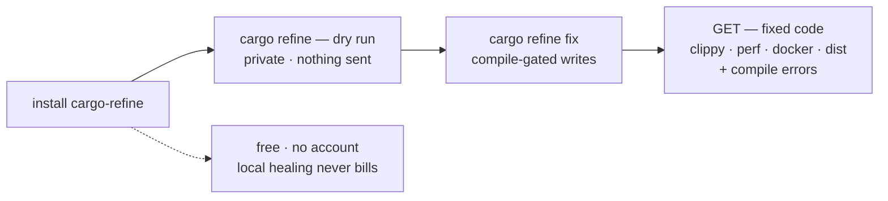
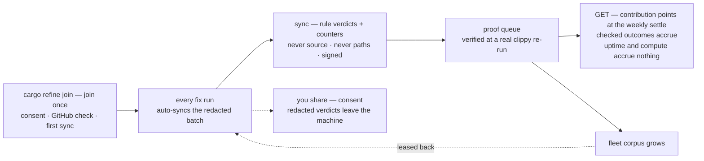
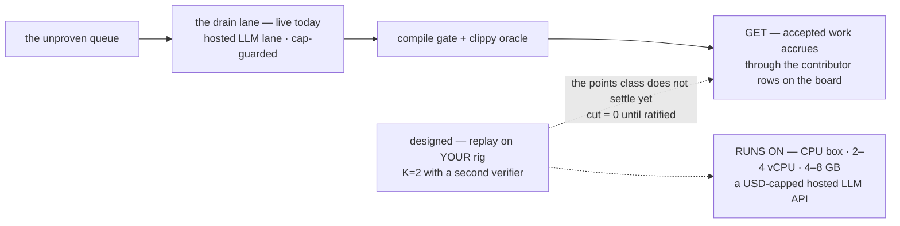
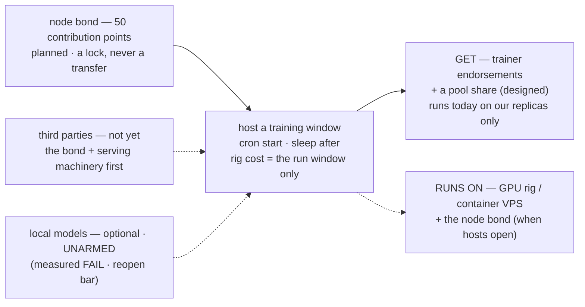

# Role flows — what each Get-started role does, gets, and shares

> **Purpose:** the Get-started roles on refine.riir.ai (coder / contributor /
> fixer / trainer), each as one end-to-end flow: what you DO, what you GET,
> and what you SHARE. Issue 132; re-scoped to the contribution-points plane
> (Proposal 025 v4 — [`.proposals/025_mozilla_human_scale_ai_incubator.md`](../../.proposals/025_mozilla_human_scale_ai_incubator.md),
> the durable record; the tier matrix and the KAT meter left the story).
> Each role renders TWICE: the ` ```gfflow ` block in its section is the
> render source for the per-role web figures (the family flow shape —
> numbered steps, grouped lanes; design guide §8), and the mermaid block
> beside it is the annotated source of truth (the honest edge-by-edge
> reading). The front page embeds the coder render in its one role pane; the
> other three serve at `/assets/` and re-wire when their lanes open. The
> companion docs carry the other axes of the same facts:
> [`node_tiers.md`](node_tiers.md) is what a rig can run (the fixer/trainer
> lanes), the points plane section below is what a contribution accrues.

## How to read the diagrams

- **Solid arrows** — the flow: what you do and what happens next.
- **The `GET` node** (solid, terminal) — what you get. If the
  class is designed-but-not-settling, the node says so.
- **Dotted arrows** — what you share, consent, grants, and status caveats.

Capabilities-only per the P013 law: a diagram claims only what settles
today. A designed lane is drawn dotted and names its blocker — never an
earnings promise.

## coder — heal your own code (free, anonymous)



| | |
|---|---|
| **Does** | install (one binary: `cargo install cargo-refine`, Homebrew, or a checksum-verified download) · `cargo refine` dry run (private review, writes and sends nothing) · `cargo refine fix` (compile-gated writes; divergence classes stay manual). |
| **Gets** | healed code across the shipped domains: clippy lints + compile errors, perf, Dockerfiles, release profiles (security, GPU-kernel and shader rules are in preview, not in the release). Plus the local self-evolve loop (memory always; learning when the oracle is present). |
| **Shares** | nothing — anonymous and free. Fixing runs entirely on your machine; no account, no network, nothing reported or billed at run time. The fix keeps a local memory under the crate's `.refine/`, and deleting it starts fresh. |

One binary, two postures: `cargo refine join` adds the contributor loop
below — nothing about fixing changes.

### The coder render source (renders `role_coder_flow.svg`)

One lane: your machine (the fixing pipeline). The dry run carries the
free posture as a tag, not a step: anonymity is the absence of sharing,
not a thing that happens.

```gfflow
file  = "role_coder_flow.svg"
title = "The coder loop: dry-run first, then the compile-gated fix — free, anonymous, entirely on your machine"
accent = "refine"

[[lane]]
id = "me"; label = "Your machine"; note = "every run · free · private"; color = "refine"

[[step]]
id = "inst"; n = "1"; lane = "me"; col = 0
title = "Install"; body = "one prebuilt binary lands in ~/.cargo/bin"
status = "live"
[[step]]
id = "dry"; n = "2"; lane = "me"; col = 1
title = "Dry run"; body = "lists the fixes it would make, writes nothing"
status = "live"
tag = { text = "free · no account", color = "refine" }
[[step]]
id = "fix"; n = "3"; lane = "me"; col = 2
title = "The compile gate"; body = "kept only if your crate still compiles"
status = "live"
[[step]]
id = "get"; n = "4"; lane = "me"; col = 3
title = "Fixed code"; body = "clippy · perf · docker · dist + compile errors"
status = "live"

[[edge]]
from = "inst"; to = "dry"
[[edge]]
from = "dry"; to = "fix"
[[edge]]
from = "fix"; to = "get"

[[walk]]
title = "Install"
text  = "One prebuilt binary (Homebrew, Scoop, the install script, or `cargo install cargo-refine`) lands in ~/.cargo/bin — no repo clone, no build. It stays anonymous: fixing needs no account."
steps = ["inst"]
[[walk]]
title = "Dry run first"
text  = "The bare `cargo refine` is a review: it lists the fixes it would make across your crate and writes nothing. No listing is published as a fixture — your code never leaves the machine, so this walk shows real bytes only where a step crosses to the network."
steps = ["dry"]
[[walk]]
title = "The compile gate"
text  = "`cargo refine fix` writes an edit only if your crate still compiles after it; a breaking fix is reverted automatically. Divergence classes the gate cannot judge (comment-guarded matches, array-literal defaults) stay manual and are listed, not applied."
steps = ["fix"]
[[walk]]
title = "What you get"
text  = "Healed code across the shipped domains — clippy lints, compile errors, Rust perf, Dockerfiles, release profiles — plus the local self-evolve loop: memory always records, learning runs when the oracle is present. Hosted lanes, where a deployment funds them, are metered by contribution points as fair use — never local healing."
steps = ["get"]
```

## contributor — share records, accrue points



| | |
|---|---|
| **Does** | `cargo refine join` once (consent + a read-only GitHub check, binding a random client ID to your handle), then fixes as usual — every fix run auto-syncs the redacted batch, and offline runs stack locally. |
| **Gets** | contribution points — non-transferable, expiring reputation, never purchasable, never payment. Rows enter the proof queue on push, are verified at a real clippy re-run, and accrue at the weekly settle (Monday 00:00 UTC) for checked outcomes only. Every leaderboard row is a contributor. And the fleet corpus leases back — the network's observed pattern classes improve your own healer's retrieval. |
| **Shares** | consent first: only a redacted batch uploads — rule verdicts and counters, never source, never paths — secret-scanned, signed with your key. `cargo refine leave` stops every send; `cargo refine offline` is the firewall; fixing was always local. |

### The contributor render source (renders `role_miner_flow.svg`)

Two lanes: your machine (join, record, push) and the service (proof,
accrual, corpus). The fleet corpus step carries a back edge — the lease
returns to your own retrieval, which is the flywheel closing. (The stem
keeps the pre-pivot file name — a render-parity name, not copy; the gate
pins content.)

```gfflow
file  = "role_miner_flow.svg"
title = "The contributor loop: redacted records up, proof at real clippy, points at the weekly settle — and the corpus leases back"
accent = "refine"

[[lane]]
id = "me"; label = "Your machine"; note = "opt-in · reversible"; color = "refine"
[[lane]]
id = "net"; label = "The service"; note = "the network side"; color = "ai"

[[step]]
id = "join"; n = "1"; lane = "me"; col = 0
title = "Join once"; body = "cargo refine join: consent · GitHub check · first sync"
status = "live"
tag = { text = "opt-in · reversible", color = "refine" }
[[step]]
id = "bat"; n = "2"; lane = "me"; col = 1
title = "The redacted batch"; body = "verdicts + touched snippets, secret-scanned, signed"
status = "live"
[[step]]
id = "proof"; n = "3"; lane = "net"; col = 2
title = "Proof queue"; body = "rows are verified at a real clippy re-run"
status = "live"
[[step]]
id = "points"; n = "4a"; lane = "net"; col = 3
title = "Points at the settle"; body = "checked outcomes accrue at the weekly settle"
status = "live"
tag = { text = "never payment", color = "ai" }
[[step]]
id = "grow"; n = "4b"; lane = "net"; col = 4
title = "The corpus grows"; body = "the network's observed pattern classes"
status = "live"

[[edge]]
from = "join"; to = "bat"
[[edge]]
from = "bat"; to = "proof"; label = "sync"
[[edge]]
from = "proof"; to = "points"; label = "accrues"
[[edge]]
from = "proof"; to = "grow"; label = "grows"
[[edge]]
from = "grow"; to = "bat"; back = true; label = "leased back — your own retrieval improves"

[[walk]]
title = "Join once"
text  = "`cargo refine join` opts in with the contribution policy + a read-only GitHub check, and binds your random client ID — one command, reversible (`cargo refine leave` stops every send; fixing was always local). Local healing never needs consent or network."
steps = ["join"]
[[walk]]
title = "The redacted batch"
text  = "Every fix run auto-syncs the redacted batch: rule verdicts plus the short snippets each fix touched — secret-scanned, never whole files, never your paths, signed with your key. This is the network's published sample batch, so you can inspect exactly what leaves the machine before opting in."
steps = ["bat"]
in    = { lang = "json", src = "data/flows/role_miner/01_batch.json", label = "one contribution batch (published sample)" }
[[walk]]
title = "Proof queue"
text  = "On push, rows enter the proof queue and are verified only at a real clippy re-run on the queue's own fixture — a verdict is measured, never trusted from the client. Live on riir.ai."
steps = ["proof"]
[[walk]]
title = "Points at the settle"
text  = "At the weekly settle (Monday 00:00 UTC) checked outcomes accrue contribution points: a fix record accepted into the corpus intake, a reported miss a landed rule later heals, a fix merged upstream into a public repo, a rule landed in the community corpus. Node uptime, compute served, and fix attempts accrue nothing, by design. Points are non-transferable, never purchasable, never payment."
steps = ["points"]
[[walk]]
title = "The corpus grows — and leases back"
text  = "Every verified row grows the fleet's pattern corpus, and the corpus leases back to every machine's retrieval — the flywheel closing. This is the newest row of the recorded corpus history: rules per domain, today."
steps = ["grow"]
out   = { lang = "json", src = "data/flows/role_miner/02_corpus.json", label = "the fleet corpus per domain" }
```

## fixer — verify the network's queue (the operator lane today)



| | |
|---|---|
| **Does** | today, the **operator's fixer**: the API drain lane over the unproven queue (free-first LLM router, redaction-gated, USD-capped), every candidate through the compile gate + the real clippy oracle. No download — a node lane, not an install. |
| **Gets** | accepted work accrues through the **contributor rows** on the board — the operator lane today. The third-party half is **designed, not settling**: replay verification (Proposal 015) would lease queued fixes, re-run the gate + oracle on your own rig, and — on K=2 agreement with a second verifier — share a bounded cut of the row's points. The cut is pinned at 0 until ratified; nothing is promised until it settles. |
| **Runs on** | a CPU box (~2–4 vCPU, 4–8 GB, no GPU) · API costs ride the free legs or the CF USD cap · the replay client (when it opens) needs an oracle build — the release binary carries no oracle, because a replay verdict is measured, never guessed. |

### The fixer render source (renders `role_fixer_flow.svg`)

Three lanes: the queue (network), the operator's nodes (live today), and
your rig (the designed third-party lane). The queue branches — 2a is the
operator drain that runs today, 2b is the replay lane your rig would run;
both converge on the gates, and accepted work accrues through the
contributor rows. The replay's points class does not settle yet — the tag
says so, never an accrual promise.

```gfflow
file  = "role_fixer_flow.svg"
title = "The fixer loop: the operator drains the queue today; third-party replay is designed and settles nothing yet"
accent = "refine"

[[lane]]
id = "net"; label = "The unproven queue"; note = "the network side"; color = "ai"
[[lane]]
id = "ops"; label = "The operator's nodes"; note = "live today"; color = "refine"
[[lane]]
id = "rig"; label = "Your rig"; note = "designed · not open yet"; color = "refine"

[[step]]
id = "q"; n = "1"; lane = "net"; col = 0
title = "Unproven queue"; body = "pushed rows await proof"
status = "live"
[[step]]
id = "drain"; n = "2a"; lane = "ops"; col = 1
title = "The drain lane"; body = "hosted LLM drafts · cap-guarded · redaction-gated"
status = "live"
[[step]]
id = "rep"; n = "2b"; lane = "rig"; col = 1
title = "Replay, your rig"; body = "lease fixes, re-run gates, K=2 verifier"
status = "planned"
tag = { text = "settles nothing yet", color = "ai" }
[[step]]
id = "gates"; n = "3"; lane = "ops"; col = 2
title = "The gates"; body = "compile gate + the real clippy oracle"
status = "live"
[[step]]
id = "settle"; n = "4"; lane = "net"; col = 3
title = "On the board"; body = "accepted work settles through the contributor rows"
status = "live"

[[edge]]
from = "q"; to = "drain"; label = "the operator lane today"
[[edge]]
from = "q"; to = "rep"; label = "designed · not open yet"
[[edge]]
from = "drain"; to = "gates"
[[edge]]
from = "rep"; to = "gates"
[[edge]]
from = "gates"; to = "settle"

[[walk]]
title = "The unproven queue"
text  = "Pushed rows wait for proof — nothing accrues until a verifier re-runs the gate and the oracle. Live on riir.ai."
steps = ["q"]
[[walk]]
title = "The operator's drain lane (live today)"
text  = "Our nodes draft fixes for queued rows over a hosted-LLM lane — free-legs first, USD-capped, redaction-gated. It is a node lane, not a download: nothing for you to install yet."
steps = ["drain"]
[[walk]]
title = "Replay on your rig (designed)"
text  = "The third-party lane would lease queued fixes to your own CPU box, re-run the gate and the oracle locally, and — on K=2 agreement with a second verifier — share a bounded cut of the row's points. The cut is pinned at zero until ratified; nothing is promised until it settles."
steps = ["rep"]
illustrative = true
[[walk]]
title = "The gates"
text  = "Every candidate, whichever lane drafted it, passes the same two gates: your crate still compiles, and real clippy is silent on the result. A replay verdict is measured, never guessed — that is why the replay client needs an oracle build."
steps = ["gates"]
[[walk]]
title = "On the board"
text  = "Accepted work settles through the contributor rows on the public board — the operator lane today, in public."
steps = ["settle"]
```

## trainer — host a training window (ours only today)



| | |
|---|---|
| **Does** | posts a **node bond** (50 contribution points, planned — a lock, never a transfer, burned on a proven fault) and hosts a training window: one container, cron-start, sleep-after. The LLM lane is API-first (free legs → CF, cap-guarded); local models stay optional and **UNARMED** — measured quality + latency FAIL, reopening only per the `l4_fallback.md` reopen bar. |
| **Gets** | trainer endorsements + a pool share — a **designed** class: windows run today on **our replicas only**, and we say so rather than market it. Third-party hosts open when the bond + serving machinery matures. |
| **Runs on** | the GPU rig or container VPS — the rig cost is the run window only · v1 windows are operator-funded. |

### The trainer render source (renders `role_trainer_flow.svg`)

Two lanes: the network (the node bond — designed for third parties) and
the training window (running on our replicas today). The window step is
live but ours-only — the tag says so; the GET class stays planned, and
the local-model option rides a tag because it is unarmed, not a lane.

```gfflow
file  = "role_trainer_flow.svg"
title = "The trainer loop: bond, host a training window — ours only today; the reward class is designed"
accent = "refine"

[[lane]]
id = "net"; label = "The network"; note = "the bond · designed"; color = "ai"
[[lane]]
id = "win"; label = "The training window"; note = "ours today · third parties planned"; color = "refine"

[[step]]
id = "bond"; n = "1"; lane = "net"; col = 0
title = "Node bond"; body = "50 contribution points locked — a bond, never a fee"
status = "planned"
[[step]]
id = "win"; n = "2"; lane = "win"; col = 1
title = "The training window"; body = "cron start · sleep after — the rig cost is the run window only"
status = "live"
tag = { text = "runs on our replicas only", color = "refine" }
[[step]]
id = "get"; n = "3"; lane = "win"; col = 2
title = "Endorsements"; body = "a designed class — settles when hosts open"
status = "planned"
tag = { text = "local models: unarmed", color = "ai" }

[[edge]]
from = "bond"; to = "win"
[[edge]]
from = "win"; to = "get"

[[walk]]
title = "The node bond (designed)"
text  = "A lock of 50 accrued contribution points — never a transfer, never a fee; a proven fault burns it into the expiry sink. Designed for third parties; the bond + serving machinery matures first. Local models stay optional and unarmed (measured quality + latency fail; a reopen bar is on record)."
steps = ["bond"]
[[walk]]
title = "The training window"
text  = "One container, cron-start, sleep-after — the rig cost is the run window only. The LLM lane is API-first with free legs and a USD cap. It runs today on our replicas only, and the page says so."
steps = ["win"]
[[walk]]
title = "Endorsements (a designed class)"
text  = "Trainer endorsements plus a pool share — the reward class settles when third-party hosts open; until then nothing is promised. v1 windows are operator-funded."
steps = ["get"]
```

## The points plane (what a contribution accrues)

All four roles sit on one user-facing unit, **contribution points
(TUNA)** — non-transferable, expiring, no cash value, never purchasable,
never payment ([Proposal 025](../../.proposals/025_mozilla_human_scale_ai_incubator.md)
§"The points plane in full" is the canonical record):

- **Local healing is always free and never blocked.** The dry run, `fix`,
  `scan` and `corpus` never touch points — there is nothing to buy, and
  points never go negative-locked.
- **Accrual is for checked outcomes, at the weekly settle** (Monday
  00:00 UTC): an accepted fix record, a reported miss a landed rule later
  heals, a fix merged upstream into a public repo, a rule landed in the
  community corpus. Node uptime, compute served, and fix attempts accrue
  **0, by design**. (The weight table is `TUNA_WEIGHTS_V1`, owner-armed
  2026-11-07; weights are versioned and stored at issue — a V2 never
  re-prices points already accrued.)
- **Expiry is rank-decay, never erasure.** The rank weight decays over
  the ledger's tranche-expiry mechanics; the contribution history and the
  corpus contributions are permanent (the corpus is MIT data forever).
  Rank requires GitHub-joined identity — anonymous users get local stats
  only.
- **Hosted/expert lanes** are metered by points as fair use — one
  sentence, and the whole drain story until the fair-use policy lands.
- **Vocabulary:** contribute / contribution / contributor / contribution
  points. Never "mining", never "earn" as marketing; never "gas", "fee",
  "tokenomics", or any value word.
- **The starter allowance + the anti-spam deposit** (design, disclosed):
  a one-time starter allowance funds the refundable per-submission
  deposit, so a newcomer can start immediately; honest contributors pay
  nothing net. Allowance points fund deposits but never count for rank;
  only accrued points do.
- **The frozen KAT lane** is upstream-only — internal builds; compiled
  out of every public binary, and out of this story. Existing balances:
  the site FAQ carries the frozen-lane note.

## What contributing sends (the data path, request to public corpus)

The trust section's answer to "what leaves my machine when I contribute,
and who sees it" (riir-dapps Plan 046, `refine.riir.ai/#mining-data`).
Three lanes by WHO can read the data at that step: your machine, the
network (the operator), and everyone (the public corpus every machine
downloads). Every claim is code-backed — the batch fields are
`src/kat_sync_payload.rs`, the scan is riir-kat `kat_redact.rs` (default
policy drops a row with any finding), the publish is riir-dapps
`cloudflare/kat-service/src/prove.rs` (proven `shape`/`fix` pairs land
verbatim in the lease segment), and `GET /lease` + `GET /segment/<hex>`
are unauthenticated (`routes.rs`). Not end-to-end encrypted: the
network must read a row to re-run clippy on it.

```gfflow
file  = "mine_data_flow.svg"
title = "What contributing sends: your fix spans leave signed, the network proves them, and proven pairs join the public corpus"
accent = "refine"

[[lane]]
id = "me"; label = "Your machine"; note = "nothing leaves before step 4b"; color = "refine"
[[lane]]
id = "net"; label = "The network"; note = "the operator reads it"; color = "ai"
[[lane]]
id = "pub"; label = "Everyone"; note = "public, no login"; color = "ai"

[[step]]
id = "run"; n = "1"; lane = "me"; col = 0
title = "Your fix run"; body = "compile-gated, local; records each fix"
status = "live"
[[step]]
id = "rows"; n = "2"; lane = "me"; col = 0
title = "One row per fix"; body = "the span it replaced + the fix; no paths"
status = "live"
[[step]]
id = "scan"; n = "3"; lane = "me"; col = 0
title = "Secret scan + sign"; body = "a finding drops the row; Ed25519 signed"
status = "live"
[[step]]
id = "export"; n = "4a"; lane = "me"; col = 1
title = "Inspect first"; body = "consent + scan --blind show it; sends nothing"
status = "live"
[[step]]
id = "post"; n = "4b"; lane = "net"; col = 1
title = "Sent over HTTPS"; body = "the signed batch; the server checks the key"
status = "live"
tag = { text = "signed, not encrypted", color = "ai" }
[[step]]
id = "proof"; n = "5"; lane = "net"; col = 2
title = "Proof queue"; body = "a real clippy re-run confirms the fix"
status = "live"
[[step]]
id = "pub"; n = "6"; lane = "pub"; col = 2
title = "Public corpus"; body = "proven before/after pairs, downloadable"
status = "live"
[[step]]
id = "lease"; n = "7"; lane = "me"; col = 2
title = "Lease back"; body = "downloads the corpus for your next run"
status = "live"

[[edge]]
from = "run"; to = "rows"
[[edge]]
from = "rows"; to = "scan"
[[edge]]
from = "scan"; to = "export"; label = "export"; exit = "e"; enter = "s"
[[edge]]
from = "scan"; to = "post"; label = "send"; exit = "e"; enter = "n"
[[edge]]
from = "post"; to = "proof"; label = "queued"
[[edge]]
from = "proof"; to = "pub"; label = "proven"
[[edge]]
from = "pub"; to = "lease"; label = "pull"; via = "gutter"
[[edge]]
from = "lease"; to = "run"; back = true

[[walk]]
title = "Your fix run"
text  = "`cargo refine fix` runs on your machine and keeps only fixes that still compile. The once-per-install consent question runs first — the demo on the front page captures it verbatim. Each fix is recorded locally under `.refine/`. Logged out, this is where the story ends: nothing is uploaded."
steps = ["run"]
[[walk]]
title = "One row per fix"
text  = "A contribution row is the exact code span a fix replaced and its replacement, plus the rule name, a short numeric shape fingerprint and counters. File paths, crate names, repo URLs, git remotes and usernames are not fields. A span is your code verbatim, and one field may be up to 64 KiB — a long function a fix rewrote travels whole."
steps = ["rows"]
[[walk]]
title = "Secret scan + sign"
text  = "Every span runs through the secret scanner — the consolidated provider-format set: API keys and tokens across the major AI, cloud and SaaS providers, private-key blocks (incl. PGP and PuTTY headers), credentialed connection strings, bearer tokens, secret assignments, long hex/base64 runs, and structured shapes like JWTs and bot tokens. Under the default policy any finding drops the whole row — it is never sent. The batch is signed with your key, so the network can prove it is yours and untampered. The same scanner powers `cargo refine scan` and `scan --blind` on your side."
steps = ["scan"]
[[walk]]
title = "Inspect first"
text  = "Nothing is sent before the consent answer, and the consent prompt (reproduced in the demo above) names exactly what sharing means. `cargo refine scan --blind FILE` shows what the scanner would redact in your own files before anything is ever shared. The published sample below is the batch shape the network's nodes push — read it before you join."
steps = ["export"]
in    = { lang = "json", src = "data/flows/role_miner/01_batch.json", label = "one batch (published sample)" }
[[walk]]
title = "Sent over HTTPS"
text  = "A joined, consenting `cargo refine fix` sends the signed batch over HTTPS. The signature proves who sent it; it does not hide the content — the network must read a row to verify it."
steps = ["post"]
[[walk]]
title = "Proof queue"
text  = "Rows wait in the proof queue until a real clippy re-run confirms the fix. A verdict is measured, never trusted from the client. Unproven rows stay with the operator."
steps = ["proof"]
[[walk]]
title = "Public corpus"
text  = "A proven row's before/after pair is published verbatim into the corpus segment — a public URL anyone can download without logging in. This is the shared corpus the flywheel promises; it is also why confidential code should stay out of your contributions."
steps = ["pub"]
[[walk]]
title = "Lease back"
text  = "Every machine's corpus pull downloads the segment. The request carries only the version your machine already has — no code, no account — and your next run retrieves from what the network proved."
steps = ["lease"]

```

## The role grid (what each role does, gets, and shares)

| role | does | gets | shares / runs on | status |
|---|---|---|---|---|
| coder | dry run + fix, anonymous | fixed code (clippy · perf · docker · dist · compile errors; sec is preview, not in the release) | nothing | shipped |
| contributor | `join` + auto-synced redacted batches | contribution points at the weekly settle · corpus lease-back | redacted verdicts + snippets (secret-scanned, signed) | shipped |
| fixer | operator drain lane over the unproven queue | settles through the contributor rows | CPU box + free-leg API / CF cap | operator lane live · replay designed (P015), does **not** settle |
| trainer | node bond (planned); host a training window | endorsements + pool share (designed) | GPU rig; rig cost is the run window only | **ours only today** |

One install covers coder + contributor. Fixer and trainer are node
lanes, not downloads — they open to third parties when their classes
settle, and the leaderboard stays honest about that.

## The SVG renders (the web-delivery assets)

| File | Renders | Serves on |
|---|---|---|
| [`role_coder_flow.svg`](role_coder_flow.svg) + `_m` | the coder gfflow block above | the coder pane (`#rpane-coder`) |
| [`role_miner_flow.svg`](role_miner_flow.svg) + `_m` | the contributor gfflow block | `/assets/` (unwired mirror — the pane returns with the lane) |
| [`role_fixer_flow.svg`](role_fixer_flow.svg) + `_m` | the fixer gfflow block | `/assets/` (unwired mirror) |
| [`role_trainer_flow.svg`](role_trainer_flow.svg) + `_m` | the trainer gfflow block | `/assets/` (unwired mirror) |
| [`mine_data_flow.svg`](mine_data_flow.svg) + `_m` | the data-path gfflow block | the trust section (`#mining-data`) |

Each is rendered from this doc's own ` ```gfflow ` block by
reflex-site's `scripts/render_flows.py` — the family flow shape
(numbered step cards in path order, grouped into swimlanes, the 390 px
card list as `_m`). The doc block is the source of truth — re-render
from it, never hand-edit the SVG. The renderer writes BOTH mirrors in
one run: the canonical copies beside this doc and the pinned mirrors in
`riir-dapps/cloudflare/kat-service/src/assets/` that the worker embeds
via `include_str!` — the two must move in the same commit (the Issue
131 mirror law). Each SVG's CSS is scoped under its own root id (unique
per figure), so the inline figures never collide and the worker
needs no id-suffixing.

Each block also carries a **walk** (the step-through, design guide §8.4).
Its IN/OUT payloads live in the kat-service tree
(`cloudflare/kat-service/src/data/flows/role_miner/`),
derived from recorded captures by `riir-dapps
scripts/build_flow_walks.py` — never typed; steps with no committed
capture stay payload-less. The no-JS fallback the worker serves is
filled by the renderer into `assets/<figure>_walk.html` (the include
target beside the SVGs).

**The gfflow re-expression landed 2026-10-04** (superseding the
mermaid.ink renders of Issue 132 Phase 2 — the four `role_*.svg`
mermaid files and the worker's `scope_ids` suffixing died with it;
the mermaid blocks above stay as the annotated sources of truth, the
`self_evolve_flow.md` convention). The worker embeds both shapes per
figure and a CSS media query swaps them — the no-JS `<picture>`
equivalent, the self-evolve hero's convention. **The v4 re-scope landed
2026-11-17**: the tier matrix and the KAT meter left the story — one
user-facing unit (contribution points), accrual vocabulary, the
billing-plane lane out of the coder flow, the node bond in the trainer
flow (Proposal 025 v4 / Plan 324).

## Refs

- [Proposal 025](../../.proposals/025_mozilla_human_scale_ai_incubator.md) — the Mozilla application draft; §"The points plane in full" is the canonical points record
- `.issues/132_role_flow_perspectives_doc_svg.md` — the issue (both phases; removed on close — `HISTORY.md` 2026-09-23 carries the record + the landing commit)
- [`node_tiers.md`](node_tiers.md) — what a rig can run (the fixer/trainer lanes; Proposal 013/015), the corrections ledger
- [`kat_billing.md`](kat_billing.md) — the FROZEN KAT lane's billing spec (pre-pivot; internal builds only, kept for the frozen lane)
- [`replay_lane.md`](replay_lane.md) — the fixer replay lane's gates + pinned rate rule
- [`../10_self_evolve/self_evolve_flow.md`](../10_self_evolve/self_evolve_flow.md) — the flywheel hero this doc-sibling pattern comes from (Issue 131)
