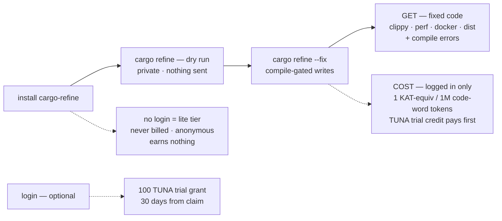
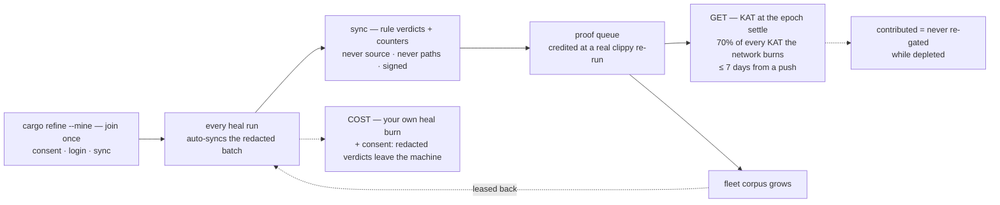
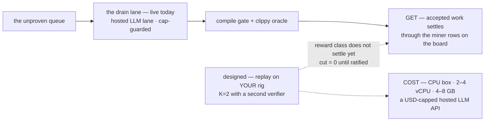
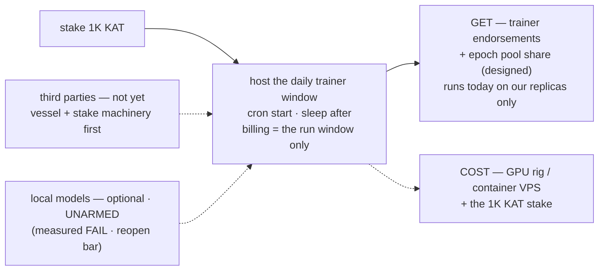

# Role flows — what each Get-started role does, gets, and pays

> **Purpose:** the four "Get started" roles on ai.gist.rs (coder / miner /
> fixer / trainer), each as one end-to-end flow: what you DO, what you GET,
> and what it COSTS. Issue 132. Each role renders TWICE: the ` ```gfflow `
> block in its section is the render source for the per-role web figures
> (the family flow shape — numbered steps, grouped lanes; design guide §8),
> and the mermaid block beside it is the annotated source of truth (the
> honest edge-by-edge reading). The front-page role tabs embed the gfflow
> renders (web delivery: Issue 132 Phase 2; the gfflow re-expression
> 2026-10-04). The companion docs carry the other two axes of the same
> facts: [`node_tiers.md`](node_tiers.md) is the TIER axis (what a rig can
> run), [`kat_billing.md`](kat_billing.md) is the billing plane every COST
> edge points into.

## How to read the diagrams

- **Solid arrows** — the flow: what you do and what happens next.
- **The `GET` node** (solid, terminal) — what settles for you. If the
  class is designed-but-not-settling, the node says so.
- **Dotted arrows** — costs, consent, grants, and status caveats.

Capabilities-only per the P013 law: a diagram claims only what settles
today. A designed lane is drawn dotted and names its blocker — never an
earnings promise.

## coder — heal your own code (the lite tier)



| | |
|---|---|
| **Does** | install (prebuilt binary → `~/.cargo/bin`) · `cargo refine` dry run (private review, writes and sends nothing) · `cargo refine --fix` (compile-gated writes; divergence classes stay manual). Optional: login — creates the account + the TUNA trial grant. |
| **Gets** | healed code across the domains: clippy lints + compile errors, perf, security, Dockerfiles, kernel/rust-perf rules, dist advice. Plus the local self-evolve loop (memory always; learning when the oracle is present). |
| **Pays** | **lite: nothing** — anonymous, free forever, outside the economy (nothing is uploaded, nothing is billed). **Logged in:** the burn meter — 1 KAT-equivalent per million code-word tokens, TUNA trial credit first. Depleted + never contributed → the 075 soft gate refuses scanning until you contribute or top up. |

The miner tab's join step upgrades the same install to **pro** — one
binary, two postures.

### The coder render source (renders `role_coder_flow.svg`)

Two lanes: your machine (the fixing pipeline) and the billing plane
(logged-in runs only). The fix step branches — 4a is what you get on
every run, 4b is what a logged-in run costs. The lite posture rides a
tag on the dry run, not a step: logging out is the absence of billing,
not a thing that happens.

```gfflow
file  = "role_coder_flow.svg"
title = "The coder loop: dry-run first, then the compile-gated fix — the meter draws TUNA before KAT"
accent = "refine"

[[lane]]
id = "me"; label = "Your machine"; note = "every run · free · private"; color = "refine"
[[lane]]
id = "bill"; label = "The billing plane"; note = "logged-in runs only"; color = "ai"

[[step]]
id = "inst"; n = "1"; lane = "me"; col = 0
title = "Install"; body = "one prebuilt binary lands in ~/.cargo/bin"
status = "live"
[[step]]
id = "dry"; n = "2"; lane = "me"; col = 1
title = "Dry run"; body = "lists the fixes it would make, writes nothing"
status = "live"
tag = { text = "logged out = never billed", color = "refine" }
[[step]]
id = "fix"; n = "3"; lane = "me"; col = 2
title = "The compile gate"; body = "kept only if your crate still compiles"
status = "live"
[[step]]
id = "get"; n = "4a"; lane = "me"; col = 3
title = "Fixed code"; body = "clippy · perf · docker · dist + compile errors"
status = "live"
[[step]]
id = "meter"; n = "4b"; lane = "bill"; col = 3
title = "The burn meter"; body = "1 KAT-equiv / 1M tokens; TUNA first where funded"
status = "live"

[[edge]]
from = "inst"; to = "dry"
[[edge]]
from = "dry"; to = "fix"
[[edge]]
from = "fix"; to = "get"
[[edge]]
from = "fix"; to = "meter"; label = "logged in"

[[walk]]
title = "Install"
text  = "One prebuilt binary (brew, scoop, or the install script) lands in ~/.cargo/bin — no repo clone, no build. Logged out it stays anonymous and is never billed."
steps = ["inst"]
[[walk]]
title = "Dry run first"
text  = "The bare `cargo refine` is a review: it lists the fixes it would make across your crate and writes nothing. No listing is published as a fixture — your code never leaves the machine, so this walk shows real bytes only where a step crosses to the fleet."
steps = ["dry"]
[[walk]]
title = "The compile gate"
text  = "`--fix` writes an edit only if your crate still compiles after it; a breaking fix is reverted automatically. Divergence classes the gate cannot judge (comment-guarded matches, array-literal defaults) stay manual and are listed, not applied."
steps = ["fix"]
[[walk]]
title = "What you get"
text  = "Healed code across the shipped domains — clippy lints, compile errors, Rust perf, Dockerfiles, release profiles — plus the local self-evolve loop: memory always records, learning runs when the oracle is present."
steps = ["get"]
[[walk]]
title = "What a logged-in run costs"
text  = "The meter counts code-word tokens and bills one KAT-equivalent per million; where the deployment funds trial credit, TUNA pays first. The signed burn report is pushed after the run, is watermark-deduped (replays are no-ops), and never carries your code."
steps = ["meter"]
```

## miner — contribute batches, earn KAT (the pro tier)



| | |
|---|---|
| **Does** | `cargo refine --mine` once (opts in, auto-logs-in, syncs). After that, every heal run auto-syncs the redacted batch; the burn reports automatically after each run (accounting, not a consent gate) and offline runs stack locally. |
| **Gets** | mining KAT — the only earn class that settles today: rows enter the proof queue on push, are credited at the proof pass (a real clippy re-run), and pay at the epoch settle, funded by **70% of every KAT the network burns**. Every leaderboard row is a miner. Contributed accounts are never re-gated while depleted. And the fleet corpus leases back — the network's observed pattern classes improve your own healer's retrieval. |
| **Pays** | your own heal burn (same meter as the coder) · consent: only `sync` uploads, and only a redacted batch — rule verdicts and counters, never source, never paths — signed with your account key. `--unmine` stops the push half (the lease pull half still runs — a read is not a contribution); healing was always local. |

### The miner render source (renders `role_miner_flow.svg`)

Two lanes: your machine (join, record, push) and the KAT fleet (proof,
payout, corpus). The fleet corpus step carries a back edge — the lease
returns to your own retrieval, which is the flywheel closing.

```gfflow
file  = "role_miner_flow.svg"
title = "The miner loop: redacted records up, proof at real clippy, KAT at the epoch settle — and the corpus leases back"
accent = "refine"

[[lane]]
id = "me"; label = "Your machine"; note = "the pro tier · opt-in"; color = "refine"
[[lane]]
id = "fleet"; label = "The KAT fleet"; note = "the network side"; color = "ai"

[[step]]
id = "join"; n = "1"; lane = "me"; col = 0
title = "Join once"; body = "--mine: consent · login · first sync"
status = "live"
tag = { text = "opt-in · reversible", color = "refine" }
[[step]]
id = "bat"; n = "2"; lane = "me"; col = 1
title = "The redacted batch"; body = "verdicts + touched snippets, secret-scanned, signed"
status = "live"
[[step]]
id = "proof"; n = "3"; lane = "fleet"; col = 2
title = "Proof queue"; body = "rows are credited at a real clippy re-run"
status = "test network"
[[step]]
id = "pay"; n = "4a"; lane = "fleet"; col = 3
title = "KAT at the settle"; body = "the pool pays — mining = processing, minted = paid"
status = "test network"
tag = { text = "never re-gated", color = "ai" }
[[step]]
id = "grow"; n = "4b"; lane = "fleet"; col = 4
title = "The corpus grows"; body = "the network's observed pattern classes"
status = "test network"

[[edge]]
from = "join"; to = "bat"
[[edge]]
from = "bat"; to = "proof"; label = "sync"
[[edge]]
from = "proof"; to = "pay"; label = "pays"
[[edge]]
from = "proof"; to = "grow"; label = "grows"
[[edge]]
from = "grow"; to = "bat"; back = true; label = "leased back — your own retrieval improves"

[[walk]]
title = "Join once"
text  = "`cargo refine --mine` opts in, auto-logs-in, and runs the first sync — one command, reversible (`--unmine` stops the push half; healing was always local). Consent tiers: Unset never pushes; running sync IS the consent."
steps = ["join"]
[[walk]]
title = "The redacted batch"
text  = "Every heal run auto-syncs the redacted batch: rule verdicts plus the short snippets each fix touched — secret-scanned, never whole files, never your paths, signed with your account key. This is the network's published sample batch, so you can inspect exactly what leaves the machine before opting in."
steps = ["bat"]
in    = { lang = "json", src = "data/flows/role_miner/01_batch.json", label = "one --mine batch (published sample)" }
[[walk]]
title = "Proof queue"
text  = "On push, rows enter the proof queue and are credited only at a real clippy re-run on the queue's own fixture — a verdict is measured, never trusted from the client. Test network today."
steps = ["proof"]
[[walk]]
title = "KAT at the settle"
text  = "The epoch settle pays the pool to miners (mining = processing, minted = paid), within seven days of an accepted push. Contributed accounts are never re-gated while depleted. Test network today."
steps = ["pay"]
[[walk]]
title = "The corpus grows — and leases back"
text  = "Every verified row grows the fleet's pattern corpus, and the corpus leases back to every machine's retrieval — the flywheel closing. This is the newest row of the recorded corpus history: rules per domain, today."
steps = ["grow"]
out   = { lang = "json", src = "data/flows/role_miner/02_corpus.json", label = "the fleet corpus per domain" }
```

## fixer — verify & fix the network's queue (the max tier)



| | |
|---|---|
| **Does** | today, the **operator's fixer**: the API drain lane over the unproven queue (free-first LLM router, redaction-gated, USD-capped), every candidate through the compile gate + the real clippy oracle. No download — a node lane, not an install. |
| **Gets** | accepted work settles through the **miner rows** on the board — the operator lane's earn path today. The third-party half is **designed, not settling**: replay verification (Proposal 015) would lease queued fixes, re-run the gate + oracle on your own rig, and — on K=2 agreement with a second verifier — share a bounded cut of the row's reward. The cut is pinned at 0 until ratified; nothing is promised until it settles. |
| **Pays** | a CPU box (~2–4 vCPU, 4–8 GB, no GPU) · API costs ride the free legs or the CF USD cap · the replay client (when it opens) needs a `--features kat_transport,clippy_verify` build — the release binary carries no oracle, because a replay verdict is measured, never guessed. |

### The fixer render source (renders `role_fixer_flow.svg`)

Three lanes: the queue (network), the operator's nodes (live today), and
your rig (the designed third-party lane). The queue branches — 2a is the
operator drain that runs today, 2b is the replay lane your rig would run;
both converge on the gates, and accepted work settles through the miner
rows. The replay's reward class does not settle yet — the tag says so,
never an earnings promise.

```gfflow
file  = "role_fixer_flow.svg"
title = "The fixer loop: the operator drains the queue today; third-party replay is designed and settles nothing yet"
accent = "refine"

[[lane]]
id = "fleet"; label = "The unproven queue"; note = "the network side"; color = "ai"
[[lane]]
id = "ops"; label = "The operator's nodes"; note = "live today"; color = "refine"
[[lane]]
id = "rig"; label = "Your rig"; note = "the max tier · designed"; color = "refine"

[[step]]
id = "q"; n = "1"; lane = "fleet"; col = 0
title = "Unproven queue"; body = "pushed rows await proof"
status = "test network"
[[step]]
id = "drain"; n = "2a"; lane = "ops"; col = 1
title = "The drain lane"; body = "hosted LLM drafts · cap-guarded · redaction-gated"
status = "live"
[[step]]
id = "rep"; n = "2b"; lane = "rig"; col = 1
title = "Replay, your rig"; body = "lease fixes, re-run gates, K=2 verifier"
status = "planned"
tag = { text = "cut = 0 until ratified", color = "ai" }
[[step]]
id = "gates"; n = "3"; lane = "ops"; col = 2
title = "The gates"; body = "compile gate + the real clippy oracle"
status = "live"
[[step]]
id = "pay"; n = "4"; lane = "fleet"; col = 3
title = "Pays on the board"; body = "accepted work settles through the miner rows"
status = "live"

[[edge]]
from = "q"; to = "drain"; label = "the operator lane today"
[[edge]]
from = "q"; to = "rep"; label = "designed · not open yet"
[[edge]]
from = "drain"; to = "gates"
[[edge]]
from = "rep"; to = "gates"
[[edge]]
from = "gates"; to = "pay"

[[walk]]
title = "The unproven queue"
text  = "Pushed rows wait for proof — nothing credits until a verifier re-runs the gate and the oracle. Test network today."
steps = ["q"]
[[walk]]
title = "The operator's drain lane (live today)"
text  = "Our nodes draft fixes for queued rows over a hosted-LLM lane — free-legs first, USD-capped, redaction-gated. It is a node lane, not a download: nothing for you to install yet."
steps = ["drain"]
[[walk]]
title = "Replay on your rig (designed)"
text  = "The third-party lane would lease queued fixes to your own CPU box, re-run the gate and the oracle locally, and — on K=2 agreement with a second verifier — share a bounded cut of the row's reward. The cut is pinned at zero until ratified; nothing is promised until it settles."
steps = ["rep"]
illustrative = true
[[walk]]
title = "The gates"
text  = "Every candidate, whichever lane drafted it, passes the same two gates: your crate still compiles, and real clippy is silent on the result. A replay verdict is measured, never guessed — that is why the replay client needs an oracle build."
steps = ["gates"]
[[walk]]
title = "Pays on the board"
text  = "Accepted work settles through the miner rows on the public board — the operator lane's earn path today, in public."
steps = ["pay"]
```

## trainer — host the daily training window (the ultra tier)



| | |
|---|---|
| **Does** | stakes 1K KAT and hosts the daily trainer window: one container, cron-start, sleep-after. LLM lane is API-first (groq → infron free legs → CF, cap-guarded); local models stay optional and **UNARMED** — measured quality + latency FAIL, reopening only per the `l4_fallback.md` reopen bar. |
| **Gets** | trainer endorsements + the epoch pool share — a **designed** class: the window runs today on **our replicas only**, and we say so rather than market it. Third-party hosts open when the vessel/stake machinery matures. |
| **Pays** | the GPU rig or container VPS — billing is the run window only · the 1K KAT stake · v1 windows are fleet-funded from the USD treasury. |

### The trainer render source (renders `role_trainer_flow.svg`)

Two lanes: the network (the stake — designed for third parties) and the
trainer window (running on our replicas today). The window step is live
but ours-only — the tag says so; the GET class stays planned, and the
local-model option rides a tag because it is unarmed, not a lane.

```gfflow
file  = "role_trainer_flow.svg"
title = "The trainer loop: stake, host the daily window — ours only at launch; the reward class is designed"
accent = "refine"

[[lane]]
id = "net"; label = "The network"; note = "the stake · designed"; color = "ai"
[[lane]]
id = "win"; label = "The trainer window"; note = "ours today · third parties planned"; color = "refine"

[[step]]
id = "stake"; n = "1"; lane = "net"; col = 0
title = "Stake 1K KAT"; body = "the operator bond for hosting a window"
status = "planned"
[[step]]
id = "win"; n = "2"; lane = "win"; col = 1
title = "The daily window"; body = "cron start · sleep after — the run window only"
status = "live"
tag = { text = "runs on our replicas only", color = "refine" }
[[step]]
id = "get"; n = "3"; lane = "win"; col = 2
title = "Endorsements"; body = "a designed class — settles when hosts open"
status = "planned"
tag = { text = "local models: unarmed", color = "ai" }

[[edge]]
from = "stake"; to = "win"
[[edge]]
from = "win"; to = "get"

[[walk]]
title = "Stake 1K KAT"
text  = "The operator bond for hosting a window — designed for third parties; the stake machinery matures first. Local models stay optional and unarmed (measured quality + latency fail; a reopen bar is on record)."
steps = ["stake"]
[[walk]]
title = "The daily window"
text  = "One container, cron-start, sleep-after — billing is the run window only. The LLM lane is API-first with free legs and a USD cap. It runs today on our replicas only, and the page says so."
steps = ["win"]
[[walk]]
title = "Endorsements (a designed class)"
text  = "Trainer endorsements plus an epoch pool share — the reward class settles when third-party hosts open; until then nothing is promised. v1 windows are fleet-funded from the USD treasury."
steps = ["get"]
```

## The shared cost plane (what every COST edge means)

All four roles sit on one billing plane ([`kat_billing.md`](kat_billing.md)
is the full spec):

- **Two tanks, one meter.** Healing is billed per million code-word
  tokens at a fixed µ rate. The SERVER decides which tank pays, always
  in the same order: TUNA trial credit first (heals only, expires), then
  KAT. A depleted TUNA tank hands off mid-report automatically.
- **Offline: nothing is debited anywhere.** The burn is a local commit;
  the next run (or `cargo refine sync`) pushes the full cumulative total,
  and the server decides the plane then. The monotone watermark makes
  replays no-ops.
- **No debt exists.** The server clamps warn-and-pay — it debits what
  exists and never goes negative.
- **The depleted posture.** A logged-in, depleted, never-contributed
  account gets scanning runs refused — with a count-only survey of what
  the run would have done, and exactly two refuel doors: **contribute**
  (`--mine` + sync) or **top up** (the payment page). Mining payouts
  land within 7 days of an accepted push; contributed accounts are never
  re-gated while depleted.
- **Anonymous is never gated.** Logged-out / offline / never-synced
  machines are outside the economy — the lite tier's free-forever is a
  design property, not a promo.

### The economy render source (renders `kat_economy_flow.svg`)

The money loop as one figure — the trust section's companion on
`refine.gist.rs/#trust`. The meter branches on which tank pays (TUNA
trial credit is terminal: trial burns fund nothing and expire); every
KAT burn funds the next epoch's pool, the settle pays the fleet, and
the corpus leases back to close the loop. The split itself is NOT drawn
as numbers — the live split renders from parameters on the pages; the
figure names where the money lands, never a typed percentage.

```gfflow
file  = "kat_economy_flow.svg"
title = "The KAT economy: the meter runs locally, burns fund the pool, the settle pays the fleet — and the corpus leases back"
accent = "refine"

[[lane]]
id = "me"; label = "Your machine"; note = "the meter runs locally"; color = "refine"
[[lane]]
id = "led"; label = "The ledger"; note = "every burn, public"; color = "ai"
[[lane]]
id = "flt"; label = "Miners"; note = "the fleet that earns"; color = "ai"

[[step]]
id = "meter"; n = "1"; lane = "me"; col = 0
title = "The run is metered"; body = "counts code-word tokens; logged out = never billed"
status = "live"
[[step]]
id = "tuna"; n = "2a"; lane = "led"; col = 1
title = "TUNA pays first"; body = "where funded: one grant · 30 days, expires"
status = "test network"
[[step]]
id = "kat"; n = "2b"; lane = "led"; col = 2
title = "KAT pays"; body = "after the trial — metered totals, signed"
status = "test network"
[[step]]
id = "pool"; n = "3"; lane = "led"; col = 3
title = "The mining pool"; body = "every KAT burn funds the next epoch's rewards"
status = "test network"
[[step]]
id = "settle"; n = "4"; lane = "flt"; col = 4
title = "The settle pays"; body = "rows mint — mining = processing, minted = paid"
status = "test network"
[[step]]
id = "lease"; n = "5"; lane = "me"; col = 5
title = "The lease-back"; body = "the fleet corpus refreshes every machine"
status = "test network"

[[edge]]
from = "meter"; to = "tuna"; label = "trial credit left"
[[edge]]
from = "meter"; to = "kat"; label = "after TUNA · logged in"
[[edge]]
from = "kat"; to = "pool"; label = "burns"
[[edge]]
from = "pool"; to = "settle"; label = "the epoch closes"
[[edge]]
from = "settle"; to = "lease"; label = "the corpus grows"
[[edge]]
from = "lease"; to = "meter"; back = true; label = "every machine refines better"

[[walk]]
title = "The run is metered"
text  = "The meter counts code-word tokens on your machine and bills a fixed µ rate per million. Logged out, nothing is billed anywhere — anonymous is outside the economy by design. Offline, the burn is a local commit; the next run pushes the cumulative total."
steps = ["meter"]
[[walk]]
title = "TUNA pays first"
text  = "Where the deployment funds trial credit, the server draws TUNA first — one grant per account, thirty days, heals only. Trial burns fund nothing and expired credit is inert; the public TUNA counters show the reservoir. Test network today."
steps = ["tuna"]
[[walk]]
title = "KAT pays"
text  = "After the trial (or where it is not funded), KAT pays — metered totals, signed, watermark-deduped so replays are no-ops. No debt exists: the server clamps warn-and-pay and never goes negative. Test network today."
steps = ["kat"]
[[walk]]
title = "Every burn funds the pool"
text  = "Each KAT burn is split by the network's published parameters — mostly into the next epoch's mining pool. The live split renders from parameters on the leaderboard and the explorer; the figure names where the money lands, never a typed percentage."
steps = ["pool"]
[[walk]]
title = "The settle pays"
text  = "The once-per-epoch settle fixes each miner's share of the pool and mints it (mining = processing, minted = paid), with mint receipts in public. Test network today."
steps = ["settle"]
[[walk]]
title = "The lease-back"
text  = "The fleet corpus every machine leases back — the newest row of the recorded corpus history: rules per domain, today. The wheel closes where it started: your next run retrieves more."
steps = ["lease"]
out   = { lang = "json", src = "data/flows/kat_economy/01_corpus.json", label = "the fleet corpus per domain" }
```

## The role × tier grid (what the tabs and the matrix share)

| role | tier | does | gets | pays | status |
|---|---|---|---|---|---|
| coder | lite | dry run + fix, anonymous | fixed code (clippy · perf · docker · dist · compile errors; sec is preview, not in the release) | nothing — free forever | shipped |
| coder | pro (login) | same install, logged in | + the TUNA trial grant, the balance surfaces | the burn meter (TUNA first) | shipped |
| miner | pro | `--mine` once; auto-sync redacted batches | 70% pool share at the epoch settle · never re-gated · corpus lease-back | own burn + consent | shipped |
| fixer | max | operator drain lane over the unproven queue | settles through the miner rows | CPU box + free-leg API / CF cap | operator lane live · replay designed (P015), does **not** settle |
| trainer | ultra | stake 1K KAT; host the daily window | endorsements + epoch pool share (designed) | rig + run-window billing + stake | **ours only at launch** |

One install covers lite + pro. Max and ultra are node lanes, not
downloads — they open to third parties when their reward classes settle,
and the leaderboard stays honest about that.

## The SVG renders (the web-delivery assets)

| File | Renders | Serves on |
|---|---|---|
| [`role_coder_flow.svg`](role_coder_flow.svg) + `_m` | the coder gfflow block above | Get started › coder |
| [`role_miner_flow.svg`](role_miner_flow.svg) + `_m` | the miner gfflow block | Get started › miner |
| [`role_fixer_flow.svg`](role_fixer_flow.svg) + `_m` | the fixer gfflow block | Get started › fixer |
| [`role_trainer_flow.svg`](role_trainer_flow.svg) + `_m` | the trainer gfflow block | Get started › trainer |
| [`kat_economy_flow.svg`](kat_economy_flow.svg) + `_m` | the economy gfflow block | the trust section (`#trust`) |

Each is rendered from this doc's own ` ```gfflow ` block by
reflex-site's `scripts/render_flows.py` — the family flow shape
(numbered step cards in path order, grouped into swimlanes, the 390 px
card list as `_m`). The doc block is the source of truth — re-render
from it, never hand-edit the SVG. The renderer writes BOTH mirrors in
one run: the canonical copies beside this doc and the pinned mirrors in
`riir-dapps/cloudflare/kat-service/src/assets/` that the worker embeds
via `include_str!` — the two must move in the same commit (the Issue
131 mirror law). Each SVG's CSS is scoped under its own root id (unique
per figure), so the five inline figures never collide and the worker
needs no id-suffixing.

Each block also carries a **walk** (the step-through, design guide §8.4).
Its IN/OUT payloads live in the kat-service tree
(`cloudflare/kat-service/src/data/flows/{role_miner,kat_economy}/`),
derived from recorded captures by `riir-dapps
scripts/build_flow_walks.py` — never typed; steps with no committed
capture stay payload-less. The no-JS fallback the worker serves is
filled by the renderer into `assets/<figure>_walk.html` (the include
target beside the SVGs).

**The gfflow re-expression landed 2026-10-04** (superseding the
mermaid.ink renders of Issue 132 Phase 2 — the four `role_*.svg`
mermaid files and the worker's `scope_ids` suffixing died with it;
the mermaid blocks above stay as the annotated sources of truth, the
`self_evolve_flow.md` convention). The worker embeds both shapes per
role and a CSS media query swaps them — the no-JS `<picture>`
equivalent, the self-evolve hero's convention.

## Refs

- `.issues/132_role_flow_perspectives_doc_svg.md` — the issue (both phases; removed on close — `HISTORY.md` 2026-09-23 carries the record + the landing commit)
- [`node_tiers.md`](node_tiers.md) — the tier spec (Proposal 013/015), the corrections ledger
- [`kat_billing.md`](kat_billing.md) — the billing + TUNA plane
- [`replay_lane.md`](replay_lane.md) — the fixer replay lane's gates + pinned rate rule
- [`../10_self_evolve/self_evolve_flow.md`](../10_self_evolve/self_evolve_flow.md) — the flywheel hero this doc-sibling pattern comes from (Issue 131)
