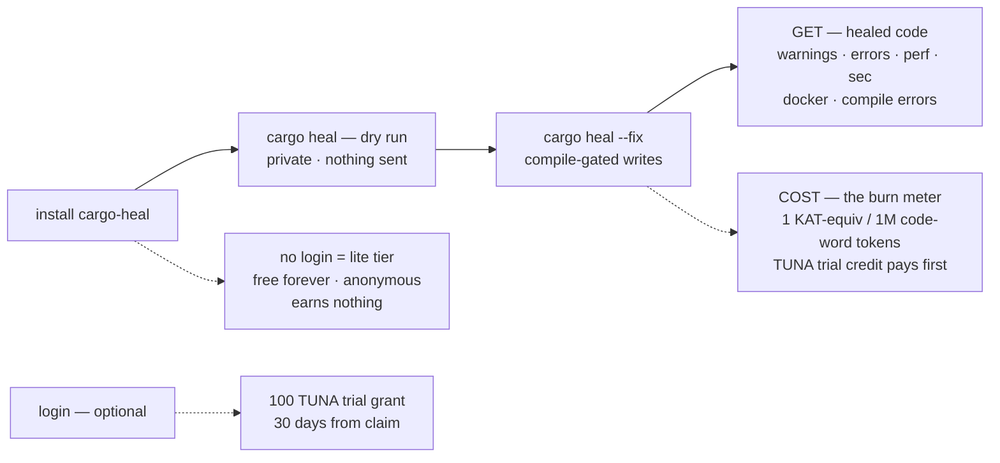
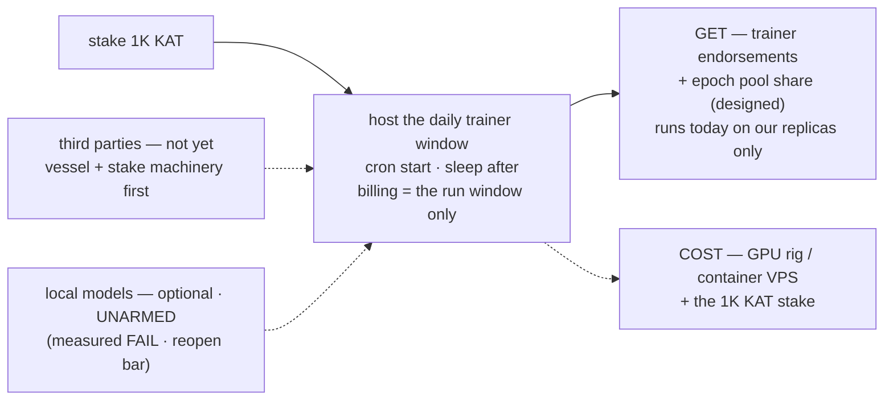

# Role flows — what each Get-started role does, gets, and pays

> **Purpose:** the four "Get started" roles on ai.gist.rs (coder / miner /
> fixer / trainer), each as one end-to-end flow: what you DO, what you GET,
> and what it COSTS. Issue 132. The mermaid blocks below are the exact
> render sources for the per-role SVGs beside this doc — the front-page
> role tabs embed those (web delivery: Issue 132 Phase 2). The companion
> docs carry the other two axes of the same facts:
> [`node_tiers.md`](node_tiers.md) is the TIER axis (what a rig can run),
> [`kat_billing.md`](kat_billing.md) is the billing plane every COST edge
> points into.

## How to read the diagrams

- **Solid arrows** — the flow: what you do and what happens next.
- **The `GET` node** (solid, terminal) — what settles for you. If the
  class is designed-but-not-settling, the node says so.
- **Dotted arrows** — costs, consent, grants, and status caveats.

Capabilities-only per the P013 law: a diagram claims only what settles
today. A designed lane is drawn dotted and names its blocker — never an
earnings promise.

## coder — heal your own code (the lite tier)

| | |
|---|---|
| **Does** | install (prebuilt binary → `~/.cargo/bin`) · `cargo heal` dry run (private review, writes and sends nothing) · `cargo heal --fix` (compile-gated writes; divergence classes stay manual). Optional: login — creates the account + the TUNA trial grant. |
| **Gets** | healed code across the domains: clippy lints + compile errors, perf, security, Dockerfiles, kernel/rust-perf rules, dist advice. Plus the local self-evolve loop (memory always; learning when the oracle is present). |
| **Pays** | **lite: nothing** — anonymous, free forever, outside the economy (nothing is uploaded, nothing is billed). **Logged in:** the burn meter — 1 KAT-equivalent per million code-word tokens, TUNA trial credit first. Depleted + never contributed → the 075 soft gate refuses scanning until you contribute or top up. |

The miner tab's join step upgrades the same install to **pro** — one
binary, two postures.

## miner — contribute batches, earn KAT (the pro tier)

| | |
|---|---|
| **Does** | `cargo heal --mine` once (opts in, auto-logs-in, syncs). After that, every heal run auto-syncs the redacted batch; the burn reports automatically after each run (accounting, not a consent gate) and offline runs stack locally. |
| **Gets** | mining KAT — the only earn class that settles today: rows enter the proof queue on push, are credited at the proof pass (a real clippy re-run), and pay at the epoch settle, funded by **70% of every KAT the network burns**. Every leaderboard row is a miner. Contributed accounts are never re-gated while depleted. And the fleet corpus leases back — the network's observed pattern classes improve your own healer's retrieval. |
| **Pays** | your own heal burn (same meter as the coder) · consent: only `sync` uploads, and only a redacted batch — rule verdicts and counters, never source, never paths — signed with your account key. `--unmine` stops the push half (the lease pull half still runs — a read is not a contribution); healing was always local. |

## fixer — verify & fix the network's queue (the max tier)

| | |
|---|---|
| **Does** | today, the **operator's fixer**: the API drain lane over the unproven queue (free-first LLM router, redaction-gated, USD-capped), every candidate through the compile gate + the real clippy oracle. No download — a node lane, not an install. |
| **Gets** | accepted work settles through the **miner rows** on the board — the operator lane's earn path today. The third-party half is **designed, not settling**: replay verification (Proposal 015) would lease queued fixes, re-run the gate + oracle on your own rig, and — on K=2 agreement with a second verifier — share a bounded cut of the row's reward. The cut is pinned at 0 until ratified; nothing is promised until it settles. |
| **Pays** | a CPU box (~2–4 vCPU, 4–8 GB, no GPU) · API costs ride the free legs or the CF USD cap · the replay client (when it opens) needs a `--features kat_transport,clippy_verify` build — the release binary carries no oracle, because a replay verdict is measured, never guessed. |

## trainer — host the daily training window (the ultra tier)

| | |
|---|---|
| **Does** | stakes 1K KAT and hosts the daily trainer window: one container, cron-start, sleep-after. LLM lane is API-first (groq → infron free legs → CF, cap-guarded); local models stay optional and **UNARMED** — measured quality + latency FAIL, reopening only per the `l4_fallback.md` reopen bar. |
| **Gets** | trainer endorsements + the epoch pool share — a **designed** class: the window runs today on **our replicas only**, and we say so rather than market it. Third-party hosts open when the vessel/stake machinery matures. |
| **Pays** | the GPU rig or container VPS — billing is the run window only · the 1K KAT stake · v1 windows are fleet-funded from the USD treasury. |

## The shared cost plane (what every COST edge means)

All four roles sit on one billing plane ([`kat_billing.md`](kat_billing.md)
is the full spec):

- **Two tanks, one meter.** Healing is billed per million code-word
  tokens at a fixed µ rate. The SERVER decides which tank pays, always
  in the same order: TUNA trial credit first (heals only, expires), then
  KAT. A depleted TUNA tank hands off mid-report automatically.
- **Offline: nothing is debited anywhere.** The burn is a local commit;
  the next run (or `cargo heal sync`) pushes the full cumulative total,
  and the server decides the plane then. The monotone watermark makes
  replays no-ops.
- **No debt exists.** The server clamps warn-and-pay — it debits what
  exists and never goes negative.
- **The depleted posture.** A logged-in, depleted, never-contributed
  account gets scanning runs refused — with a count-only survey of what
  the run would have done, and exactly two refuel doors: **contribute**
  (`--mine` + sync) or **top up** (the payment page). Mining payouts
  land within 7 days of an accepted push; contributed accounts are never
  re-gated while depleted.
- **Anonymous is never gated.** Logged-out / offline / never-synced
  machines are outside the economy — the lite tier's free-forever is a
  design property, not a promo.

## The role × tier grid (what the tabs and the matrix share)

| role | tier | does | gets | pays | status |
|---|---|---|---|---|---|
| coder | lite | dry run + fix, anonymous | healed code (warn · error · perf · sec · docker · compile) | nothing — free forever | shipped |
| coder | pro (login) | same install, logged in | + the TUNA trial grant, the balance surfaces | the burn meter (TUNA first) | shipped |
| miner | pro | `--mine` once; auto-sync redacted batches | 70% pool share at the epoch settle · never re-gated · corpus lease-back | own burn + consent | shipped |
| fixer | max | operator drain lane over the unproven queue | settles through the miner rows | CPU box + free-leg API / CF cap | operator lane live · replay designed (P015), does **not** settle |
| trainer | ultra | stake 1K KAT; host the daily window | endorsements + epoch pool share (designed) | rig + run-window billing + stake | **ours only at launch** |

One install covers lite + pro. Max and ultra are node lanes, not
downloads — they open to third parties when their reward classes settle,
and the leaderboard stays honest about that.

## The SVG renders (the web-delivery assets)

| File | Renders | Front-page tab |
|---|---|---|
| [`role_coder.svg`](role_coder.svg) | the coder diagram above | Get started › coder |
| [`role_miner.svg`](role_miner.svg) | the miner diagram | Get started › miner |
| [`role_fixer.svg`](role_fixer.svg) | the fixer diagram | Get started › fixer |
| [`role_trainer.svg`](role_trainer.svg) | the trainer diagram | Get started › trainer |

Each is a canonical mermaid.ink render of this doc's own mermaid block
(JSON-state URL, KAT dark palette — `primaryColor #1f2020` on
`#0d1117`, cluster `#10151c`/`#30363d`, edges `#8b949e`, monospace
labels), post-processed per the Issue 131 conventions: the `@import`
stripped, every CSS selector scoped to `#mermaid-svg`, `role="img"` +
an aria-label. The doc block is the source of truth — re-render from
it, never hand-edit the SVG.

**Phase 2 LANDED (Issue 132 closed 2026-09-23):** each role pane embeds
its SVG the way the self-evolve hero does — the pinned mirror lives in
the riir-dapps worker (`cloudflare/kat-service/src/role_*.svg`, loaded
by `role_flows.rs` via `include_str!`, one slot per pane in
`front_page.rs`). The mirror law is the Issue 131 one: re-render from
the doc block HERE, then copy the four files to the worker in the SAME
commit (the worker's tests pin the mirror's self-containedness + CSS
scoping, so a stale or hand-edited copy reds there). Because five
inline mermaid SVGs now share the front page (the Issue 131 hero +
these four), the worker suffixes every internal id of each copy with
the role key (`scope_ids` in `role_flows.rs`) — defs and every
`url()` reference together. Landed at riir-dapps `eefd8cd`; deployed
to devnet + apex the same day, curl-verified (4 flow wrappers, the
hero keeping the only bare root id). Testnet stays parked (owner
timing). The miner diagram is the widest render — legible at tab
scale; if it ever reads too dense, a stacked `flowchart TB` re-render
of the same doc block swaps in at zero drift cost.

## Refs

- [`.issues/132_role_flow_perspectives_doc_svg.md`](../../.issues/132_role_flow_perspectives_doc_svg.md) — the issue (both phases; removed on close — `HISTORY.md` 2026-09-23 carries the record + the landing commit)
- [`node_tiers.md`](node_tiers.md) — the tier spec (Proposal 013/015), the corrections ledger
- [`kat_billing.md`](kat_billing.md) — the billing + TUNA plane
- [`replay_lane.md`](replay_lane.md) — the fixer replay lane's gates + pinned rate rule
- [`../10_self_evolve/self_evolve_flow.md`](../10_self_evolve/self_evolve_flow.md) — the flywheel hero this doc-sibling pattern comes from (Issue 131)
