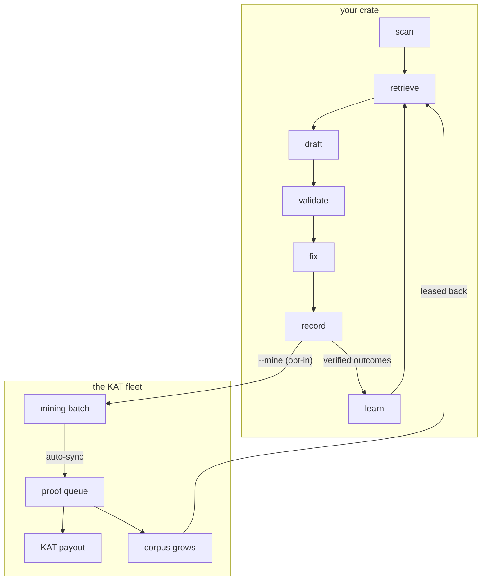
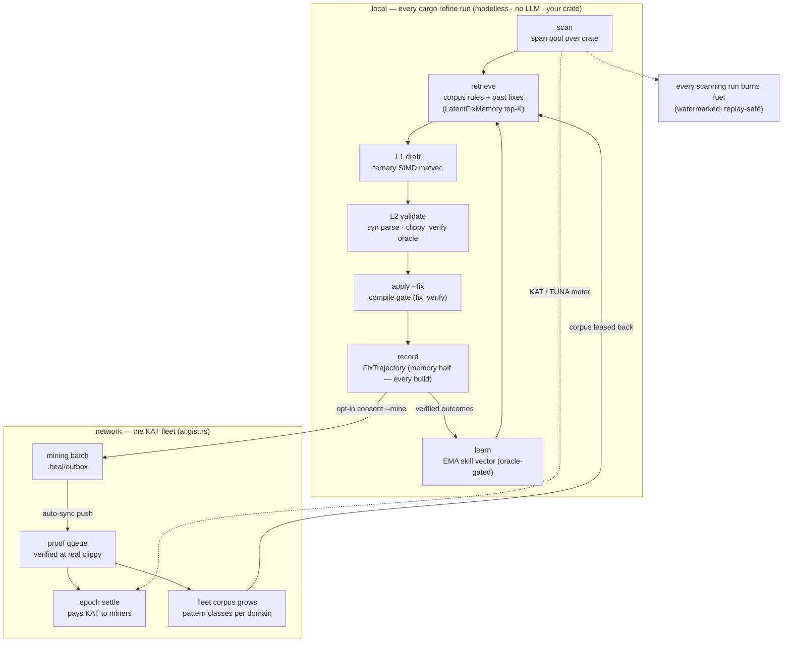

# Self-evolve flow — the e2e flywheel (local loop + fleet loop)

> **Purpose:** the one diagram that shows the WHOLE `cargo refine`
> self-evolve loop end to end — the local per-run loop (modelless
> L0–L2 + memory + learning) and the consent-gated fleet loop (mining →
> proof → KAT → corpus growth → lease-back) that closes the flywheel
> network-wide. Issue 131.

Two renders exist:

- **The hero SVG** — `self_evolve_flow.svg`, rendered from the COMPACT
  source below (short labels: it must read at front-page scale on
  `ai.gist.rs`). This is the pinned mirror the KAT network pages embed.
- **The annotated diagram** — the full mermaid in this doc, with the
  honest edge-by-edge reading. The source of truth for what the loop
  actually does.

## The compact hero source (renders `self_evolve_flow.svg`)

## The annotated source (full detail)

## What each edge means (honest reading)

- **record → learn is SPLIT by the oracle** (Issue 018): every applied
  fix becomes a trajectory (memory half — runs in every build); the EMA
  direction update consumes only oracle-verified outcomes (learning
  half — no-ops with one log line without `clippy_verify`).
- **record → mining batch is OPT-IN** (owner mandate 2026-09-08): the
  consent tiers are `Unset` / `OptedIn` / `OptedOut`; `Unset` never
  pushes — running `sync` IS the consent. `--unmine` stops the push
  half; healing was always local.
- **proof queue → epoch settle:** rows enter the proof queue on push,
  are credited at the proof pass (real `cargo clippy` re-run), and pay
  at the epoch settle — mining = processing, minted = paid (owner
  vocabulary).
- **fleet corpus grows → leased back:** the corpus view aggregates the
  network's pattern classes; clients refresh a leased corpus overlay
  (`DomainOverlay`) so retrieval sees what the fleet observed. The two
  corpus truths are different by design (the fix lane compiles in its
  rules; the suggest lane ranks on the lease).
- **scanning burns fuel** (dotted, annotated diagram only): every
  scanning run — the bare dry run included — settles charge against
  KAT, or TUNA trial credit first where the deployment funds it. The
  burn is metered locally, reported signed, and advanced via a
  server-side monotone watermark (replays no-op).

## Degenerate states (all honest, all silent-when-empty)

- No memory yet → the pipeline degenerates to the static-corpus path
  (the L0–L2 GOAT gates still hold — the layers are additive).
- No oracle → learning disabled, memory still records.
- No consent → nothing leaves the machine; `.heal/outbox/` is named,
  never deleted.
- Unfunded deployment → claims answer `unconfigured`, healing bills KAT
  directly (fail-closed).

## Re-rendering the hero SVG

The SVG is rendered from the COMPACT source above with the KAT dark
palette (transparent background, `#161b22` nodes, `#3fb950` accents,
`#8b949e` lines) and stripped of every external reference (no
`@import`, no webfont) so the worker can embed the bytes verbatim. The
band order in the render is fleet-above-local — the cycle reads as a
loop (local L→R, up into the fleet, fleet L→R, back down), which is the
point. After editing either mermaid source: re-render, strip externals,
copy the result over `self_evolve_flow.svg` here AND over
`riir-dapps/cloudflare/kat-service/src/self_evolve_flow.svg` (the
pinned mirror the worker embeds via `include_str!` — the two must move
in the same commit).

## See also

- [`heal_pipeline.md`](heal_pipeline.md) — the composition (`HealPipeline`)
- [`latent_fix_memory.md`](latent_fix_memory.md) — the memory layer
- [`latent_skill_evolution.md`](latent_skill_evolution.md) — the EMA layer
- [`evolve_recorder.md`](evolve_recorder.md) — the oracle-split recorder
- The KAT surface: riir-dapps `front_page.rs` + `heal_skill.rs` (the
  pinned SVG mirror lives in the worker's `self_evolve_flow.svg`)
