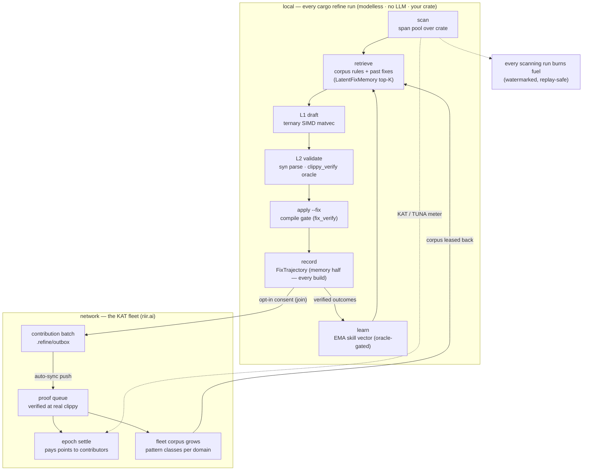

# Self-evolve flow — the e2e flywheel (local loop + fleet loop)

> **Purpose:** the one diagram that shows the WHOLE `cargo refine`
> self-evolve loop end to end — the local per-run loop (modelless
> L0–L2 + memory + learning) and the consent-gated fleet loop (mining →
> proof → KAT → corpus growth → lease-back) that closes the flywheel
> network-wide. Issue 131.

Two renders exist:

- **The hero SVG** — `self_evolve_flow.svg` (+ the 390 px card list
  `self_evolve_flow_m.svg`), rendered from the ` ```gfflow ` block below
  (short labels: it must read at front-page scale on `refine.riir.ai`).
  This is the pinned mirror the KAT network pages embed — the family
  flow-figure shape (numbered steps in path order, grouped into
  swimlanes; design guide §8, riir-ai Plan 620).
- **The annotated diagram** — the full mermaid in this doc, with the
  honest edge-by-edge reading. The source of truth for what the loop
  actually does.

## The hero source (renders `self_evolve_flow.svg`) — the gfflow block

Four lanes group the flywheel: your machine (the local pipeline), the
learning loop, the opt-in KAT fleet, and the lease-back lane that closes
the wheel. The local pipeline counts 1→5; the record step branches —
6a learns locally, 6b.1/6b.2 are the opt-in fleet loop, and step 7
leases the fleet corpus back. Two back edges never take numbers:
learning returns to retrieval, and the lease returns to retrieval.

```gfflow
file  = "self_evolve_flow.svg"
title = "cargo refine: the self-evolve flywheel — the local loop and the opt-in fleet loop"
accent = "refine"

[[lane]]
id = "local"; label = "Your machine"; note = "every cargo refine run · free · private"; color = "refine"
[[lane]]
id = "loop"; label = "The learning loop"; note = "your outcomes, your machine"; color = "refine"
[[lane]]
id = "fleet"; label = "The KAT fleet"; note = "opt-in · the network side"; color = "ai"
[[lane]]
id = "lease"; label = "Back to your machine"; note = "the wheel closes"; color = "refine"

[[step]]
id = "scan"; n = "1"; lane = "local"; col = 0
title = "Scan"; body = "the span pool over your crate — a dry run writes nothing"
status = "live"
[[step]]
id = "ret"; n = "2"; lane = "local"; col = 1
title = "Retrieve"; body = "corpus rules + your past fixes, top-K"
status = "live"
[[step]]
id = "dv"; n = "3"; lane = "local"; col = 2
title = "Draft + validate"; body = "modelless proposers draft; a real-clippy oracle judges"
status = "live"
[[step]]
id = "fix"; n = "4"; lane = "local"; col = 3
title = "Fix, compile-gated"; body = "kept only if your crate still compiles"
status = "live"
[[step]]
id = "rec"; n = "5"; lane = "local"; col = 4
title = "Record"; body = "every verified outcome becomes a trajectory"
status = "live"
[[step]]
id = "learn"; n = "6a"; lane = "loop"; col = 5
title = "Learn"; body = "skill memory updates from verified outcomes"
status = "live"
[[step]]
id = "mine"; n = "6b.1"; lane = "fleet"; col = 4
title = "Contribution batch"; body = "opt-in: redacted records queue to leave"
status = "test network"
tag = { text = "opt-in · off by default", color = "refine" }
[[step]]
id = "proof"; n = "6b.2"; lane = "fleet"; col = 5
title = "Proof + payout"; body = "verified at real clippy; the epoch settle pays points"
status = "test network"
[[step]]
id = "lse"; n = "7"; lane = "lease"; col = 1
title = "Leased corpus"; body = "the fleet corpus refreshes retrieval on every machine"
status = "test network"

[[edge]]
from = "scan"; to = "ret"
[[edge]]
from = "ret"; to = "dv"
[[edge]]
from = "dv"; to = "fix"
[[edge]]
from = "fix"; to = "rec"
[[edge]]
from = "rec"; to = "learn"; label = "verified outcomes"
[[edge]]
from = "rec"; to = "mine"; label = "opt-in"
[[edge]]
from = "mine"; to = "proof"; label = "syncs"
[[edge]]
from = "proof"; to = "lse"; label = "the corpus grows"
[[edge]]
from = "learn"; to = "ret"; back = true; label = "sharper retrieval next run"
[[edge]]
from = "lse"; to = "ret"; back = true; label = "every machine retrieves more"

[[walk]]
title = "Scan"
text  = "cargo refine scans your crate and collects the spans a fix could touch — the bare dry run writes nothing. No listing is published here: your code never leaves the machine, so the walk shows real bytes only where a step crosses to the fleet."
steps = ["scan"]
[[walk]]
title = "Retrieve"
text  = "Corpus rules and your own past fixes are ranked against each span (top-K). The fleet corpus arrives through the lease (step 7), so a fresh machine already retrieves what the network learned."
steps = ["ret"]
[[walk]]
title = "Draft + validate"
text  = "Modelless proposers draft fixes from the retrieved rules; a real-clippy oracle judges each draft before anything is written. No LLM is on this path."
steps = ["dv"]
[[walk]]
title = "Fix, compile-gated"
text  = "`cargo refine fix` writes only what the compile gate keeps: a fix that breaks your crate's build is reverted automatically. Divergence classes the gate cannot judge stay manual."
steps = ["fix"]
[[walk]]
title = "Record"
text  = "Every applied fix becomes a trajectory row — the span, the rule, the verdict — in the local memory store. Recording runs in every build; nothing is uploaded by default."
steps = ["rec"]
[[walk]]
title = "Learn"
text  = "Learning is measured, not claimed: after corpus and memory changes the score bench re-runs the fixture corpus and appends a row to the recorded history — heal rate, parse safety, the rule vocabulary. This row is the last simple-shape row in that history."
steps = ["learn"]
out   = { lang = "json", src = "data/flows/self_evolve/01_learn.json", label = "one recorded score-bench row" }
[[walk]]
title = "The mining batch (opt-in)"
text  = "Only with consent do redacted records queue to leave: rule verdicts plus the short snippets each fix touched, secret-scanned, never whole files, never your paths, signed with your key. This is the network's published sample batch — inspect what contributing uploads before opting in."
steps = ["mine"]
in    = { lang = "json", src = "data/flows/self_evolve/02_batch.json", label = "one contribution batch (published sample)" }
[[walk]]
title = "Proof + payout"
text  = "On sync, rows enter the proof queue and are verified at a real clippy re-run; the epoch settle pays contribution points to contributors (contributing = processing, proven = paid). Live on riir.ai."
steps = ["proof"]
[[walk]]
title = "The lease-back"
text  = "The fleet corpus — every verified pattern class the network observed — refreshes retrieval on every machine. This is the newest row of the recorded corpus history: rules per domain, today."
steps = ["lse"]
out   = { lang = "json", src = "data/flows/self_evolve/03_corpus.json", label = "the fleet corpus per domain" }
```

## The annotated source (full detail)



## What each edge means (honest reading)

- **record → learn is SPLIT by the oracle** (Issue 018): every applied
  fix becomes a trajectory (memory half — runs in every build); the EMA
  direction update consumes only oracle-verified outcomes (learning
  half — no-ops with one log line without `clippy_verify`).
- **record → mining batch is OPT-IN** (owner mandate 2026-09-08): the
  consent tiers are `Unset` / `OptedIn` / `OptedOut`; `Unset` never
  pushes — running `sync` IS the consent. `--unmine` stops the push
  half; healing was always local.
- **proof queue → epoch settle:** rows enter the proof queue on push,
  are credited at the proof pass (real `cargo clippy` re-run), and pay
  at the epoch settle — mining = processing, minted = paid (owner
  vocabulary).
- **fleet corpus grows → leased back:** the corpus view aggregates the
  network's pattern classes; clients refresh a leased corpus overlay
  (`DomainOverlay`) so retrieval sees what the fleet observed. The two
  corpus truths are different by design (the fix lane compiles in its
  rules; the suggest lane ranks on the lease).
- **scanning burns fuel** (dotted, annotated diagram only): every
  scanning run — the bare dry run included — settles charge against
  KAT, or TUNA trial credit first where the deployment funds it. The
  burn is metered locally, reported signed, and advanced via a
  server-side monotone watermark (replays no-op).

## Degenerate states (all honest, all silent-when-empty)

- No memory yet → the pipeline degenerates to the static-corpus path
  (the L0–L2 GOAT gates still hold — the layers are additive).
- No oracle → learning disabled, memory still records.
- No consent → nothing leaves the machine; `.refine/outbox/` is named,
  never deleted.
- Unfunded deployment → claims answer `unconfigured`, healing bills KAT
  directly (fail-closed).

## Re-rendering the hero SVG

The SVGs are rendered from the ` ```gfflow ` block above by reflex-site's
`scripts/render_flows.py`, which writes BOTH mirrors in one run — this
directory's `self_evolve_flow.svg` + `self_evolve_flow_m.svg` and
`riir-dapps/cloudflare/kat-service/src/assets/self_evolve_flow.svg` +
`_m` (the pinned mirror the worker embeds via `include_str!` — the two
must move in the same commit). Family tokens, the Refine green on the
local lanes and the network cyan on the fleet lane; the root `<svg>`
carries `data-gfflow="1"`, `role="img"`, `<title>` and a generated
`<desc>`, and every CSS rule is scoped under the SVG's own id, so the
worker can inline the bytes with no JS and no external reference. The
walk's IN/OUT payloads live in the kat-service tree
(`cloudflare/kat-service/src/data/flows/self_evolve/`), derived from
recorded captures by `riir-dapps scripts/build_flow_walks.py` (never
typed); the no-JS fallback the worker serves is filled by the renderer
into `assets/self_evolve_walk.html`. After editing the block: re-run the
payload script (if a capture moved), re-render, then commit this doc +
both mirror pairs together.

## See also

- [`heal_pipeline.md`](heal_pipeline.md) — the composition (`HealPipeline`)
- [`latent_fix_memory.md`](latent_fix_memory.md) — the memory layer
- [`latent_skill_evolution.md`](latent_skill_evolution.md) — the EMA layer
- [`evolve_recorder.md`](evolve_recorder.md) — the oracle-split recorder
- The KAT surface: riir-dapps `front_page.rs` + `heal_skill.rs` (the
  pinned SVG mirror lives in the worker's `self_evolve_flow.svg`)
