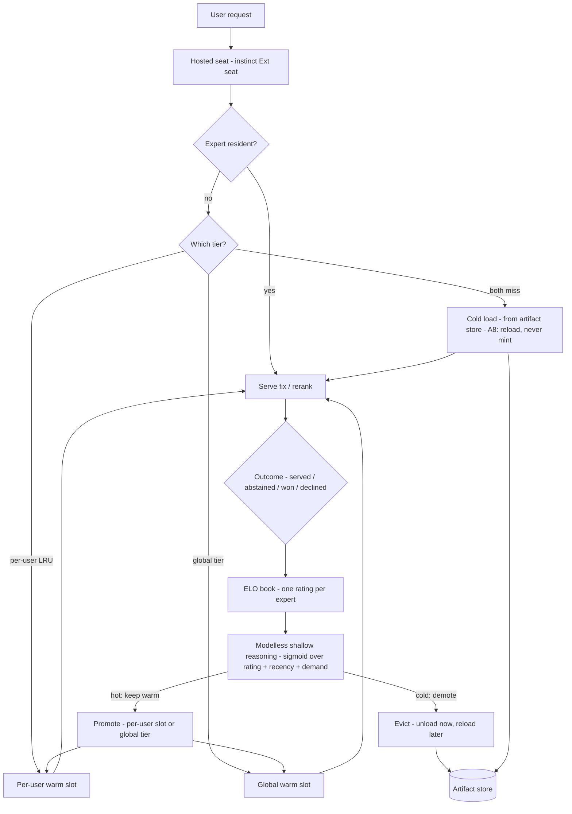

# Plan 202 — Decision-stack alignment: refine as the FIRST CUSTOMER of the arsenal/expert pattern (reflex → instinct → rethink)

**Status:** IN PROGRESS — R1 landed 2026-10-07 (katgpt-rs primitive half `6118539c7` + refine manifest half + instinct consumption `9e1fc37`; the rethink migration remains, boundary-routed). R4 landed 2026-10-08 (refine half; rethink's vessel migration remains). R2 landed 2026-10-08 (`HostedExpertL4`; HealPipeline arming stays with R6). **R3 landed 2026-10-08 (both halves: the refine `seat_rerank` client + the instinct `ext_seat_rerank_gates` seat half)**. **Dogfood spike DONE 2026-10-08 (Bench 107 — first real cross-process traffic, 32 round trips clean; R7 freeze inputs recorded in the R7 row)**. **R7 freeze LANDED 2026-10-08 (refine manifest grammar half: `min_pool` + `SeatReceipt` + the one-`heal`-suite decision; the decision_wire half = reflex issue 074)**. **R6 arm H LANDED 2026-10-08 (refine wiring half: the `heal_with_pool` seam + `escalation_dispatch` + the harness arm; the measurement run needs a live heal-suite seat)**. ACCEPTED — 2026-10-07 (verdict rounds 1-3: REVISE, REVISE, AGREE — implementation baseline; owner directive: last batch before impl) (owner ask: align the arsenal/expert-per-domain architecture across refine · reflex · instinct · rethink — "it should behave the same aka vessel"; outcome-based best-result selection ("any corpus/weight/shit that gains — we pick best result to fix the user problems"); adaptive escalation like the limelight rules with the fallback chain taken into account; refine = the first real customer, rethink = future decision-service customers; long-run per-user LRU expert cache; scale v2 without breaking much — v1 breaking is fine now, only us + low-impact users). Last batch before impl. · Verdict trail: round-1 REVISE accepted 2026-10-07 (substrate-first violations caught by code review: the escalate grammar is instinct's `EscalateSpec` — not rethink's, and a refine copy breaks one-definition; `llm_spend` is the existing cost guard; rerank-vs-generate escalation split; per-domain LRU on existing lazy lanes; R7 sequenced after the dogfood spike; fixer_regate arm H; code-egress consent scope; BOUNDARY row first) ; round-2 REVISE accepted 2026-10-07 (consistency pass: section 3/6/7 still described the rejected design - limelight signal split, chain split, test spec rewritten to the accepted design, katgpt-rs issue-first + feature flag + own GOAT for the primitive) ; round-3 AGREE 2026-10-07 — ACCEPTED as the implementation baseline. Carry-forward (one test each, no plan change): the R3a RERANK path gets the same egress-consent (Unset opens no socket), deadline-expiry (modelless answer stands), and snippet-only byte tests the R2 generate path has - rerank also sends user code to the hosted tier — LANDED with R3 (all three pins in the client's test suite). Implied order: R1 (katgpt-rs issue + primitive + GOAT) -> R4 BOUNDARY row -> R2 + R3a -> dogfood spike (DONE, Bench 107) -> R7 ledger freeze (decision_wire issue filed in reflex) -> R5/R6 to whichever side wins the measurement

## 0. The thesis

Every domain expert — in every repo of this stack — is already the same SHAPE, whatever is inside it: a **signed, versioned, BLAKE3-sealed artifact** (corpus, weights, or both) + **an escalation manifest row** + **gates that decide serve vs abstain vs escalate**. refine ships this shape modelless today (the corpus-is-the-model drafter, sealed artifacts, GOAT-gated domains). instinct/rethink serve the same shape as lanes/seats/vessels. This plan does NOT merge the repos — it aligns the PATTERN so that: (1) refine's per-domain healing is the first real customer of the decision stack; (2) rethink's future decision-service customers ride the same seat; (3) the modelless→trained fallback is measured, not vibes ("we pick best result").

## 1. The alignment table — one concept, four local names (the vocabulary translation)

| Concept | riir-refine (first customer) | riir-reflex (public decision serving) | riir-instinct (open L1 stack) | riir-rethink (private moat) |
|---|---|---|---|---|
| Expert artifact | BLAKE3-sealed corpus (the `rule_embed_frozen_v1.bin` pattern) | sealed corpora | suite/seat manifests | **vessel** (`.vessel`, signed, A10-hosted-only for moat classes) |
| Per-domain routing | `pick_domain` corpus routing | `decision_wire` domains + `pick_domain` | one suite per lane | manifest rows + Choice-criteria law |
| Escalation | `L4Fallback` seam (`DaemonL4` = the remote precedent) | — abstain is the chain's END, never an escalation (the table's one deliberate negative entry) | `Ext` seat (`install_ext_boots`) | **ESC lane** (`escalating_backend.rs`) |
| Gates | L2 parse + GOAT G1–G4 | G1–G5 (conformal floor) | parity gates | rate guard `[min_rate, max_rate]` |
| Demotion | `--active-set-demote` | kill switches | — | `RIIR_RETHINK_ESC=0` exact-literal demote |

Prior art on record: `tests/g4_l4_composition.rs` (the L4 conservative contract is TESTED wiring, not convention), `DaemonL4` (an L4Fallback already talking to a remote `bonsai_clippy_l4_eval --serve` — the hosted-expert precedent), instinct Proposal 001 (the vessel protocol: A1 bytes-are-runtime/capability-compile-time, A8 no runtime minting, A10 moat).

## 2. The laws this alignment inherits (non-negotiable)

1. **A10 moat:** hosted-only vessels NEVER enter public binaries. refine's shipped artifact stays modelless; trained experts serve ONLY from the hosted tier. (This is why "refine as first customer" = refine CONSUMES the hosted decision plane when escalated — it does not embed it.)
2. **A8:** no runtime minting — the hosted tier loads + verifies vessels; minting is offline; cache eviction reloads from the artifact store, never re-derives.
3. **Abstention-first / decline-is-correct:** every fallback chain ENDS in decline (`L4Fallback::generate_fix → None` is the conservative contract); a hosted timeout, a refusal, or a consent gap all decline — never a forced bad fix.
4. **Manifest-only arming, demote-only kill switches** (the ESC law): no code flip ever arms escalation; the runtime rate guard bounds COST only — the COMMISSIONING signal is the modelless miss rate (L0–L3 coverage), recorded even when escalation is disarmed; the two must never be conflated (a high miss rate is a coverage problem, not a demotion trigger).
5. **Code-egress consent is its own scope** (round 1): refine already has two OPPOSITE `Unset` meanings — stats consent refuses on `Unset`, mining allows. Sending user code to a hosted service is a THIRD, more sensitive scope: its `Unset` means REFUSE, the payload is the snippet (never the file), and a written no-retention-into-corpus rule stands — else A10 runs in reverse and user code becomes moat training data without opt-in.
6. **GOAT discipline picks the winner:** modelless vs hosted-trained vs hybrid is decided per domain by measured G1–G4 on frozen splits — never by preference. Losers are demoted and recorded ("we don't care what gains — we pick best result").

## 3. The escalation chain — adaptive, limelight-shaped

`L1 modelless (local, free, private) -> confidence/abstention gates -> [armed AND under the cost ceiling (llm_spend cap + max_rate) - refine has NO window lower bound] -> then, by case: (a) CANDIDATES EXIST => rerank on the seat (the hosted expert picks among our L0-L3 candidates or abstains; abstain => the modelless answer stands) - (b) NO CANDIDATES => generate via an L4 transport -> decline`.

Limelight mapping (round-2 corrected - the two signals are DIFFERENT and must never be conflated): a domain's **temperature** is its **modelless miss rate** (L0-L3 coverage), recorded even when escalation is DISARMED - a HOT miss rate is the commissioning signal that justifies a trained head for that domain; the **rate guard is a COST ceiling only** - it bounds spend and auto-demotes above `max_rate`, and below it means nothing (a low escalate rate is fine, not a demotion trigger). Escalation follows measurement, never existence.

## 4. Rows

- [ ] **R1 — the escalation manifest (shared PRIMITIVE at katgpt-core, not a copy).** ⛔ Round-1 correction: the escalate grammar is NOT rethink's — it is `riir_instinct::arsenal::EscalateSpec` (a `VesselRow` field, arsenal.rs ~L134; rethink only cross-checks it), it is encoder-lane-specific (`think_file`/`think_digest`/`margin`/`lcb_floor`, `0 < min < max < 1`), and a refine copy would be a second definition breaking the one-definition law this plan cites. The shared pieces are GENERIC: the **rolling-rate latch, the exact-literal kill-switch decode, the receipt tier** — extracted ONCE into **katgpt-core** (the lowest dep both sides share; refine's only default-build dep), consumed by instinct's EscalateSpec AND refine's manifest; shared field names for the common subset only. Refine's manifest: `domain → { modelless cap, cost ceiling (max_rate — the ONLY rate knob that carries over; min_rate means nothing here: refine's escalation rate is its L0–L3 MISS rate, coverage-decided, low = good, never a demotion trigger), escalate target, demote-only switch }`. **Low-volume bound (round 1):** `RATE_GUARD_WINDOW = 200` rarely fills at v1 traffic — until it fills `rate()` is None and the guard never runs; add a cost/time bound that works from the FIRST request (the llm_spend daily cap is that bound; R2). Dual-pinned goldens still apply — to the SHARED PRIMITIVE's bytes, not to two manifests. Ships ALL-EMPTY (arming = manifest edit, never a release). **Katgpt-rs side law (round 2):** the primitive is a cross-repo landing in katgpt-rs => file `katgpt-rs/.issues/NNN_*` FIRST (the drift-ledger rule), behind an OPT-IN feature flag (Feature Flag Discipline - promotion to default needs its own GOAT), and the extraction is NEW work (no existing rate latch in katgpt-rs/crates to reuse - verified in review) so the primitive gets its own GOAT gate.
  - **Landed (katgpt-rs half, `6118539c7`, 2026-10-07):** [Issue 923](../../katgpt-rs/.issues/923_escalation_guard_shared_primitive.md) — the primitive behind opt-in `escalation_guard`: `RollingRateLatch` (both-bounds `0<min<max<1` AND cost-ceiling-only shapes; rate() None until full; sticky latched demotion; O(1) alloc-free observe), `demote_only_decode` (absence-armed, ONLY the exact literal `"0"` demotes) + the uncached env helper, the ns-parameterized receipt tiers (`ns="ESC"` reproduces rethink's bytes exactly — migration is a pure move), `rate_bounds_valid`. GOAT (Bench 923): G1 17 tests, G2 **1.74 ns/observe** (ceiling 20), G3 default surface unchanged (2141 default lib count), G4 0 allocs/1000 observes. Test-gate row `katgpt-core:2158:escalation_guard`. The tpr/ugc private kill-switch copies STAY (default-on surfaces an opt-in feature cannot serve; truth tables cross-pinned by tests both sides). Substrate-first catch: the decode existed as THREE private spellings (rethink public + `tpr::parse_kill` + `ugc_schedule`'s pattern-copy) — the primitive is the fourth-ness repair, not a copy.
  - **Landed (refine half, 2026-10-07):** `src/escalation_manifest.rs` behind opt-in `escalation_manifest = ["katgpt-core/escalation_guard"]` — the ALL-EMPTY manifest at `.refine/escalation_manifest.json` (absent file = zero behavior, the active_set law; any other read error or invalid content = loud refusal), rows keyed by DomainId labels `{modelless_cap [0,1], max_rate (0,1) cost-ceiling grammar, target {kind: l4_daemon|hosted_expert|seat_rerank, endpoint}, demoted}`, the exact-literal env `RIIR_REFINE_ESC=0` decoded by the SHARED primitive (`is_armed_with` test seam), cost-ceiling guards via `guard_with` (fresh latch, no min — `rate_below_min` cannot exist). 13 tests incl. the `DOMAIN_LABELS` mirror-pin against the draft router under `latent_retrieval`. Clippy clean both postures.
  - **Remaining (R1 stays open):** rethink's migration onto the shared latch/receipts — ⛔ boundary finding (2026-10-07): rethink's BOUNDARY.md L78 pins katgpt-core as TRANSITIVELY-ONLY (through riir-instinct's re-exports, never a direct dep), so the migration route is instinct widening its pub surface (`pub use katgpt_core::escalation_guard;` — the seam law's sanctioned mechanism) and rethink's `escalating_backend.rs` consuming it from there; byte-neutral by construction (the primitive reproduces rethink's exact tier bytes, latch reasons, and decode truth table — cross-pinned both sides). Deliberately its own unit: it refactors rethink's promoted ESC serving lane.
  - **Instinct consumption landed (`9e1fc37`, 2026-10-07):** `EscalateSpec::validate()` now calls `katgpt_core::escalation_guard::rate_bounds_valid` — the ONE definition of the `0 < min < max < 1` grammar, consumed by EscalateSpec AND refine's manifest; behavior + refusal text identical, 86/86 lib tests green, clippy clean; the katgpt-core dep list gains the opt-in `escalation_guard` feature.
- [x] **R2 — `HostedExpertL4`: one MORE transport under the existing `L4Fallback` seam.** The seam already has two hosted shapes: `DaemonL4` (long-lived process, ~24 s/fix measured) and `CfClient` (`cf_workers_ai.rs`, hosted-model client). HostedExpertL4 is a third transport beside them — not a new pattern. **Existing machinery, not new:** (1) cost guard = `llm_spend.rs` (Issue 046: reserve-then-reconcile, USD daily cap, hard decline for the rest of the day — the never-retry-into-burn rule measured on the Issue-040 169-request incident); the kat-meter billing is a LATER concern, not the guard; (2) **code-egress consent = its own scope** (§2 law 5): `Unset` refuses, snippet-only payload, no-retention-into-corpus rule written on the wire; (3) **hard deadline**: `generate_fix` is synchronous `&mut self` — deadline expiry means DECLINE (the conservative contract), with a test; (4) registered in the R1 manifest, never in code.
  - **Landed (2026-10-08, R2 refine side):** `src/hosted_expert.rs` behind opt-in `hosted_expert = ["l4_lora", "riir-llm/transport"]` (the groq_first dep shape — no direct ureq; `llm_spend` lights via the lib.rs cfg-any, ledger itself feature-free). The four points, as wired: (1) `SpendLedger` reserve-then-reconcile with `CapReached` → decline, never retried, + a separate `Decline::Unpriced` class (an unpriced model is a CONFIG fix, not a wait-for-midnight — the conflation the first test run caught); (2) `RIIR_REFINE_CODE_EGRESS=snippet` — the ONLY consenting spelling (unset/blank/`1`/`true`/junk all refuse, junk loudly naming the accepted value), checked BEFORE any socket, independent of every other consent scope; the payload builder takes ONLY `&str` (file-to-payload unrepresentable) and the no-retention rule rides the wire twice (system message + `metadata.retention:"none"`); (3) an already-expired deadline declines pre-socket (in-flight bounded by the leaf's `CALL_TIMEOUT`); (4) endpoint + model are construction args — the manifest row's data, no default, no env fallback. Wire = `riir_llm::Wire::OpenAi` via `transport::post_chat_on` (both timeout ceilings, classification, bearer scrub); bearer via `RIIR_HOSTED_EXPERT_TOKEN` (optional — loopback experts skip). Tests: 10, incl. the four §6 pins (consent-Unset-no-socket via a loopback server that asserts ZERO connections; deadline-decline pre-socket; cap-0 declines twice with the ledger counting both; sent-bytes carry the snippet + retention rule and no file-content marker) + a happy-path loopback round-trip. Consent is INJECTABLE (`generate_fix_checked_with`) — no test ever mutates the process env (the first run's env-race flake, repaired at the design level). Gates: clippy `-D` ×3 postures with `--all-targets`; feature-on lib 2501/0; default lib 2473/0; hosted_expert+escalation_manifest+vessel_artifacts combo 2522/0; flag-off compiles (module absent). En-route: `cargo refine`'s proposer PANICKED on a char-boundary slice in `helpers.rs:630` (multi-byte source comments) — manual fixes used for the 5 mechanical findings; the panic feeds the post-mining intake. Arming/wiring into `HealPipeline` stays with R6's arm H (the manifest row is the arming surface, never code).
- [x] **R3 — the instinct `Ext` seat serves the RERANK half (round-1 contract fix).** ⛔ Contract mismatch found in review: `LaneBackend::decide` returns a `ServedDecision` — pick an index from PRESENTED options, or abstain; a healing fix is a free-form `String`, so the seat cannot serve GENERATION without a new generative wire (a decision_wire break for no reason). **Escalation therefore splits in two:**
  - **Landed (2026-10-08, R3a both halves):**
    - **(a) Rerank on the seat — refine client (this commit):** `src/seat_rerank.rs` behind opt-in `seat_rerank = []` — STD-ONLY HTTP/1.1 over the serve edge's `/decide` envelope (the riir-agents `decision_client` shape — a decision-plane edge, not an LLM leg: no riir-llm, no ureq, zero new deps). The L0–L3 candidates ride `options` verbatim, in order (snippet-only builder: takes the snippet + the candidate list and nothing else — a file's content is unrepresentable). The echo-is-the-trust-anchor contract: the reply's `options` must equal the sent candidates element-wise BEFORE any pick is read (an index into a different presentation is a different answer); **L4 invariant 3 by construction** — the answer's candidate is taken from the CALLER's list by index, and a reply whose `pick` field names a non-candidate declines `Contract`; abstain is first-class (`SeatAnswer::Abstained` — the modelless answer stands); empty candidates decline `NoCandidates` PRE-SOCKET (a rerank with nothing to rank is a generate-shaped miss — it never becomes seat traffic); an `https://` endpoint is a pre-socket config refusal (TLS belongs to a proxy). Consent is the SHARED code-egress scope — moved to `src/code_egress.rs` (cfg-any of its two consumers, the `llm_spend` shape; `hosted_expert` re-exports for API stability) — Unset refuses before any socket; the deadline is REQUIRED and deadline-phased (capped connect, write/read under the remaining budget, a late complete reply is DROPPED — compute-once). 17 tests incl. all carry-forward pins (consent-Unset-no-socket via a silent listener, junk-consent loud, deadline pre-socket, snippet+candidates-only body with a decoy marker, pick round-trip, abstain stands, non-candidate pick declines, echo mismatch declines even with a valid index, out-of-range declines, neither-pick-nor-abstain declines, 503→Wire naming the edge code, malformed body declines not panics, dead endpoint fast, late-reply dropped, Debug never carries the endpoint). Gates: clippy `-D` ×4 postures with `--all-targets` (default / seat_rerank / hosted_expert / 4-feature combo); combo lib **2541/0**; default lib **2473/0** (floor held exactly); hosted_expert 10/0 (the consent move kept R2 green via the re-export).
    - **(b) The seat half — instinct (`tests/ext_seat_rerank_gates.rs`, its own test binary):** DELIBERATELY a separate binary — `install_ext_boots` is install-once per process and `serve_gates` pins the no-backend refusal of the same open build (a stub in that binary would flip its refusal into a boot). A `StubRerank` LaneBackend (pick index 1 of the presentation, abstain on `ABSTAIN`-prefixed state, refuse options-less calls) installed via the `EXT_BOOTS` OnceLock; a custom `lane_loader` (the Rethink-host seam, plan 009 T2 — the raw route would `check_winner_file`-refuse an ENC row on a bridged suite) returning `lane_tag_digest` as the artifact digest (the SAME value the slot's birth tag carries → `Idempotent` install); the lazy ENC row boots through the real edge: seat prep → `boot_bytes` → ENC route → ext boot → hoard gate (zero centroid admitted UNJUDGED) → epoch-tagged install → 503 window → ready. 4 gates: the presented options reach the backend EXACTLY as presented (recorded server-side; race-proof any-match on unique candidates); pick/abstain round-trip over the wire (echo = presentation, pick = options[pick_index], receipt present); options-less body refuses 422 with the contract-naming text (the edge's `bad_request` bucket — a backend `Err(String)` outside the bag lanes' shape prefixes); the lazy 503 window stays observable. Gates: instinct clippy `--all-targets -D warnings` clean; full instinct suite green (86 lib + 4 rerank + 24 serve_gates + the rest, 0 failures); ext gates race-stable ×3.
    - **En-route sibling repair (instinct, disclosed):** `src/bin/arena.rs`'s `pin_a0_identity` was missing reflex Issue 072's new `RunOptions::dump_items` field — the pair (reflex moved, instinct unbuilt since) failed to compile, blocking every instinct test target. Repaired `dump_items: false` with the pin-context comment (the pin persists no items directory; measurement-only field, results.json byte-identical). Pre-existing drift, one line, no behavior change.
  - **(b-original) Generate (the no-candidate miss; NEVER touches the seat):** stays an `L4Fallback` transport — landed as R2 (`HostedExpertL4`, DaemonL4/CfClient-shaped); the split is structural: `SeatRerankClient` has no `L4Fallback` impl and no free-form-answer path; `HostedExpertL4` never touches `/decide`.
  - refine is still the first customer — its rerank traffic is what hardens the `install_ext_boots` seat for rethink's future customers (the AOI-reveal-bridge both-sides-consumer precedent). The R6 arm-H wiring joins `TargetKind::SeatRerank` rows to this client (arming stays manifest-only).
- [x] **R4 — vessel-shaped artifacts, formalized.** ⛔ BOUNDARY FIRST (round 1): the vessel verify path lives in `reflexer-vessel`, which instinct pulls only under its `vessel` feature — refine depending on it needs a **`BOUNDARY.md` allowlist row BEFORE any code** (the read-BOUNDARY-first rule is enforced, not prose). Then: refine's sealed corpora adopt the vessel protocol's verify path (sign / blake3 / monotonic apply / strict refusal on tamper — A1/A8). Where a trained healing head exists (hosted-only), it IS a `.vessel`; public-release vessels never carry non-public corpus (A10). One artifact protocol across the stack.
  - **Landed (2026-10-08, R4 refine side):** the BOUNDARY.md allowlist row + `src/vessel_artifacts.rs` behind opt-in `vessel_artifacts = ["dep:reflexer-vessel"]` — the VERIFY-ONLY seam (A8 adjudication: refine never mints; the sign half of the protocol lives at the minter, riir-train's offline lane — tests mint fixtures via the format crate's `encode_public`). Pin posture mirrors reflex: compiled table EMPTY + the `RIIR_REFINE_VESSEL_PUBKEY` operator wildcard (unset = loud config gap naming the env; bad hex = same), strict verify through `decode`/`open` unchanged, monotonic apply with downgrade/fork refusal + state-advance (in-memory; persistence is the R2 consumer's). The embedded corpora + `rule_embed_frozen_v1.bin` stay code-sealed — the A10 leak law: no vessel bytes in shipped binaries (artifact-dir leak test pins assets/; the escalation-lane binary scan is R2's test-spec row). `default-features = false` + `vessel_public_read` ONLY — the hosted reader never compiles into the publicly-distributed binary. 9 tests (pin posture ×3, tamper, path round-trip, monotonic ×1, A10 posture ×2, format pin). Gates: clippy `-D` ×3 postures with `--all-targets` (feature-on / default / flag-off), feature-on lib 2482/0, default lib 2473/0 (floor held), standalone-dep gate 14 rows. En-route gate repair (pre-existing, disclosed): `bench_005_neon_pq2_m3_goat` carried TWO x86_64-only `-D warnings` reds — the host-gate `exit(2)` inline in `main` made every following statement `unreachable_code`, and the correctness `reference` binding is read only under aarch64 cfg — meaning `--all-targets` clippy has been lib-only-in-practice on this box since the Plan-204 T11 landing (`8e5a433b`); repaired (host gate moved into its own fn, cfg_attr allow with the construction comment), refusal text byte-identical. CI: rust.yml provisions the 8th sibling (public, token-free lane) + the gap message; the flag-OFF `cargo test --lib` lane shows a PRE-EXISTING `build_stamp::the_stamp_is_populated` failure (stamp legitimately empty at zero features; outside every guard posture — the flag-OFF layers are check+clippy only), left as-found.
- [ ] **R5 - per-DOMAIN LRU on the existing lazy lanes (round-1 re-scope; substrate-first).** The load/evict machinery ALREADY EXISTS: `BudgetSpec { load = "lazy" }`, `POST /arsenal/release`, and `LaneSlot` reinstalling as `InstallOutcome::Idempotent` after eviction. An LRU is a POLICY on top of that - build the policy, not the machinery. Hosted-side only (correct as written). **`- [-]` per-USER and per-ALL-USERS (global warm tier) caches are DEFERRED to the next version (owner note 2026-10-07: "LRU per user and also per all user, so we can keep it warm")** - the full deferred context is in R5b below.
- [-] **R5b - warm-tier cache policy, per-user AND global (DEFERRED until needed - next version; recorded so the context survives).** Two tiers, one policy family:
  - **Per-user LRU** (hosted tier): a user's repeatedly-escalated domain experts stay warm across their requests; eviction = reload from the artifact store (A8: never mint).
  - **Per-all-users GLOBAL warm tier**: the shared pool of experts worth keeping warm for EVERYONE - promoted from observed cross-user demand, so the first request of the day is warm, not cold.
  - **The policy is MODELLESS (the owner's bet, confirmed in substrate): keep an ELO per expert** (from real serve outcomes - served/abstained/escalated/won-vs-declined), and a **modelless shallow-reasoning pass over the ELO table drives warmth/promotion/eviction** (sigmoid gates over rating + recency + demand - the house style, no trained model deciding cache policy; "we have a lot of AI to handle that decision... keep ELO and use modelless shallow reasoning").
  - **Substrate pointers (grepped 2026-10-07, do NOT rebuild):** katgpt-core `zone_density_routing` (DEFAULT-ON) already ships `ZoneDensityCache<V>` - a papaya LRU with tier/drift/TTL invalidation driven by a modelless sigmoid classify (mobility -> tier + cache_key); `engram` (DEFAULT-ON) ships the plasma-tier lock-free papaya LRU; the game-lane Elo book precedent lives in riir-ai `attack_reasoning` (Plan 575, Bench 898 GOAT); rethink already warms encoder workers at boot (encoder_serve.rs warm path). New work at impl time: the ELO book for experts (riir-ai precedent transplanted) + the shallow-reasoning policy over it + the two-tier wiring onto the existing lazy lanes. Boundary note: the policy primitive (if shared) routes via katgpt-core like R1's.
  - Defer trigger: host the first real decision-service customer OR escalate traffic that makes cold-start latency visible in W2-style metrics - whichever first.

**R5b flow (educational):**

Legend: the straight path (request -> tiers -> serve) is REQUEST TIME; the loop (outcome -> ELO book -> policy -> promote/evict) is LEARNING TIME, asynchronous, fed only by real serve outcomes. The policy is modelless - sigmoid gates over the ELO table, never a trained model. A8: every cold load and every post-eviction reload comes from the artifact store - nothing is ever minted at runtime. Deferred (next version) until a defer trigger fires.

- [-] **R6 — outcome-based selection: arm H in the EXISTING harness (round-1 re-scope).** The harness exists: `src/bin/fixer_regate.rs` (Issue 040) already runs arms A, B, G, G2, C + the dry-run BT8DRY over deny-by-default redaction policy — **add a hosted-expert arm H there**, never a second harness. Comparison is PAIRED PER-CASE on the frozen split (deterministic — interleaving fixes timing noise, not quality), with an explicit COST axis: quality gained per dollar (llm_spend ledger) and per second (modelless fixes are microsecond-scale; a 24 s hosted fix must buy real quality to win). Demote the loser via manifest/active-set; record the measurement. This is the standing mechanism for "we pick best result".
  - **Landed (2026-10-08, R6 refine wiring half):** (1) **the `heal_with_pool` seam** (`self_evolve.rs`) — the `heal` body extracted to `heal_inner(pool_out: Option<&mut Vec<String>>)`; the pool collects at the two birth points (Stage-2 verified singleton; the deduped drafter+memory pool before selection, so the miss paths still expose what the modelless path had); plain `heal` passes `None` — bit-identical, G4 `heal_is_alloc_free_after_warmup` green. `RegateHarness::classify_outcome` surfaces miss + serve + `score` (the worthiness axis) + pool; `classify` delegates. (2) **`src/escalation_dispatch.rs`** (new, gated `escalation_manifest` AND any transport — the code_egress shape): `EscalationDispatch::arm` (absent/demoted/kill-switch → `Ok(None)` — the ALL-EMPTY posture; feature-off armed rows refuse loud; `l4_daemon` = R6 follow-up), the shared worthiness→sticky-latch gate (ONE miss observation per case; the case that TIPS the window still escalates), the **`min_pool` enforcement consumer** (pre-socket — `BelowMinPool` is a first-class outcome), the **deadline-capped readiness retry** (Bench 107's lazy `503 {"code":"loading"}` window: retries ONLY that code, under the REMAINING budget, `lane_failed` falls through on attempt 1), the S8 presentation cap (pool truncated to 8, read back at the wire in a test), abstain → modelless stands, every decline → modelless stands. 13 tests incl. wire-recorded request bodies. (3) **manifest grammar: `model` on hosted_expert rows** (R2's construction law — the cost guard refuses an unpriced model; no default, no env fallback; dead knob on l4_daemon/seat_rerank rows, refused). (4) **arm H in `fixer_regate.rs`** — paired per-case (modelless arm = the prepare-time pipeline pick + its true µs; escalated arm = the dispatch), JSONL rows (`--out`) + the paired summary (chain outcome classes, paired keep_s wins/losses/ties, cost axes, `spend_summary_line` on the hosted leg, the quality-history row under arm "H"), the demotion is a PRINTED verdict (manifest edit, never code); flags `--esc-manifest/--esc-domain/--deadline-ms` (default 2 s). Offline rehearsal: ALL-EMPTY → SKIP exit 3; consent-unset + dead endpoint → every case declines pre-socket, ties 12/12, no sockets. Gates: clippy `-D warnings` at default/all-features/seat-only/hosted-only/combo (all-targets); lib feature-on 2551/0, default 2475/0 (+2 ungated seam tests over the old 2473 floor); G4 green. **En-route repair (pre-existing on develop, disclosed):** `tests/kat_sync_v1_fixture_freeze.rs` (M3 session, `9d6daa23`) landed WITHOUT its `[[test]]` required-features row — default `clippy --all-targets` red E0432; row added (`kat_service, latent_retrieval`, the module's own gate).
  - **Remaining (R6 measurement):** a live heal-suite seat (the instinct dogfood server still serves `sst5` — the R7 one-`heal`-suite decision needs the example's SUITE constant flipped or a serve-side heal lane), an armed row with a real cap, the run recorded as a bench doc, then the demote-the-loser manifest edit. Then R5/R6 measurement per the plan order.
- [ ] **R7 — the v1-breaking ledger: RIGHT budget, WRONG time (round-1 re-sequencing).** Spending the one-time break BEFORE any first-customer traffic risks a SECOND break — the unknowns (rerank vs generate payloads, consent fields, receipt tiers) only surface under real traffic. Order: **freeze the R7 ledger after a short R2+R3 dogfood spike**; include a `contract_version` field IN the break so v2 is additive forever after. **The decision_wire half of the ledger is filed as reflex issue 074 (`4600c2e`, 2026-10-08, post-spike)** (decision_wire belongs to reflex — G3/repo law), not as a refine row; refine's manifest grammar half stays here.
  - **Spike DONE (2026-10-08, Bench 107):** the first cross-process refine-client → instinct-seat traffic (release both sides, 32 round trips, zero contract violations) ran clean — the v1 rerank envelope `{suite, state, options}` carried everything the contract needs. Ledger freeze inputs (Bench 107's findings, condensed): (1) **the corpus is 1-fix-per-rule across every domain** → real pools are size ≤1 fresh; rerank is the warm-memory arm — the manifest grammar freezes a **min-pool gate (rerank arms fire at pool≥2)**; (2) **the lazy 503 window is the first-customer experience** (one declined call + ~100 ms under budgeted retry) — R6 arm H owns a deadline-capped readiness retry or eager-load rows; (3) **transport floor ~0.8–6 ms/decision** loopback release (pool=1; 1.4–8.9 ms at 8 options; `Connection: close` per decision; OS-socket-warm spread measured across two warm runs) — accepted for v1, keep-alive is the v2 lever; (4) **the client drops the seat's receipt** (`receipt{build,features,input_blake3,decision_blake3}` + `us`/`confidence`/`arm`/`lane_load` unread) — the receipt tier on `SeatAnswer` is the additive v2 row the `contract_version` field exists for; (5) **consent stays local-only** (no consent fields on the wire — refusal lane exercised clean pre-socket); (6) **the seat's suite axis is dataset-bound** — the healing suite vocabulary (one `heal` suite vs per-domain) freezes WITH the manifest grammar; (7) rule-id context on the wire is an expert-quality lever, not a contract need. R2's generate half stays loopback-evidenced — real-endpoint arming is R6 + owner-gated spend (Bench 107 §R2 scoping).
  - **Freeze LANDED (refine manifest grammar half, 2026-10-08):** (a) `EscalateTarget.min_pool` — absent → the frozen default 2 (`DEFAULT_MIN_POOL`), seat_rerank rows may raise it, never lower it (validated 2..=8, the S8 presentation cap), DEAD-KNOB REFUSED on generate rows (an armed row carrying meaningless fields is the conflation class this manifest keeps refusing); 3 grammar tests; (b) `SeatReceipt` — the seat's decision receipt surfaces on BOTH `SeatAnswer` variants (lenient parse: every field optional, an envelope with no receipt still answers — the additive-on-the-wire law), the audit trail reads build/input_blake3/decision_blake3/us/confidence/arm; 1 wire-shape test + the abstain pin extended; the dogfood driver prints the receipt per pick; (c) **suite vocabulary DECIDED: one `heal` suite for v1** — one seat lane hosts the healing rerank expert; per-domain lanes wait for measured need (the hosted tier scales experts independently — R5's LRU; multiplying seats before traffic is the premature-axis class); recorded in Bench 107 + reflex issue 074. Gates: feature-on lib 2508/0; default floor 2473/0 held exactly; clippy `-D warnings` both postures.
## 5. Scale-v2-without-breaking (the constraint, restated as laws)

1. A new domain = corpus + manifest row + GOAT — never a pipeline change (the manifest grows rows, not code).
2. The shipped binary never grows trained weights (A10) — the hosted tier scales experts independently (R5's LRU).
3. The escalation contract is versioned; v1 breaks are spent ONCE (R7), then additive forever.

## 6. Tests (the implementer's spec - consistent with rounds 1-2)

- **R1 primitive pins:** the shared katgpt-core primitive's bytes are pinned (rate latch, kill-switch decode, receipt tier); instinct's `EscalateSpec` AND refine's manifest are EACH pinned against that primitive (one definition, three pins - never manifest-to-manifest).
- **Rate guard (refine shape):** above `max_rate` => demote receipt + cheap-only latch; **below it => nothing** (never a demotion). **Low-volume case:** the llm_spend cap reached => decline from the FIRST request while the 200-decision window is still `None` (the guard that never ran must never be the thing that saved us).
- **R2 (HostedExpertL4):** deadline expiry => decline - spend cap reached => decline with NO retry (the llm_spend hard-decline rule) - **egress `Unset` must never open a socket** (the consent test names the code-egress scope, not a generic Unset) - **snippet-only payload:** assert the bytes sent contain no content from outside the snippet.
- **R3a (rerank on the seat):** the options are EXACTLY the L0-L3 candidates - expert abstains => the modelless answer stands - **a pick can never replace a parsing candidate with a non-parsing one (L4 invariant 3)** - generate traffic NEVER reaches the seat.
- **A10 leak scan:** no vessel bytes in any shipped binary (the `binary_leak_scan.sh` pattern, extended to the escalation lane).
- **R5 LRU:** eviction/reload correctness under A8 on the existing lazy lanes; a reload NEVER mints; cold-start latency bounded.
- **R6 arm H (fixer_regate):** paired per-case comparison on the frozen split with the cost axis (quality per dollar via llm_spend, per second) - **arm H cannot silently drop out: a missing or empty arm-H run FAILS the harness, never passes.**

## 7. Cross-refs

[Plan 001](001_plan_heal_domain_pipeline.md) (HealDomain) · the `L4Fallback` conservative contract + [tests/g4_l4_composition.rs](../tests/g4_l4_composition.rs) · `DaemonL4` (the remote precedent) · instinct Proposal 001 (the vessel protocol — A1/A8/A10) · rethink AGENTS laws (seam law, pin lockstep, A10, consent) + `escalating_backend.rs` (the ESC lane; the grammar itself is instinct's `riir_instinct::arsenal::EscalateSpec` - rethink only cross-checks it) · reflex G1–G5 (the conformal floor) · dapps [Plan 048 §Phase C](../../riir-dapps/.plans/048_master_mainnet_direct_cutover_and_corpus_expansion.md) (the domain expansion feeds this stack) · the mining-queue slot discipline (`.distill/001_mining_queue_snapshot.md`).
