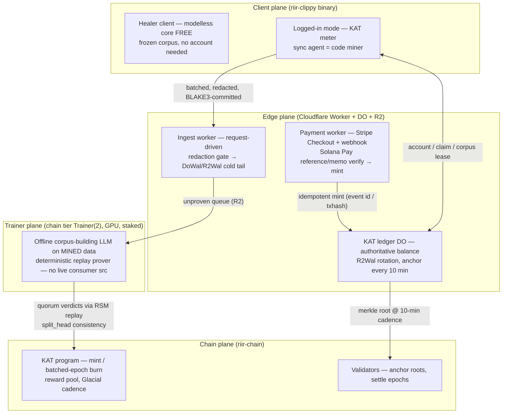

# Proposal 005 — KAT: `cargo heal` as a token-metered, self-improving service network

Status: **draft — revised 2026-08-25 after an adversarial substrate re-audit** (verdict: GO on the thesis and the de-gating decision; NO-GO on the "this is composition, not construction" framing). Four load-bearing claims were falsified by grep and are corrected in place, each marked *"correction"* at its point of use: (1) **§Payments** — `solana_watcher` has no verification machinery (`poll_inner` → `Ok(vec![])`); the rail is new construction. (2) **§KAT** — `AstChunker` is not the meter's substrate (wrong repo, default-off, emits chunks not word tokens); the meter is new code over raw span bytes, with new gate **G9**. (3) **§Mining** — the 53.38/85.17 ns figures belong to `ChainDivergenceDetector`, not `verify_no_split_head`; the quorum path is unmeasured and compile-bound. (4) **§caveat 2** — riir-ai Issue 742's vLLM win is the qwen3-8B stack, not Bonsai; that counterweight is withdrawn. Also added: **§Economics** two-currency separation + G7's `USD_inflow ≥ GPU + vendor` invariant, caveats **#14–#17** (boundary, mining-value copy, the free-build pricing inversion, citation hygiene), and Issue 041 (closed 2026-08-25 — resolution in git history).
Blocked by: [Issue 037](../.issues/037_e2e_self_evolve_adoption_proof.md) gate **A1 only** (E1–E5 all MET as of 2026-08-25; cadence gate earliest close 2026-08-26) + [Proposal 003](003_binary_only_distribution.md) (binary distribution is the delivery substrate — same A1 blocker). The consumer-facing **fixer node is BLOCKED** on quality + consumer-src leak (§Honest caveats #2) — **trainer nodes only at launch** (owner's call, 2026-08-25). First unblock candidate: the cheap re-gate POC on CF Workers AI + partial-credit metrics ([Issue 040](../.issues/040_fixer_regate_poc_cf_workers_ai.md)). Issue 041 (service-plane home) **RESOLVED 2026-08-25** — Option A adopted under the owner's execute order: the service plane lives in `../riir-dapps` (its §Owns widened to metered-service settlement in the same change); riir-clippy ships the **client half only**, allowlist unchanged.
Branch: `develop` (per global rule — no feature branches)
Owner: unassigned
Fusion of: Proposal 003 (binary-only distribution) × Issue 037/038 (the closed self-evolve loop + `TrajStore`) × the riir-chain USDC bridge **shape** (`solana_watcher.rs`'s RPC-poll/cursor skeleton + the `BridgeEvent` row — *not* its verification, which does not exist; see §Payments) + `InflationSchedule` (Plan 279 T26) + chain Proposals 002/003 (subscription billing / cross-chain mint) × riir-neuron-db `R2Wal`/vessel × the RSM `split_head` game-proof substrate × [riir-ai Proposal 040](../../riir-ai/.proposals/040_riir_deployer_game_and_chain_devops.md) caveat 3 (the prior "service blocked on quality" verdict this proposal answers)
Related: [Proposal 001](001_multi_domain_modelless_code_healer.md), [Proposal 004](004_sec_domain_fourth_heal_domain.md), [node_tiers.md](../../riir-ai/.docs/01_orientation/node_tiers.md), [riir-dapps Proposal 001](../../riir-dapps/.proposals/001_agreement_boundary_and_tiered_durability.md)

## TL;DR

> **Install (1-liners, per Proposal 003's dist repo):**
> - macOS/Linux: `curl -fsSL https://cargo-heal.gist.rs/install.sh | sh` (or `brew install gist-rs/tap/cargo-heal`)
> - Windows: `iwr -useb https://cargo-heal.gist.rs/install.ps1 | iex` (or `scoop install gist-rs/cargo-heal`)
> - Then: `cargo heal login` → **free 100,000,000 KAT** (**1 KAT = 1 code word token processed** — modelless healing included; ≈ $300 of Claude-equivalent sticker value).

Package the healer as **a metered network with a data flywheel**, not just a binary. **Modelless healing burns KAT — 1 KAT per code word token processed — because a token nothing burns for is a token with no value** (owner's call: the modelless sink IS the token economics). The free grant (100M KAT ≈ $300 of Claude-equivalent value) is consumed by real usage; **code miners** who sync heal data back earn KAT when it proves new value through a deterministic trainer-quorum replay (the game's `split_head` proof, 1..N nodes). **Trainer nodes build corpus from *mined* data only — never live consumer src; the consumer-facing fixer node is explicitly BLOCKED** (quality + consumer-src leak, caveat #2) — with a **Cloudflare Workers AI variant** (`@cf/meta/llama-3.3-70b`, $0.29/$2.25 per M tokens, REST from the same Worker — no GPU fleet of our own for serving) as the cheaply-re-gateable unblock candidate (Issue 040). Pay with card (Stripe, on a Cloudflare Worker) or **Solana USDC** (Solana Pay QR; `txhash` + reference as mint proof — verification is **new code**, not a reuse of the bridge; the shipped watcher parses nothing). Mining rewards decay per epoch (`InflationSchedule` shape) with a first-discovery bonus — first come, more per serve. The CLI shows balance, accrued-but-unproven mining records, and **$-saved vs Claude per-token pricing** (never a $ figure beside a KAT accrual — caveat #15). This is our design fusing prior art (Solana Pay reference flow, prepaid-credit closed-loop posture, decayed mining rewards); the flywheel composition — heal usage → unproven data → quorum-proven corpus rules → a better healer for everyone → more usage — is the product.

## The problem this solves

Everything the service needs already exists as substrate, but it is unpackaged and unconnected:

| User-visible gap | Substrate that exists today, unconnected |
|---|---|
| No way to charge for / sustain the healer beyond free binaries | Proposal 003 ships binaries; Proposal 040 §caveat 3 declared "clippy-as-a-service **blocked on quality**" (Plan 336 G1 FAIL 0/60) — a verdict that gated the *entire* service on L4 quality. |
| The self-evolve loop is proven (Issue 037 E1–E5) but mines only one machine's data | `TrajStore` (Issue 038) records trajectories + verdicts locally; `.heal/` store + `EvolveRecorder` exist; nothing flows between users. |
| No payment rail | **Weakest row — read §Payments before believing it.** A bridge *skeleton* exists (`../riir-chain/crates/riir-chaind/src/bridge/solana_watcher.rs` — 110 lines; `poll_inner` returns `Ok(vec![])`) plus the `BridgeEvent` row type (`tx_signature: [u8; 32]`, always written as zeros, and half a Solana signature's width) and the Plan 196 Surfpool e2e *harness pattern*; chain Proposal 002 ships `SubscriptionProgram`; chain Proposal 003 extends the bridge to cross-chain mint. **No payment verification of any kind exists**, no Stripe rail, no retail checkout UX. |
| No reward distribution | `InflationSchedule.epoch_reward = initial_reward × decay_factor^epoch` (Plan 279 T26) + the 60/20/10/10 epoch split + Curator accuracy-proportional rewards (Plan 281 T12) — the decay/first-come economics, already tested, unused by any product. |
| No multi-node proof of a heal's value | The game proof substrate: RSM topologies **C1–C5 (1, 2, 3, … N nodes)** + `verify_no_split_head` replica-consistency detection + deterministic replay (`game_replay_verify`, `fix_verify`, the clippy oracle — all deterministic). Nothing composes them for heal-data proof. |
| No cold-tier ingest for heal data | `DoWal`/`R2Wal` (DO live tail + R2 sealed segments, riir-dapps Issue 003) — a CF-Worker-shaped cold tier with quota/failure rows already mapped. Unused outside the game. |
| No secure trainer execution / asset protection | The vessel substrate (`../riir-neuron-db`: `secure_vessel` feature, `NeuronVesselSidecar`, ARTB real-WASM packer Plan 543) — BLAKE3-committed, fuel-gated WASM. `DaemonL4` (**this repo**, `src/l4_daemon.rs`) + `bonsai_clippy_l4_eval --serve` (**`../riir-train/crates/riir-train-engine/examples/`**, load-once/serve-many) exist as the L4 transport. |

What goes wrong without this proposal: the healer stays a static binary (corpus frozen at build time), every user's healing data evaporates, L4 quality work has no economic engine funding it, and the moat Research 003 named — "the adaptive/learning layers" — stays a single-machine demo instead of a network compounding loop.

**The prior verdict this must answer (not dodge):** Proposal 040 caveat 3 blocked the service on Plan 336 G1. This proposal's answer: **stop gating the service on the fixer**. The metered product at launch is the network — modelless token burn + evolved corpus + mining + payments; the **fixer node is explicitly BLOCKED** (quality + consumer-src leak, caveat #2), and trainer nodes touch only mined, redacted, ToS-licensed data.

## The proposed design

### The topology (4 planes; Worker-grade ingest, no 20 Hz anywhere)



The user's instinct is correct and matches the substrate: **a CF Worker is enough for ingest** — heal-data sync is request-driven, batched, Glacial-class (no 20 Hz tick; the Doc 56 finding that DO Alarms can't hold a 20 Hz tick is irrelevant here, while the DO's *request-driven* Validator-hat shape is exactly the ingest/ledger shape).

### KAT — the unit, the free tier, what burns, what earns

- **Unit:** 1 KAT = **1 word token of code processed by the healer** — counted over the **raw bytes of the span** (whitespace-delimited word tokens of the span text), NOT over an AST. Integer u64 balance. **No decimals.**
  - **Correction (2026-08-25 review):** an earlier draft claimed "`AstChunker` already produces the token stream". **It does not, and it is not reachable in the default build.** `AstChunker` lives in `../riir-ai/crates/riir-rag` behind the default-**OFF** `ast_chunker` feature (~2 MB, `syn`+`quote`), reachable from riir-clippy only under opt-in `latent_retrieval`; and it emits **item-boundary chunks, not word tokens** (`word_token` → zero hits in this repo). **The meter is NEW code**, ~50 LOC, owned by riir-clippy (Phase 0 T0.5).
  - **Why raw bytes, not the AST — this is a correctness requirement, not a shortcut.** A `syn`-parsed counter (a) does not exist in the light build, (b) yields *nothing* on spans that fail to parse — which is precisely the L4 miss class the reachability contract (Issue 030) routes to the expensive path, so the most expensive work would bill zero — and (c) shifts its count whenever `syn`/corpus versions move, making the same repo bill differently across releases. A money meter must be reproducible; see **G9**. When the fixer eventually unblocks, its LLM tokens price in KAT at a *higher* per-token rate (GPU-real cost) on top of the code-token meter.
- **Free tier:** 100,000,000 KAT granted once per account key at `cargo heal login` — ≈ 100M code word tokens ≈ **~$300 of sticker value at Claude-Sonnet-class $3/M input** (the honest comparison: what *reading + fixing* that code via an API would cost). Our marginal cost is ~zero (local compute) — the grant is cheap for us *and* the conversion funnel: normal usage consumes it, mining extends it.
- **Burns KAT (the sink that gives KAT value — owner's call, 2026-08-25):**
  1. **Modelless healing — 1 KAT per code word token processed.** The volume sink: every repo healed consumes KAT, so KAT demand = healing demand. Without this KAT has no value (nothing to spend it on at launch).
  2. **Evolved-corpus lease** — a flat per-epoch lease (e.g. 1,000 KAT) for hot-push updates; deliberately small next to the token meter.
  3. *(Blocked/later)* **Fixer-node LLM fixing** — LLM-token rates; see the fixer blocker (caveat #2).
- **Enforcement posture (the honest half):** the meter is client-side accounting reconciled at sync; what the **server** enforces is *network membership* — accounts in good standing (synced burns plausible against synced data, balance ≥ 0) get corpus hot-push + mining settlement + cloud features. A patched binary freeloads the frozen corpus only, outside the economy (no earnings, no updates). See caveat #1.
- **Earns KAT (mining):** syncing unproven heal data that later **proves new value** (see §Mining).
- **Out-of-KAT UX:** warn at 10M remaining; at 0 → **QR code (terminal ASCII + URL)** to the payment page + evolved-corpus hot-push stops at epoch end + persistent warning — **but mining accrual and settlement CONTINUE at balance 0** (earning it back by syncing data is the loop that keeps a broke user running — warn-and-pay, never brick).
- **Non-transferable in v1** (prepaid service credit, closed-loop). See caveats #7 for the legal reasoning and the transferability decision gate.

### Account + client surface

- **Identity:** an Ed25519 keypair in SSH format — the exact pattern already shipped three times (`riir-chain/src/ssh_key.rs`, `GmKeySetup`, `avatar_crypto`'s registry). Account id = BLAKE3(pubkey). No email required v1.
- **CLI additions** (all behind opt-in feature `kat_service` in riir-clippy; the default binary is unchanged offline):

```
$ cargo heal login            # generate/import key, claim free 100M KAT
$ cargo heal account
  KAT balance:              87,412,331 KAT
  Records pending proof:    1,204 (est. 42,000 KAT service credit if proven)
  Proven this cycle:        318 records → +9,450 KAT credited
  Healed this cycle:        12.5M code word tokens (−12.5M KAT)
  Saved vs Claude:          12.5M tokens healed ≈ $37.50 at $3/M input (as-of 2026-08-25)
                            KAT is prepaid service credit — not currency, not redeemable
  [QR] top up — card / Solana USDC:  https://kat.heal.gist.rs/pay?acct=9f3a…
$ cargo heal sync            # push redacted batches, pull corpus lease (auto after N records)
$ cargo heal claim --tx <sig>  # Solana Pay claim (or auto-detected via reference on sync)
```

### Payments (card + Solana USDC; txhash as proof — #12 answered)

- **Stripe (card):** payment worker creates a Checkout Session with the account id in `client_reference_id`; webhook `checkout.session.completed` (**signature-verified**) → **idempotent mint keyed by the Stripe event id**. SLO p95 webhook→mint < 30 s.
- **Solana USDC (Solana Pay):** the worker emits a transfer request `solana:<payee>?amount=<X>&spl-token=<USDC-mint>&reference=<uuid>` — QR in terminal + on the payment page. The **reference key** (the Solana Pay spec's mechanism for finding/validating a specific payment server-side) binds the payment to one claim; the user claims by pasting the tx signature or it is auto-found on next sync. Verification requires five checks: tx **finalized**, SPL-USDC transfer **to our payee**, amount ≥ price, **reference present**, signature **unseen** (replay table — the chain's nonce/replay-protection discipline). SLO p95 claim→mint < 60 s incl. finality. E2E tests run against **Surfpool** (the Plan 196 bridge e2e precedent) with planted fixtures: wrong payee, short amount, missing reference, replayed sig — all must reject.
  - **Correction — this is NEW CONSTRUCTION, not reuse (2026-08-25 review).** An earlier draft described the five checks as "reusing `solana_watcher`'s machinery, adapted". **There is no such machinery.** `../riir-chain/crates/riir-chaind/src/bridge/solana_watcher.rs` is a 110-line skeleton: `get_slot()` works, and `poll_inner()` advances `last_slot` and returns `Ok(vec![])` under the comment *"In production: parse Anchor event logs from transactions / For now: return empty (actual parsing needs Anchor IDL)"*. **Zero of the five checks exist.** What IS reusable is narrower and worth naming honestly: the **HTTP/RPC-poll shape**, the `last_slot` cursor, the `BridgeEvent` row concept, and the **Surfpool e2e harness pattern** (Plan 196). Budget T1.4 as a from-scratch build.
  - **Type blocker to fix first:** `BridgeEvent.tx_signature` is `[u8; 32]` (`bridge/mod.rs:88`) — **half the width of a Solana Ed25519 signature (64 bytes)** — and every call site found writes `[0u8; 32]` (`ingress.rs:117`, `dp_sidecar.rs:104/115`, `e2e_bridge.rs:29`), i.e. the field has never carried a real signature. The replay table therefore cannot key on the field as typed. Decide explicitly at plan time: **widen to `[u8; 64]`**, or key the replay table on **`blake3(signature)`** and rename the field `tx_sig_hash` so no reader mistakes it for the signature. Do not silently truncate — a 32-byte prefix of a signature is not a signature, and a collision-by-truncation in a replay table is a double-mint.
  - Related smell on the same struct (not this proposal's to fix, but do not copy it): `BridgeEvent.fractional_cents: f64` — float money. KAT's own ledger is integer `u64` by §KAT; keep it that way through the mint path.
- **USDC stays OUT of our chain — by design.** This is *not* the lock-and-mint bridge: USDC lands in a revenue treasury wallet and is never bridged, wrapped, or redeemable. KAT is a **non-redeemable prepaid credit minted on receipt of payment**. That one sentence is the difference between a checkout flow and a regulated bridge (caveat #7).
- Refunds: Stripe-side within N days if KAT unspent (credits are clawable precisely because they are non-transferable).

### Mining + proof (the game-proof reuse — #4, #7, #9, #10 answered)

1. **Unproven data** accrues locally in `TrajStore` (already records trajectories + verify verdicts): misses, verify-reverted edits, novel patterns that fired `clean_spans` negative controls, new miss classes.
2. `cargo heal sync` pushes **redacted** batches (see §Redaction) to the ingest worker → `DoWal`/`R2Wal` cold tail under BLAKE3 commitments.
3. **Trainer quorum proof** — a candidate record (span hash, proposed fix hash, corpus+model version, verdict vector) is submitted through the RSM: each trainer replica **deterministically replays** `fix_verify` (compile gate) + the clippy oracle + the score-bench fixture on the same proof object. Verdicts must agree; **`verify_no_split_head` catches divergence** (`../riir-chain/src/consensus/split_head.rs:35` — exists, and is the right primitive).
   **Perf-citation correction (2026-08-25 review):** an earlier draft attached "53.38 ns consistent / 85.17 ns divergence" to `verify_no_split_head`. **Those numbers belong to a different primitive** — `ChainDivergenceDetector::check_one` (feature `chain_divergence_detector`, Plan 014: `BackupMirror::integrity_check_3way` → `ChainDivergenceProof` → slashing sink). **The trainer-quorum replay path is UNMEASURED.** It is also the wrong order of magnitude to borrow from: a quorum step here re-runs `fix_verify` (a **compile** gate) plus the clippy oracle plus a score-bench fixture — seconds-to-minutes per record, not nanoseconds. G6 must therefore gate *correctness* (negative controls reject) and G2 must carry a **separate, honest throughput budget** — records/hour/trainer at the compile-bound cost — never a nanosecond figure lifted from a hash-comparison primitive. **Works for 1, 2, 3, … N trainers** — C1 `LocalOnly` bootstrap → C5 `DistributedConsensus` — which is exactly the "single node or split head" property the game substrate already guarantees. Trainers are the **existing chain tier `Trainer(2)`** (stake 1K, GPU) gaining a heal-proof endorsement class; v1 we run them ourselves (caveat #10).
4. **Proven value = measurable, not vibes:** a record earns when it is (a) **novel** (BLAKE3 corpus dedup — the commitment machinery), (b) quorum-passed, and (c) either fills a documented miss class or moves the frozen **score-bench** (heal_rate up / created_rate down — the healer's own GOAT). Accepted patterns enter the corpus-candidate channel; the score-bench regression gate runs **before** hot-push; `EvidenceTier` Certified on quorum-pass, **Withdrawn (absorbing)** on post-hoc regression — poisoning defense already shipped.
5. **Difficulty + first-come (#9):** the per-epoch reward pool follows `InflationSchedule` decay (`initial_reward × decay_factor^epoch`, `max_supply`-capped — reuse the struct, parameters tuned at plan time). Within an epoch, weight = novelty class, with a standing **×3 first-discoverer bonus** per pattern class. Later miners find less novel ore (the corpus saturates) *and* the pool decays — both axes push "come early". The CLI's **unrealized value** line is the pre-proof estimate; only quorum-passed value mints.

### The economics loop (burn funds the rewards)

**Two currencies, never conflated (2026-08-25 review — an earlier draft mixed them).**

| | Unit | Where it comes from | What it can pay for |
|---|---|---|---|
| **KAT** | integer credit, non-transferable, non-redeemable | minted on payment; re-minted from the burn split | *only* healing + corpus lease (a usage discount, by construction) |
| **USD** | cash | Stripe/USDC **received**, i.e. the treasury slice of *fiat inflow* | trainer GPU hours, Cloudflare, RPC, salaries — everything with a real invoice |

Burned KAT is a **retired liability, not revenue**. The 70/20/10 split
(**70% → mining+trainer reward pool · 20% treasury · 10% true burn**, the same
split *shape* as the chain's 60/20/10/10) redistributes that liability: it pays
**miners in KAT**, which costs the treasury no cash — and therefore cannot fund
a GPU hour. **Trainer GPU hours are funded from USD inflow only.** The earlier
phrasing ("trainer GPU hours … are paid out of what healing spends") was a unit
error; the burn is the *demand signal* that sizes the fleet, not its funding.

**The invariant G7 must prove (not merely simulate):** per epoch,
`USD_treasury_inflow ≥ trainer_GPU_cost + vendor_cost`. Order of magnitude at
the §Account CLI's own implied price ($1.25 per 12.5M KAT = **$0.10/M KAT**) and
a ~$0.30–0.50 rented-4090 hour: one trainer-GPU-hour needs
**~15–25M KAT of burn** at a 20% treasury slice — i.e. ~15–25 fully-healed
mid-size repos per trainer-hour. If the measured ratio is worse, the lever is
KAT price or trainer duty cycle, **never** the reward pool (which is not cash).
The **modelless per-token burn is the volume sink** that makes KAT scarce
(millions of KAT per repo healed vs the flat corpus lease) and the metric that
sizes all of the above. Settlement is batched through the chain (Glacial tier), exact-once via the settlement-ring discipline measured in riir-dapps Issue 001 (G1: 341 obligations zero loss; G8 30-min soak: 559 obligations, zero loss, exact-once money).

### Ledger + chain placement (never per-op chain writes)

Authoritative hot ledger = the **DO** (transactional put as the flush point, `R2Wal` rotation — the dapps tiered-durability model verbatim). The chain sees: **merkle root anchors every 10 min** (measured at 0.0002% of the 783 req/s floor — Bench 329) + **batched epoch mints/burns**. Per-op chain writes are forbidden by the standing rate table (one `commitment_root` at 10⁵ accounts = 63% of a 20 Hz budget — never again). The KAT token program itself (`chain_prog_kat`, opt-in) is chain-native and passes the three-test rule: it *is* a token (test 2), payments are rare Glacial-class events (test 3), and a commerce customer wants a service-credit token (test 1).

### Redaction (the landmine the brief missed)

No payload leaves the machine before passing a **redaction gate**: secret-pattern scan (keys, tokens, env values, high-entropy strings), identifier policy, and span minimization (the AST-chunked span, never whole files). Sync is **opt-in per project** with a `.heal-sync-policy` allowlist; adversarial fixtures with planted AWS keys / private keys / connection strings are a standing CI gate (**G4** — zero secrets in any synced payload, by test). Trajectories already store snippets; the policy layer decides which stores are sync-eligible.

### Trainer execution + asset protection (#10's "egg/shell")

- Trainer nodes run the L4 stack **offline, on mined unproven data only** (`bonsai_clippy_l4_eval` batch mode; the `DaemonL4` transport is reusable as-is) — **never a live consumer serving path**. The **vessel discipline** covers both directions: fuel-gated WASM for anything executing third-party-derived code, and — for the third-party-trainer era — L4 LoRA weights + proprietary corpus packs ship as **`NeuronVessel`s** (BLAKE3-committed, capability-restricted projection): trainers build corpus without extracting weights. The ARTB packer (Plan 543) is the distribution format.
- The **fixer node** (consumer pays KAT → live span → fixed, the `--serve` shape) is a **separate, BLOCKED surface** (caveat #2): quality + consumer-src leak. When unblocked it reuses the same transport + vessel machinery at LLM-token KAT rates on top of the code-token meter.

### The remote flow (when the fixer unblocks) — pre-pass → LLM → verify → trainer

The owner's pipeline (2026-08-25), mapped to substrate — ~80% of it is already shipped:

```
BEFORE:  consumer → wrong code ──────────────────────→ LLM ──────────→ fixed code (raw, unverified)
AFTER:   consumer → wrong code → fixer (modelless pre-pass) → less wrong code
                                   → LLM (CF Workers AI or local Bonsai)
                                   → unheal (fix_verify compile gate + clippy oracle, strict-keep)
                                   → trainer → smarter fixer (corpus first; LoRA when it unblocks)
```

- **`fixer → less wrong code`** = the L4 reachability contract (Issue 030), already shipped: L4 sees *only* misses (no candidate / doesn't parse / off-corpus) — the modelless pass runs first by construction.
- **`less wrong code → LLM`** = the NEW delta: prompt shaping — send the span *plus the modelless candidate diff* *plus retrieved corpus few-shots* (the retrieval substrate already ranks exemplars), constraining the LLM's output space. Better accuracy from the same model.
- **`unheal`** = the never-wrong discipline, proven in-house: the `rustc_errors` domain went **105/105 fixed where `cargo fix` was 0/105 — on Bench 045's UNCONTESTED stratum** (corpus N=212; the stratum qualifier is load-bearing, do not quote the 105/105 bare) on exactly this rule — keep iff strictly fewer coded errors / oracle-verified, else byte-exact revert. A rejected LLM fix costs KAT but never lands in the tree.
- **`trainer → smarter fixer`** has two realization paths: **corpus-as-context** (works today — mined+proven rules enter retrieval and shape the next prompt; the E3-proven self-evolve loop) and **LoRA weights** (blocked, Plan 336). The corpus path means the flywheel improves the fixer *before* any model training succeeds.
- **Cost basis (the KAT deduction):** remote-flow KAT burns at LLM-token rates with CF's per-token price as the cost floor (e.g. llama-3.3-70b at $0.29/M in + $2.25/M out ≈ **$0.0017 per ~2K-in/500-out fix**), pass-through + margin — deliberately separate from the local code-token meter. Two flows, two rates, one balance.
- Proof objects pin **corpus version + model version** so replays stay reproducible across upgrades.

## Honest caveats — READ BEFORE IMPLEMENTING (MANDATORY)

1. **Meter honesty vs token economics (the owner's call, encoded here).** The modelless meter runs client-side; a patched binary can zero it, and pretending otherwise is DRM theater. The design **still burns KAT on modelless healing** — because KAT needs a volume sink to have value (owner: "otherwise KAT has no value") — and enforces at the **network layer**: honest sync (burns plausible against synced data) is what earns corpus hot-push + mining settlement + cloud; freeloaders sit outside the economy on the frozen corpus. Server-side anomaly checks (zero-burn accounts requesting leases, implausible burn/data ratios) are flag + rate-limit surface, not proof. Say this in the README, not just here.
2. **The fixer node is BLOCKED — quality AND consumer-src leak (owner's call, 2026-08-25).** No consumer-facing "send your code, get a fix" serving path ships in this proposal. Two named blockers: (a) **quality** — Plan 336 G1 measured FAIL 0/60 twice (**`../riir-train/.benchmarks/`** 465/467 — repo prefix is load-bearing: riir-ai's own Bench 465 is `mag_emotion_migration`, an unrelated file); (b) **leak** — live consumer source leaving the consumer's machine is a different trust class than *mined* data (which passed the redaction gate + carries the sync ToS data-license at donation time). Trainer nodes in this proposal **never see live consumer src** — they build corpus from already-donated unproven data only.
   **Quality-record correction (owner asked, 2026-08-25):** "only the LoRA is bad" is *not* what the benches say — G1's 0/60 was **tied with the frozen-backbone control**, i.e. base Bonsai also scored zero on the exact-match metric. What IS true: the fix-task metric (minimal-diff EM) is strict, and the corpus was rebuilt twice mid-campaign under suspicion (v2 → v2edit) — so the honest state is **unproven-with-confounds, not proven-terrible**.
   **Withdrawn counterweight (2026-08-25 review).** An earlier draft added *"Bonsai throughput/serving is genuinely strong (riir-ai Issue 742: WIN vs vLLM 1.24×, TTFT 1.84×, tokenizer parity 17/17)"*. **That evidence is not about Bonsai and does not transfer.** riir-ai Issue 742 (RESOLVED 2026-08-24, file removed per the noise rule; record in `../riir-ai/AGENTS.md` row 742 + Bench 754) measured the **qwen3-8B W4A16 cudarc stack on the 4090** — different model, different quant, different GPU path — and its own verdict is *"honest mixed"*: engine-vs-engine WIN on doc-repro (1.24×), **the published 381 tok/s stands unbeaten at 53.7%**, *"chat is theirs decisively"*, and **"No feature promotion (G2 speed gates FAIL)"**. Quoting the WIN half as a Bonsai fact was the least-supported sentence in this proposal. The confound argument above stands on its own; it does not need a borrowed throughput number, and Issue 040 is the right answer either way. That is exactly why a cheap re-gate (Issue 040: partial-credit metrics + modelless pre-pass + verify-filtered acceptance, on CF models AND local Bonsai) is the right next step rather than treating the blocker as permanent.
   **The CF Workers AI variant** (owner's call, 2026-08-25) is the first unblock candidate for the *serving* path: llama-3.3-70b via REST from the Worker we already run, no GPU fleet for serving, ~$0.0017/fix at list prices. It softens — does not remove — the leak blocker: one vetted vendor, per-model data-usage policy (no-training default; verify at implementation), still opt-in + redaction. Trainer nodes stay local-Bonsai (that is where the LoRA/corpus IP lives). The fixer unblocks when EITHER (i) Issue 040's verify-filtered acceptance beats `decline` on the reachable-miss set (CF or base-Bonsai arm), or (ii) Plan 336 G1 flips (the LoRA path) — plus a leak-posture sign-off either way. Do not market LLM fixing until then.
3. **Issue 037 A1 is still open** (2/3 days; earliest close 2026-08-26). Same blocker as Proposals 003/004 — no release before it, for the same reason (the moat claim is only proven once the loop has cadence).
4. **Mining "proven value" has a cold-start + saturation risk.** Early epochs pay best precisely when the corpus is most starved — good — but if miss-classes saturate quickly, mining income collapses and the "keep it running by sending data back" loop (#5) weakens for latecomers. The decay parameters are a product decision with a simulation gate (G7) before launch; do not pick them in code review.
5. **Sybil economics.** Accounts are free keypairs; the mitigations are structural (only *quorum-proven novelty* pays — garbage earns 0), plus per-IP/device grant caps and ingest rate limits. Free-tier farming costs ≈ nothing in compute (modelless marginal ~0; the corpus hot-push is the give) but mints grant liabilities and can pollute mining with duplicate-but-novel-looking data — per-IP/device grant caps + novelty-weight decay are the bounds. State the cap parameters as launch-blocking ops config (G7), not code details.
6. **Data poisoning is partially defended, not provably closed.** Quorum replay + `EvidenceTier::Withdrawn` + the score-bench regression gate handle wrong-but-plausible data; a determined adversary submitting *correct-but-useless* novel patterns earns novelty pay until the class saturates. Mitigation: novelty weight decays with class frequency; accept residual leak, measure it in G7.
7. **Legal posture is a launch blocker, not a footnote.** v1 KAT is a **closed-loop prepaid credit**: non-transferable, non-redeemable, no yield — the posture that keeps it outside money-transmission territory (FinCEN guidance: accepting/transmitting *value substituting for currency* triggers it; own-service prepaid credits in a closed loop do not). **Transferability, DEX listing, or USD-out would reclassify the product** — that is a deliberate later decision with counsel, not an upgrade. Also required before public launch: ToS with a **data-license grant** for synced snippets (the corpus is built from user data), privacy policy, sanctions screening (Stripe handles card side; **incoming USDC is pseudonymous** — set a sweep + screening policy or a stated risk acceptance), sales-tax/VAT handling, refund policy. This list is Phase-1 exit criteria.
8. **Chargebacks vs minted KAT.** A Stripe dispute after mint is a loss unless KAT is clawable — non-transferability makes freeze/clawback possible; keep a reserve and an ops runbook step. Solana payments are final — no dispute path (also no refund friction).
9. **Metering integrity across flaky sync.** The authoritative burn ledger is server-side (L4 call = server event); the corpus-lease state is a signed lease blob, not a client counter. Never let a client-reported number mint or spend.
10. **Trainer decentralization is v1 fiction.** We run the trainers; the "quorum" is replay-consistency across our replicas (C5), not Byzantine agreement among independent parties. The vessel/stake/endorsement machinery is the path to real decentralization in a later, separately-gated phase (independent of the fixer blocker); until then, say "our trainers", not "the network's trainers", in user-facing copy.
11. **Vendor concentration.** Stripe (cards, country availability), Cloudflare (Worker/DO/R2), Solana RPC (claim verification — run our own node or a paid provider; Surfpool for tests only). Each needs a degradation story; the client must treat cloud-down as "local mode + queued sync" (the WAL/resume pattern), which the design already gives us.
12. **The $-saved-vs-Claude comparison must stay honest.** It compares code word tokens *processed* at Claude's list input price (what reading + fixing that code would cost an API user) against KAT price. The modelless path's honesty edge: its marginal cost is ~zero — KAT price is software licensing, not GPU cost; say "cheaper than the API", never "free GPU". Pin the pricing table server-side with an `as-of` date; never hardcode competitor prices in the binary.
13. **Naming check:** `KAT` has **zero existing hits** across `.rs`/`.md`/`.toml` in all repos (the `Satellite` naming discipline — re-verified 2026-08-25) and rides the katgpt brand. Re-run the grep at plan time before committing to it in wire formats.
14. **The service plane has no boundary-legal home in this repo** ([Issue 041](../.issues/041_boundary_kat_service_plane_placement.md), filed 2026-08-25 pre-implementation). `BOUNDARY.md` §"Does not own" routes *Chain / storage* elsewhere; §"May depend on" allowlists four crates and **`riir-chain-sdk` is not one**; §Owns scopes this repo to *"developer tooling behind the `HealDomain` trait"* — which a Stripe checkout and a ledger DO are not. Risk 7's mitigation ("separate workspace member") does **not** clear the gate: `ci_boundary_contract.sh` measures the **repo's** dep graph, not a per-member closure. Recommended: service plane → `../riir-dapps` (which already owns generic settlement + the exact-once ring + the tiered-durability model whose chaos/soak numbers **G1 reuses**), client half stays here. Resolve Issue 041 **before** the Phase 0 plan, not "at plan time".
15. **Copy honesty on mining value — do not print money that is not money.** The §Account mock shows *"unrealized ~42,000 KAT"* next to a *"$37.50 saved"* line. KAT is non-transferable, non-redeemable, non-yielding (caveat #7) and its only sink is a product that is **free with the feature off** (caveat #16) — so a KAT accrual is a **prospective usage discount**, not income. Rule, enforced in review of user-facing strings: never render a `$` figure adjacent to a KAT accrual; label accruals *"records pending proof"* with the KAT figure clearly marked as *service credit*; the `$`-saved line refers only to **already-consumed** healing. Getting this wrong is a securities/marketing exposure sharper than caveat #12's competitor-price comparison, and it is the exposure most likely to be screenshotted.
16. **The pricing structure inverts value against G3 — the free default build is the metered mode's competitor.** G3 guarantees that with `kat_service` **off** the binary is *"bit-identical in behavior to today's"*: unlimited modelless healing, free, forever, from our own signed release. So the per-token burn prices a good obtainable at $0 by omitting a flag — the real leak is not patched binaries (caveat #1) but the shipped default. Meanwhile the **corpus lease** — the thing a metered user actually cannot get for free — is deliberately *"small next to the token meter"*. **Recommendation, preserving the owner's call that the modelless burn IS the sink:** keep per-token *accounting* (it is the demand signal, the mining-fairness input, and the §Economics sizing metric) but *charge* it as a **volume-tiered lease** — tiers keyed to tokens healed per epoch. Same sink, same scarcity, same honest meter, no per-unit price on a substitute available at zero. Decide this before T1.3 (it changes the Stripe SKU shape and every price string).
17. **Citation hygiene is part of the contract, not pedantry.** This proposal's reference block claims *"all verified by grep 2026-08-25"*; the 2026-08-25 review found the payment machinery absent, the meter's cited source in another repo under another concept, a nanosecond figure lifted from a different primitive, and a throughput WIN attributed to the wrong model — every one of them citable-looking. Numbering is per-repo and monotonic, so bare numbers collide (**465** exists in riir-train, riir-neuron-db, katgpt-rs *and* riir-ai, meaning different things). Rule for this proposal's descendants: every cross-repo citation carries its **repo prefix** and, for a code claim, the **file:line** that was actually read.

## Fusion lineage

1. **Proposal 003 (binary distribution)** — the client delivery substrate; this proposal adds the *return path* (sync/pay) that 003 deliberately lacked.
2. **Issue 037 + Issue 038 (`TrajStore`)** — the proven self-evolve loop and the local trajectory store; mining is "TrajStore rows with a redaction gate and an economy".
3. **riir-chain USDC bridge + `InflationSchedule` + chain Proposals 002/003** — payment verification (`tx_signature` proof, Surfpool e2e), decayed epoch rewards, and the billing/mint precedents; KAT deliberately does **not** reuse lock-and-mint redeemability.
4. **riir-neuron-db `R2Wal`/vessel + riir-dapps tiered durability** — the cold-tier ingest (DO tail + R2 segments, quota/failure rows pre-mapped) and the fuel-gated sandbox/weight-distribution format.
5. **The game proof: RSM C1–C5 + `verify_no_split_head` + deterministic replay** — trainer quorum proof for 1..N nodes; also `ai_p2p_jury` (declared, unimplemented) is the natural transport name if a P2P proof channel is ever wanted — cite, don't build yet.
6. **riir-ai Proposal 040 caveat 3** — the contradiction this proposal resolves by de-gating the service from L4 quality.

## GOAT gate (service gates; the healer's own G1–G4 stay untouched offline)

- **G1 (money e2e, exact-once):** pay→mint→spend→mine→settle round-trip with **zero loss / zero double-mint** under the dapps chaos standard (16-seed × 4-fault-class sweep + 30-min soak); replayed Stripe event ids and Solana sigs rejected; refund clawback path exercised. 
- **G2 (perf):** client meter overhead alloc-free on the heal path (the `CountingAllocator` convention); sync batches ≤ 2 MiB `R2Wal` segments; ingest worker p99 < 100 ms non-mint; mint p95 < 30 s (Stripe) / < 60 s (Solana incl. finality); `account` render (incl. QR) < 50 ms. **Trainer-quorum throughput is a SEPARATE, compile-bound budget** — records/hour/trainer measured end-to-end (`fix_verify` compile + clippy oracle + score-bench fixture), stated in seconds-per-record. Never quote a nanosecond figure here (see §Mining step 3).
- **G3 (no-regression):** with `kat_service` off or cloud unreachable, the binary is **bit-identical in behavior** to today's (frozen corpus, local stores) — offline is a mode, not a failure. With the feature ON and offline, the meter is accounting-only (burns reconcile at next sync; healing never blocks on connectivity).
- **G4 (privacy):** adversarial redaction suite — planted secrets/PII in every payload class never leave the machine; opt-out honored byte-for-byte (zero sync traffic).
- **G5 (leak):** Proposal 003 G2 unchanged **plus** no corpus/weight extraction from any distributed vessel (commitment verify fails on tamper — pinned by test).
- **G6 (proof correctness):** trainer quorum negative controls — injected wrong fixes, divergent replicas (forced split-head), version-skewed replays all **rejected**; honest fixes pass at C1 and C5.
- **G7 (economics simulation):** decay + first-come + burn-split simulation over ≥10⁴ synthetic contributors: no pool overdraw, monotonic early-miner advantage, budget bounded under free-tier farming at cap parameters; sensitivity table recorded in `.benchmarks/`. **Two-currency invariant is the pass/fail line, not a footnote:** the simulation must report `USD_treasury_inflow ≥ trainer_GPU_cost + vendor_cost` per epoch across the price/duty-cycle grid (§Economics), with the KAT reward pool accounted as a **liability re-mint, never as cash**. A run that balances the pool in KAT while USD inflow underfunds the fleet is a **FAIL**, not a pass with a note.
- **G8 (e2e adoption realism):** one full external-user simulation from clean machine: install (both 1-liners) → login (grant) → heal (modelless, free) → sync (mine) → simulated pay (Surfpool USDC + Stripe test mode) → corpus lease refresh — scripted, in CI, green.
- **G9 (meter reproducibility — NEW, 2026-08-25):** the billing counter is money, so it must be a **function of pinned inputs only**. (a) Same repo + same binary version + same corpus epoch → **bit-identical** token count across runs, hosts, and OSes (M3 + 4090/Windows, since line endings and path separators must not move the count). (b) A version bump that changes the count is **recorded as an explicit, versioned delta** in the meter's changelog — never a silent reprice. (c) Spans that fail to parse still bill (the raw-bytes rule, §KAT) — a fixture of deliberately unparseable spans must bill non-zero and identically on both hosts. (d) Client-side counts **never mint or spend** (caveat #9); G9 governs the *number*, not its authority. Without G9 the same repo can bill differently across releases with no audit trail — an unarguable dispute.

## What ships now (riir-clippy primary) vs deferred

### Ships now — client substrate (riir-clippy) + service plane (riir-dapps) + chain program (Phases 0–2 of the rollout)
- riir-clippy (**client half only**): `kat_service` feature (opt-in, dep-gated `qrcode`/HTTP client — third-party crates, **no new riir dep** per the Issue-041 T4 audit), account key + `login/account/sync/claim` CLI, redaction gate + policy file, TrajStore sync payload schema, the alloc-free code-token meter + out-of-KAT warn UX, corpus-lease + hot-push consumer, unrealized-value accounting.
- riir-chain: `chain_prog_kat` (opt-in) — mint/batch-burn/reward-pool accounts, anchor rows.
- riir-dapps (**service plane — home RESOLVED 2026-08-25, Issue 041 Option A**): the CF Worker crate (ingest + ledger DO + payment routes) + the Stripe/Solana mint composition via `riir-chain-sdk` (already allowlisted there under `chain_backend`). riir-dapps' §Owns was widened in the same change (metered-service outcome → settlement) — it already owns generic settlement + the exact-once ring + the tiered-durability model this proposal's G1 reuses. The earlier draft placed the Worker as a riir-clippy workspace member ("keeps the TrajStore row format in-repo — DRY; the `riir-game-sdk`-hosts-`riir-viz` precedent"); that collided with riir-clippy's §"Does not own" (Chain) row and its four-crate allowlist, and the DRY argument does not survive scrutiny — the sync payload is a **versioned serialization contract** riir-clippy owns (T0.3) and the Worker consumes as *data*, which needs no co-location. riir-clippy's allowlist is **unchanged**.
- Docs: node_tiers.md additions (below), Proposal 003 README TLDR refresh, ops runbook skeleton.

### Deferred — gated
- **Fixer node (consumer-facing LLM fixing)** — BLOCKED on quality (Plan 336 G1) AND consumer-src leak posture (caveat #2); trainer-nodes-only until both flip. Vesselized third-party trainers after that.
- KAT transferability / any USD-out path — gated on counsel (caveat #7).
- `ai_p2p_jury` transport for proof traffic (cite-only today).
- winget/notarization (Proposal 003's own deferrals, unchanged).

### Explicitly NOT shipped by this proposal
- Any change to the modelless healer's offline behavior or its G-gates.
- Training-method work (riir-train territory, own plans); the trainer *quality* gate is not this proposal's work — it consumes the verdict.
- Game-plane anything (no game crate gains a heal dep; the service consumes game *substrate* patterns, not game code).
- Multi-product billing generalization (other `riir-*` services adopt the pattern later, own proposals).

## Phased rollout (sketch — a plan would expand this)

### Phase 0 — client substrate (riir-clippy, unblocks with Issue 037 A1)
- [x] T0.0 **Resolve Issue 041** (service-plane home) — DONE 2026-08-25: Option A adopted under the owner's execute order — service plane → `../riir-dapps` (its §Owns widened: metered-service settlement), riir-clippy keeps the client half only, allowlist unchanged; `ci_boundary_contract.sh` re-run at close (riir-clippy ledger hard errors cleared, allowlist green)
- [ ] T0.1 `kat_service` feature + account key (SSH Ed25519, existing loaders) + `login`/`account` (local view, no cloud)
- [ ] T0.2 Redaction gate + `.heal-sync-policy` + adversarial fixtures (G4 local half)
- [ ] T0.3 Sync payload schema over TrajStore rows (BLAKE3 batch commitment; versioned)
- [ ] T0.4 Pending-record estimator (local, deterministic) — service-credit framing per caveat #15, no `$` beside an accrual
- [ ] T0.5 **The meter** (NEW code, ~50 LOC — there is no substrate): raw-span-byte word-token counter on the heal path, alloc-free (`CountingAllocator`), version-stamped; **G9 fixtures** (cross-host bit-identity + unparseable-span fixture) land with it
- [ ] T0.6 Decide the charge model — per-unit burn vs volume-tiered lease (caveat #16) — **before** T1.3's Stripe SKU shape

### Phase 1 — KAT rail (chain program in riir-chain; service plane in riir-dapps)
- [ ] T1.1 [riir-chain] `chain_prog_kat` + tests (mint/batch-burn/pool; anchor rows; pinned discriminants per the 096 discipline)
- [ ] T1.2 [riir-dapps] Ledger DO (`R2Wal`) + ingest worker + 10-min anchor wiring; chaos sweep + soak (G1)
- [ ] T1.3 [riir-dapps] Stripe Checkout + webhook mint (idempotent by event id) + payment page
- [ ] T1.4 [riir-dapps] Solana Pay — **from-scratch verification** (the shipped watcher parses nothing; see §Payments): reference/memo flow, then each check as its own testable unit — (a) tx **finalized**, (b) SPL-USDC transfer **to our payee**, (c) amount ≥ price, (d) **reference present** and bound to one claim, (e) signature **unseen** (replay table). Plus: decide the signature width (`[u8; 64]` vs `blake3(sig)` + rename to `tx_sig_hash` — **never** a 32-byte truncation), keep the mint path integer-only (no `f64` cents), Surfpool e2e + the 4 negative fixtures (wrong payee / short amount / missing reference / replayed sig) all rejecting
- [ ] T1.5 [riir-dapps channel + riir-clippy consumer] Corpus lease + hot-push channel (versioned, BLAKE3-committed, compat matrix)
- [ ] T1.6 [riir-clippy] QR + out-of-KAT warn UX; `sync`/`claim` live; G2/G3/G8 gates

### Phase 2 — mining + proof
- [ ] T2.1 Unproven queue (R2) + trainer pull path
- [ ] T2.2 Quorum proof via RSM replay + `verify_no_split_head` (C1 bootstrap config; C5 target) + version pinning (G6)
- [ ] T2.3 Reward schedule (`InflationSchedule` reuse, tuned params) + epoch settlement (exact-once ring)
- [ ] T2.4 Score-bench promotion gate + `EvidenceTier` wiring for network-learned rules
- [ ] T2.5 Economics simulation + parameter freeze (G7)

### Phase 3 — fixer node (BLOCKED — quality + consumer-src leak; unblock via Issue 040)
Blocked on BOTH: (a) quality — **unblock bar re-defined 2026-08-25**: Issue 040's *verify-filtered acceptance beats `decline` on the reachable-miss set* under partial-credit metrics (CF llama-3.3-70b arm OR base-Bonsai+pre-pass arm), with Plan 336 G1 EM remaining the bar only for the LoRA path; (b) leak posture — single-vetted-vendor (CF) sign-off or vessel-sandbox proof. When both flip:
- [ ] T3.0 Re-gate POC executed + verdict recorded ([Issue 040](../.issues/040_fixer_regate_poc_cf_workers_ai.md))
- [ ] T3.1 Fixer serving metered by KAT at LLM-token rates (on top of the code-token meter; CF per-token price as the cost floor)
- [ ] T3.2 Leak-posture sign-off (CF data-usage policy verification, or vessel sandbox adversarial suite over consumer-grade code)
- [ ] T3.3 Weights-as-vessels for third-party fixers (`Trainer(2)` onboarding, stake + slashing) — local-Bonsai serving variant only

### Phase 4 — prod hardening + MA
- [ ] T4.1 Multi-region worker + failover; status page; SLO dashboard
- [ ] T4.2 Legal checklist execution (ToS/data-license/privacy/sanctions/tax/refund) — **launch blocker**
- [ ] T4.3 Ops runbook (key rotation quarterly; incident; dispute handling); secrets custody for mint key (multisig/FROST — existing substrate)

## Risks

1. **Legal/regulatory (highest):** a misclassified token (transferable/redemptive) converts a checkout flow into a regulated activity. Mitigation: v1 closed-loop posture is load-bearing (caveat #7); counsel before any transferability.
2. **Product risk — flywheel may not spin:** if mined data rarely proves new value, mining income ≈ 0 and the KAT burn/earn loop is decorative. Mitigation: G7 simulation + launch with the *documented-miss-class* payout floor so early contributions reliably earn; measure and publish the ratio.
3. **The fixer may never unblock** — with the modelless code-token burn as the volume sink, KAT demand stands on healing alone and the economy holds without it; the fixer is upside, not the spine. (The mirror risk: modelless pricing must be low enough that the burn reads as licensing, not a paywall — G7 sensitivity.)
3b. **Pricing structure vs G3 (structural, highest product risk):** the flag-off build heals free forever, so a per-unit price sits on a zero-price substitute while the lease — the only non-substitutable good — is priced small. Mitigation: caveat #16's volume-tiered lease, decided at T0.6 before any price string ships.
3c. **Unit conflation in the economics** (KAT liability vs USD cash) would let a G7 pass hide an underfunded trainer fleet. Mitigation: the §Economics two-currency table + G7's explicit `USD_inflow ≥ GPU + vendor` pass/fail line.
4. **Privacy incident** (secret in synced payload) would be existential for trust. Mitigation: G4 adversarial gate, opt-in policy, span minimization; breach runbook.
5. **Poisoning/griefing** degrades corpus quality → Mitigation: quorum + Withdrawn absorbing tier + regression gate; measure residual (caveat #6).
6. **Perf risk:** hot-push corpus validation on client must stay off the heal hot path (lease check once per run, not per span).
7. **Architectural risk — workspace coupling:** putting the worker in riir-clippy pulls `riir-neuron-db`/`riir-chain-sdk` into the dev-tool repo's graph. Mitigation: worker is a separate workspace member (its dep closure never touches the healer's), boundary-guard at every landing; esc to a new repo if the closure leaks.
8. **Cloudflare/Stripe/Solana outages** → client degrades to local mode (by design); payment outage blocks new spend, not usage of leased corpus.

## Release & maintenance (MA) lifecycle

- **Versioning:** binary semver (Proposal 003 channels) **and** an independent **corpus semver**; a compat matrix (min binary per corpus epoch) is enforced at lease time — a stale binary gets the last compatible corpus, never a broken one.
- **Channels:** `curl|sh` / `iwr|iex` + brew/scoop for binaries (003); **corpus hot-push needs no release** — rules land via the lease (the flywheel's release cadence is data, not code). Emergency corpus rollback = serve the previous epoch (segments are immutable + addressed).
- **Cadence:** corpus weekly (or per accepted-mining-batch); binary minor monthly; security patches ASAP out-of-band; chain program changes follow the pinned-discriminant + tombstone discipline (never reuse tags/ids).
- **Support:** N-2 binary versions receive corpus leases; older = frozen (still fully usable offline — the honesty dividend).
- **Ops:** SLOs — ingest p99 < 100 ms, mint p95 < 30/60 s, corpus-push success ≥ 99.5%, trainer queue depth alert; quarterly mint-key rotation; `self_evolve_audit.sh` extended with network sections (per-epoch proven/unproven/rejected, pool accounting); status page + `cargo heal status` subcommand.
- **Security disclosure:** security@ on the dist repo; rotation plan for the Stripe secret, Solana payee key (cold), mint authority (multisig), and installer signing keys (per 003 caveat 5).

## Node-tier additions (for `node_tiers.md` — #13)

No new *chain* tier is needed — **`Trainer(2)` already exists** (stake 1K, GPU, "submit training data + endorsement") and gains a heal-proof endorsement class. The additions are roles/hats/platform rows:

| Addition | System | Placement |
|---|---|---|
| **`Healer client`** (modes: anonymous / account / miner) | 1 (game runtime roles table) | **dApp/service-plane row, `Satellite`-style** (no game-plane role; chain identity `Player(1)`, stake 0, vote 0). Native desktop + musl Linux (§4b rows). |
| `code-miner` mode | 1 | A *mode* of the healer client (sync hat), not a separate binary. |
| **`Ingest/Ledger/Payment worker`** | 1 + 3 | CF Worker + DO (request-driven, the Validator-hat execution shape — viable on DO per Doc 56); Glacial-class writes; hosts the anchor submission. |
| `heal-proof hat` on `Trainer(2)` | 3 | Request-driven proof + offline corpus-building LLM on mined data; GPU required (native desktop / GPU VPS only, per §4b's Trainer column). The consumer-facing **fixer hat is BLOCKED** (caveat #2) — not scheduled. |
| `sync hat` on client | 3 | Glacial cadence (per-sync batches), no tier change. |

Also worth adding to System 2's note block: KAT balances live in the ledger DO with chain-anchored roots — a *ledger mirror*, not a new consensus participant.

## What the owner's brief was missing (the #11 fill-in, consolidated)

1. **Redaction/PII gate before any sync** (§Redaction) — the single highest-consequence omission.
2. **Data licensing in ToS** — the corpus is built from synced user code; without a license grant the product is built on unlicensed data.
3. **The meter-enforcement line** — the modelless burn is client-accounted + network-enforced (corpus/mining/cloud membership), not binary-DRM; say it plainly so nobody builds gate-the-binary theater — while still marketing the burn honestly (it is the sink that makes KAT scarce).
4. **Sybil + poisoning defenses** with measurable residuals (caveats #5/#6, G7).
5. **Chargeback/refund mechanics** enabled by non-transferability.
6. **Legal posture as launch blocker** (closed-loop prepaid; sanctions on inbound USDC; tax) — not a Phase-4 cleanup item.
7. **Metering integrity rule:** client numbers never mint/spend; only server events do.
8. **Corpus/binary versioning + compat matrix + rollback** (the MA core — the flywheel makes *data* the release artifact).
9. **Offline/cloud-down degradation** as a designed mode (G3) — local-first is both honesty and resilience.
10. **Trainer decentralization honesty** (v1 = our replicas; quorum is consistency, not Byzantine agreement).
11. **Value-proof definition** — "proven" must mean quorum + score-bench, or the mining economy pays noise.
12. **Vendor concentration + Solana finality policy** (finalized-only claims; our own RPC or paid provider).
13. **Observability/SLOs + audit** — network sections in `self_evolve_audit.sh`, status surface.
14. **Free-tier unit economics** — modelless marginal cost ≈ 0, so the 100M grant is cheap for us but consumed by real usage (the conversion funnel). **Trainer GPU hours are funded from USD treasury inflow, NOT from the 70% KAT reward pool** (a KAT re-mint is not cash — §Economics two-currency table); the fleet is *sized* by burn volume and *funded* by fiat, with `USD_inflow ≥ GPU + vendor` as G7's pass/fail line.

## Out of scope

- katgpt-rs / public-repo changes (KAT, accounts, service = private forever per Research 003).
- The Plan 336 L4 quality work itself (this proposal *consumes* its verdict).
- Game-plane roles/nodes; the healer service never becomes a game dependency.
- Recurring-billing mode (chain Proposal 002's `SubscriptionProgram` is a natural later add-on for team plans — cite-only).
- fiat-off / KAT transferability / DEX (deliberately excluded, caveat #7).
- Telemetry beyond sync'd heal data (no usage analytics in v1; the synced payload IS the telemetry, opt-in).

## References

### In-house (substrates this composes — grep-verified 2026-08-25, **re-audited the same day**: rows 3 and 5 were overstated and are now corrected in place; the meter's claimed source, `AstChunker`, was withdrawn entirely — see §KAT. Read every row as "what was actually read", not "what would be convenient".)
1. [Proposal 003](003_binary_only_distribution.md) — binary distribution (client delivery + dist-repo rules).
2. [Issue 037](../.issues/037_e2e_self_evolve_adoption_proof.md) — the E2E self-evolve gates (E1–E5 MET; A1 pending) + [Issue 038](../.issues) `TrajStore` (the Warm-tier trajectory store the sync payload rides).
3. `../riir-chain/crates/riir-chaind/src/bridge/solana_watcher.rs` (110 lines; `poll_inner` → `Ok(vec![])`) + `bridge/mod.rs:88` (`BridgeEvent.tx_signature: [u8; 32]`) + riir-ai Plan 196 — the bridge **skeleton + Surfpool e2e harness pattern**. Read as: RPC-poll/cursor shape and a test precedent, **not** a payment-verification substrate (§Payments).
4. `riir-chain/src/economics/inflation.rs` (`InflationSchedule`, Plan 279 T26) — decayed epoch rewards; `riir-chain` Proposals [002](../../riir-chain/.proposals/002_recurring_payment_authority.md)/[003](../../riir-chain/.proposals/003_cross_chain_subscription_migration.md) — billing + cross-chain mint precedents (and the redeemability this proposal deliberately declines).
5. `../riir-chain/src/consensus/split_head.rs:35` (`verify_no_split_head` — exists; **unbenchmarked for this use**, and the 53.38/85.17 ns figures belong to `chain_divergence_detector`'s `ChainDivergenceDetector::check_one`, a different primitive) + RSM C1–C5 + `riir-game-sdk/crates/riir-e2e` divergence drills — the multi-node proof substrate; `ai_p2p_jury` (declared stub) as the future P2P transport name.
6. riir-neuron-db `local_kv` (`DoWal`/`R2Wal`) + `vessel`/`neuron_vessel` + riir-dapps Proposal 001 / Issue 001 — cold-tier ingest + tiered durability + sandbox/weight-vessel formats, with the chaos/soak GOAT standard this proposal's G1 reuses.
7. [riir-ai Proposal 040](../../riir-ai/.proposals/040_riir_deployer_game_and_chain_devops.md) caveat 3 — the prior "service blocked on quality" verdict. L4 transport, **correct repos**: `DaemonL4` = **this repo**, `src/l4_daemon.rs`; `bonsai_clippy_l4_eval --serve` = **`../riir-train/crates/riir-train-engine/examples/bonsai_clippy_l4_eval.rs`** (`--serve` at line 203). Plan 336 + Benches 465/467 are **`../riir-train/`**. Bonsai quality evidence: see caveat #2's withdrawn-counterweight note — riir-ai Issue 742 is the qwen3-8B stack, not Bonsai.
8. [node_tiers.md](../../riir-ai/.docs/01_orientation/node_tiers.md) — the tier map this extends (§"Node-tier additions").

### External (cited-only)
9. **Solana Pay** — transfer requests with **reference identifiers** for server-side payment finding/validation + memo program for order binding (solana.com/docs Solana Pay overview + transfer-request quickstart; Helius "Solana Pay" guide) — the claim/verify flow in §Payments.
10. **FinCEN guidance on prepaid access / money transmission** (fincen.gov "Application of FinCEN's Regulations to Persons Administering…"; state MTL definitions) — the closed-loop non-transferable posture in caveat #7.
11. **Stripe Checkout + webhook signature verification** (stripe.com docs) — standard; cited for the idempotency-by-event-id pattern.
12. **Cloudflare Workers AI** — [`@cf/meta/llama-3.3-70b-instruct-fp8-fast`](https://developers.cloudflare.com/workers-ai/models/llama-3.3-70b-instruct-fp8-fast/) ($0.29/M input, $2.25/M output; per-model data-usage policy, no-training default) + [pricing](https://developers.cloudflare.com/workers-ai/platform/pricing/) (per-Neuron) + batch support (Workers AI improvements blog) — the remote-fix LLM variant.

## TL;DR

**Ship it (phased) — the thesis holds; the "it's all composition" framing does not.** Package `cargo heal` as the KAT network — modelless healing burns KAT per code word token (the volume sink that gives KAT value; **charge model tiered-vs-per-unit is T0.6**, caveat #16), code-miners earn decayed first-come rewards on quorum-proven data (the `split_head` game proof), trainer nodes build corpus from mined data only (the consumer-facing fixer node is explicitly BLOCKED: quality + consumer-src leak), card + Solana-USDC payments with txhash-proof minting on a CF Worker, chain anchors at 10-minute cadence.

**Scope correction to carry into the plan:** the two paths the product stands on — **the payment rail and the billing meter** — are **greenfield**, not reuse. Phase 0/1 must be budgeted as construction. Launch gate: **Issue 037-A1** (cadence) — not the fixer (Issue 041, the service-plane home, closed 2026-08-25: plane → `../riir-dapps`, client half stays here, allowlist unchanged). Next action: A1 closes → open the Phase 0 plan with T0.5/T0.6 and the corrected T1.4.
