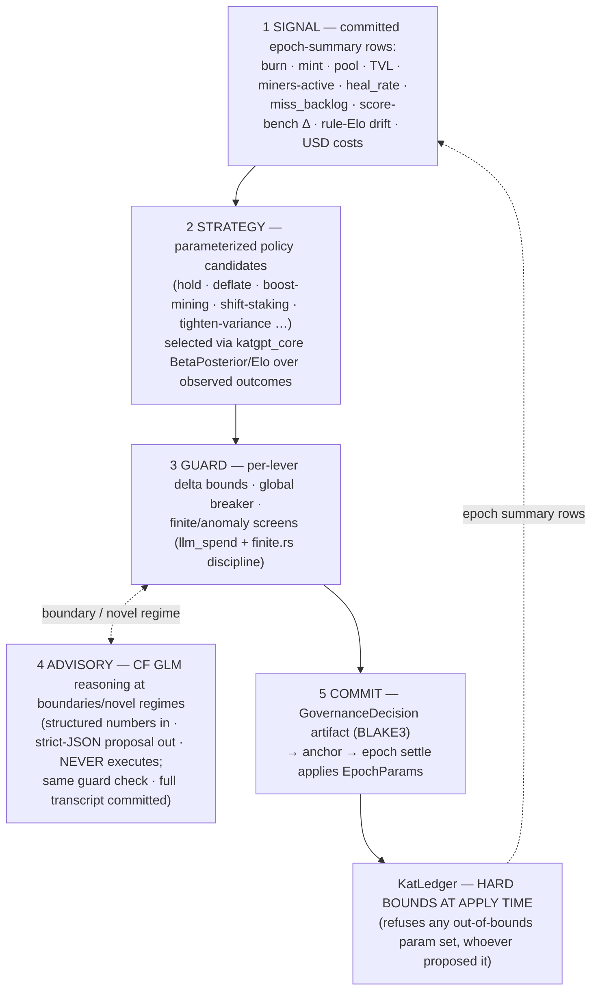

# Proposal 008 — Adaptive tokenomics: an autonomous, bounded governance agent for the KAT economy (new repo `riir-dao`)

Status: **draft** (filed 2026-08-27). The owner's ask: "a strategy that adjusts by our shallow AI self-heal to make tokenomics sustain and auto-live (think auto-DAO) — a tokenomics agent that gets the data from ruliology and reasons about it, inflate/deflate/burn/dilute, auto-prevent flash loan, circuit break, ask Cloudflare GLM to reason about the decision — think like game theory to keep miner dopamine and tokenomics stable." This proposal answers that ask with one load-bearing safety inversion: **the agent never holds the money levers — the ledger does. The agent proposes parameter sets inside hard bounds; `KatLedger` enforces the bounds AT APPLY TIME.** Amends [Proposal 005](005_kat_heal_service_network.md) T2.3's "parameters frozen at T2.3" → *initial values* frozen at T2.3, then versioned/bounded/agent-movable after the Phase 4 autonomy ramp. Creates the repo [`riir-dao`](../../riir-dao/) (name matches the sibling pattern; alternatives `riir-tokenomics`/`riir-econ` rejected — long/obscure).
Branch: `develop` (per global rule — no feature branches)
Owner: unassigned
Fusion of: Proposal 005 §Economics (the economy governed) × the riir-clippy self-heal selection math (`SelectionMode::BetaPosterior` + Elo — now public substrate in `katgpt_core::rating` + `beta_lcb_order_into`, Bench 675) × riir-dapps epoch-settle/anchor (`KatLedger`, the exact-once ring, Merkle anchors — the apply+audit seam) × riir-dapps `FairRoll` (commit-reveal variance — the dopamine lever) × `src/llm_spend.rs` USD-cap discipline (the cost breaker precedent) × RAI's reflexive PI controller (prior art — §References, our differentiators named in §Honest caveats #8)
Related: [Proposal 005](005_kat_heal_service_network.md), [Proposal 007](007_kat_usdc_staking.md) (the staking actuator), [riir-dapps Proposal 001](../../riir-dapps/.proposals/001_agreement_boundary_and_tiered_durability.md) (which lists tokenomics as out-of-scope for dapps — the boundary argument for this repo)

## TL;DR

The KAT economy's parameters (burn split, emission multiplier, mining decay, staking share, lease price, reward-variance profile) are frozen constants that nobody can tune without a release. Give them to an **autonomous agent in a new repo `riir-dao`**: every epoch it reads committed telemetry (ledger flows + heal-network health aggregates, including the ruliology-derived metrics), **selects a bounded parameter set modellessly** (BetaPosterior/Elo over strategy candidates — the same selection math that already ships in the healer's self-evolve loop, consumed from the public `katgpt-core` primitives), consults **Cloudflare GLM for reasoning at guard boundaries** (advisory-only, never executes — its proposals pass the same deterministic guard check), and commits a **BLAKE3-anchored decision artifact** (telemetry hash + strategy scores + guard trace + advisory transcript + chosen params) that epoch settle applies. **Flash-loan defense and circuit breakers are structural**: parameters move ≤ bounded deltas per epoch, decisions read epoch-aggregate (never spot) telemetry, staking weights snapshot a lockup-age before payout (007), and — decisive in v1 — **KAT is non-transferable: there is no KAT market to flash-loan from**. Miner retention is engineered as **variable-ratio reward variance via `FairRoll` commit-reveal** (EV-capped jackpots + streaks — the strongest known reinforcement schedule, honestly labeled as behavioral design). Everything is proven in a **deterministic simulator (defend-wrong PoC) BEFORE any autonomy**: agent vs frozen-constants baseline vs adversarial best-responder. If the agent can't beat frozen constants on the Pareto, it stays advisory-only — that verdict is a gate, not a hope.

## The problem this solves

Proposal 005's economics are three hardcoded constants (`POOL_NUM/POOL_DEN` 70/20/10, `InflationSchedule` params, `KatPack` prices) plus a T2.3 note to "freeze" tuned values. That has three failure modes:

1. **No response to shocks.** A demand spike starves miners (pool thin relative to activity); a demand dip over-pays them; an adversarial farming wave eats the pool for a quarter before a human notices. Every fix is a code release.
2. **Owner toil forever.** "Tune the tokenomics" becomes a recurring human task — exactly the class of work this stack keeps automating (self-evolve, sweepers, housekeeping).
3. **No telemetry loop exists at all.** The ledger has the numbers (burn, mint, pool, TVL after 007) and the heal network has the health metrics (heal rates, miss backlog, score-bench deltas, rule-Elo drift — the ruliology surface), but nothing computes epoch summaries or closes the loop from them to parameters.

What goes wrong without this proposal: the economy launches with constants that were right for a simulation and wrong for the world, and stays wrong.

## The proposed design

### The control loop (5 layers, one epoch cadence)

**The safety inversion (load-bearing, restated):** the agent is a *proposer*. The enforcement point is the ledger — `KatLedger` gains a versioned `kat:params:<epoch>` row written only through a signed governance intent, and **apply-time bounds checking**: an out-of-bounds parameter set is refused by the ledger regardless of who signed it. A compromised agent, a jailbroken advisor, or a bug can move the economy at most `Δmax` per lever per epoch. The agent's governance key is ops-held and rotatable (the mint-authority discipline, 005 T4.3).

### The levers (what moves, and what never does)

| Lever (user's word) | Parameter | Hard bounds (per epoch) | Mechanism |
|---|---|---|---|
| **inflate** | `emission_mult` r on `mint = r × Σ credited outcomes` | 0.5–2.0 ×, Δ ≤ 10% | more KAT per credited outcome (still burn-backed: mint ≤ 90% of burn, the existing 10∤B-remainder rule) |
| **deflate** | same r, downward | same | |
| **burn** | `true_burn_share` | 5–15%, Δ ≤ 2 pp | net supply cut vs re-mint |
| **dilute** | re-mint allocation: `mining_share`/`staking_share` of the 70% pool; `treasury_share` | mining 50–90%, staking 5–30%, treasury 15–25%, Δ ≤ 5 pp each | redistribution of the burn re-mint — **there is NO unbacked-mint lever**: post-registration supply discipline (005) means dilution only happens through the reward pool, and the agent structurally cannot print |
| (retention) | `reward_variance` table — jackpot (p, multiplier) pairs via `FairRoll` | EV ≤ base + ε (hard), max multiplier ≤ 10× | the dopamine actuator, §Miner dopamine |
| (pricing) | corpus-lease price (KAT) | bounds per 005 §KAT | the one demand-side price inside the loop |
| (decay) | mining `decay_factor` | 0.90–0.99, Δ ≤ 0.01 | early-vs-late miner balance |

**Never levers (frozen, by contract):** `max_supply` (chain-registered); the free grant; KAT↔USD pack prices (USD-side, operator-owned; the agent may *annotate* decisions with pricing observations, never set them); any USDC-out path; KAT transferability; the legal posture; the bounds themselves (changing a bound is an owner-reviewed ledger upgrade, not an agent action).

### 1 — Signal layer: ruliology telemetry, honestly sourced

New construction (named): the service plane computes **committed epoch-summary rows** (`kat:telemetry:<epoch>`, one durable write per epoch, BLAKE3-chained): ledger flows (burn, mint, pool paid/available, TVL, unstake queue) + heal-network health aggregates computed **server-side from synced data** — records synced, proven/rejected, miss-backlog by class, score-bench delta from accepted rules, rule-Elo movement (the ruliology surface: `TrajStore` Elo + `RuliologySearch` Pareto classes, aggregated). riir-dao consumes these rows as **data** — no cargo dep on riir-clippy (the 005 Issue-041 one-way rule, inherited). Decisions read **epoch aggregates only, never spot values** — TWAP-by-construction, the flash-loan oracle lesson without an oracle.

### 2 — Strategy layer: the shallow-AI self-heal, transplanted

Strategy candidates are small parameter-set generators ("hold", "shift 5pp pool → staking", "raise variance, cut base", …). Each epoch the agent picks via **`beta_lcb_order` / Elo `update_scored` over (strategy, observed-outcome) history** — the exact public primitives (`katgpt_core::rating`, Bench 675) the healer's `SelectionMode::BetaPosterior` uses. This is the owner's "adjust by our shallow AI self-heal", literally: the same selection math, rewarded on economy health instead of fix outcomes. **It is a selection mechanism, not an optimizer** — no convergence claim, and the simulator (G5) is the only evidence surface for whether it works.

### 3 — Guard layer (agent-side half)

- **Per-lever delta bounds** (the EIP-7265 doctrine: bound the change, not just the halt).
- **Global breaker:** any non-finite or implausible telemetry value → **freeze to last-good committed params**, zero movement, loud row (the `finite.rs` screen + `llm_spend` cap discipline: checked before the move, terminal for the epoch).
- **Novelty gate:** telemetry vector far (cosine distance) from the historical epoch cloud → advisory path + reduced delta budget (half bounds) — unknown regime, cautious steps.

### 4 — Advisory layer: GLM on Workers AI, reasoning without authority

- Designated model: **GLM** (owner directive 2026-08-27; the Workers-AI GLM catalog id — e.g. `@cf/zai-org/glm-4.7`-class — is config, **verified by the standing one-call smoke at first use**; the 005 model-pivot discipline applies: a model change without a re-smoke is the 7.8k-neuron incident class).
- Triggered on: guard-boundary proposals (delta at a bound), novel regimes (signal-layer gate), and a configurable every-Nth-epoch "explain yourself" audit mode.
- Contract: **structured numbers in, strict-JSON parameter proposal out** — no free text crosses into the prompt except committed enum labels; the output re-enters the SAME guard check; the modelless selector still owns the decision (GLM ranks/annotates; the deterministic layer decides). **The advisor can veto nothing and approve nothing — it can only propose within bounds, and the transcript is committed for audit.**
- Cost: per-neuron pricing inside a `llm_spend`-shaped USD daily cap, reimplemented repo-locally under the same discipline (reserve-then-reconcile). Advisory unavailability is the **fast path** — decisions proceed modellessly, never block on the LLM.

### 5 — Commit: proof-of-AI-work

Each decision artifact = `{telemetry_root, strategy_scores, guard_trace, advisory_transcript?, chosen_params, prev_params_root}` → BLAKE3 → anchored at epoch settle (the existing anchor machinery). **The trail IS the proof-of-AI-work**: deterministic replay (same telemetry + strategy state → bit-identical artifact — G1) lets any staker/auditor verify the governance work the agent claims its stipend for. The agent's operating budget: a capped, decayed governance stipend from the treasury share — payment for auditable governance work, not profit participation.

### Miner dopamine (the game-theory half)

- **Variable-ratio jackpots at claim time** via `FairRoll` commit-reveal (the shipped dapps service — unmanipulable randomness, neither miner nor operator steers the roll): e.g. `{90% ×1 · 9% ×2 · 1% ×10}` with **EV pinned ≤ base + ε by construction** — the agent may reshape *variance*, never expected emission.
- **Streak bonuses:** consecutive-epoch activity multiplier, decaying (loss-aversion framing, bounded, capped).
- **First-discoverer ×3** (005, unchanged) — the "come early" schedule.
- The behavioral design is **on the label**: retention mechanics are named as such in the docs, variance is capped (no unbounded jackpots), and G7 reports expected AND realized emission so variance never hides supply movement.

### The simulator (defend-wrong PoC — autonomy's precondition)

Deterministic sandbox in riir-dao (`sim/`, seeded — `FairRng::from_combined_seed` as the actor RNG, zero new deps): synthetic economy of healers/miners/stakers/demand-shocks + **adversarial best-responders** (sybil farms, flash-stake churn, grinding loops). Three arms head-to-head, ≥ 10⁴ epochs, seeded grid:

1. **adaptive agent** (full loop),
2. **frozen constants** (005 T2.3's params — the baseline),
3. **adversary vs adaptive** (breaker/damage accounting).

Metrics: burn/mint convergence, pool-overdraw events, miner retention (returning miners/epoch), TVL stability, incentive leakage to adversaries, USD invariant (005 G7, unchanged and still pass/fail). **Pass = Pareto-better than frozen on ≥1 axis while worse on none, AND adversarial damage ≤ bound with breaker trips.** Fail → the agent stays advisory-only (Phase 2 terminal state) — the defend-wrong discipline: the PoC defends OR refutes, and a refutation is a recorded outcome, not a re-roll.

### The autonomy ramp (never skip a step)

1. **Advisory mode** — artifacts + alerts only; operator applies params by hand.
2. **Guard-bounded auto** — in-bounds moves apply at epoch settle automatically; owner gets a review window (revert path) each N epochs.
3. **Steady state** — review windows lengthen with clean history. **There is no step 4**: out-of-bounds autonomy does not exist in this design.

### Repo: `riir-dao` (created with this proposal)

| | |
|---|---|
| **Domain test** | Is this autonomous tokenomics governance (signal → bounded strategy selection → guard → advisory → commit) over the KAT economy? Not settlement composition (dapps), not a client tool (clippy), not agreement (chain). |
| **Allowlist** | `riir-dapps` (kat ledger surface: telemetry rows + governance-intent seam), `katgpt-core` (public `rating`/beta primitives). **NO riir-clippy dep** (telemetry crosses as committed data), no game crates. |
| **Direction** | `riir-dao → riir-dapps → riir-chain` — the one-way graph extended by one node; `direction_gate`-class check ships with the scaffold. |
| **Deployment** | A CF Worker cron per epoch decision (the `riir-kat-housekeeping` precedent — milliseconds, $0); the simulator runs in CI, not prod. |

## Honest caveats — READ BEFORE IMPLEMENTING (MANDATORY)

1. **Goodhart is undefeated.** Every metric in the objective is gameable; the guards bound the damage per epoch, they do not eliminate gaming. The simulator's adversary arm exists because adversaries WILL probe the levers; the honest defense is bounded blast radius + committed trails, not a clean metric.
2. **Reflexivity — the controller sits inside the economy it controls.** Second-order effects (stakers front-running parameter moves, miners gaming retention streaks) are real. RAI's surviving lesson is *slow, bounded, committed moves* — hence per-epoch deltas, epoch-aggregate signals, and the weekly-effective decision cadence. RAI's dead predecessors (unbounded feedback AMMs) are the cautionary family; we are not a stablecoin and not pegging anything, but the loop-hazard class is the same.
3. **Prompt-injection surface is real but narrow.** Telemetry derives from user data; an adversary shaping aggregate telemetry to steer the agent is a novel attack class. Mitigations: numbers-only prompts (no free text crosses except committed enum labels), strict-JSON output schema, guard re-check on everything, committed transcripts. Residual: telemetry *shaping* (inflating sync counts to look healthy) — bounded by delta caps and named as a standing measurement item.
4. **The simulator is not the economy.** Parameters that win in sim may fail live (overfit). The ramp exists for exactly this; Phase 2's review windows are not ceremony.
5. **"Auto-DAO" honesty — v1 is an autonomous agent, not decentralized governance.** The agent is our Worker, keys are ours, stakers hold economic positions but **no vote** (stake-weight feeds telemetry, not control; Proposal 007 explicitly out-of-scopes voting). User-facing copy says "autonomous bounded policy engine", not "decentralized". The DAO half arrives only if/when governance rights are designed as their own proposal.
6. **The GLM model id is unverified** until the first one-call smoke; a wrong id is a loud failure, a silent schema mismatch is the 7.8k-neuron class. The 005 smoke rule is inherited verbatim.
7. **Agent bugs move money parameters.** The ledger-side apply-time bounds are the last line of defense, and the breaker's safe state is *frozen at last-good* — but a persistent subtle bias (not a crash) is only caught by the audit trail. The every-Nth-epoch advisory "explain yourself" mode doubles as the drift detector.
8. **Prior-art honesty (the invention claim, precisely stated).** Control-theoretic tokenomics is **not ours**: Reflexer's RAI runs a PI controller on its redemption rate (2020–), and arXiv:2210.12881 models infrastructure token economies as control systems. AI-agents-in-DAOs is an active literature. What THIS design claims as its own: (a) the controller operates over a **service-burn utility economy** (demand = real healing work, not a peg), (b) strategy selection is **modelless self-heal machinery** (BetaPosterior/Elo over policies) with the LLM strictly advisory-under-guards — the inverse of the LLM-agent-runs-the-DAO pattern in the literature, and the exact fixer pre-pass→LLM→verify shape applied to economics, (c) **ledger-side apply-time bounds** as the enforcement point (agent-proposes/ledger-enforces), and (d) commit-reveal **EV-capped variance shaping** as a governed retention lever. If any of these exists published, this proposal downgrades on discovery — the §4 search duty of the research skill applies at plan time.

## Fusion lineage

1. **[Proposal 005](005_kat_heal_service_network.md) §Economics** — the governed object; its G7 USD invariant and mint anchor are inherited unchanged (the agent moves parameters, never the invariants).
2. **riir-clippy self-evolve selection math → `katgpt_core::rating`/`beta_lcb_order_into`** — the strategy selector, consumed from the public crate (Bench 675's promotion made this fusion possible without a client-tool dep).
3. **riir-dapps `KatLedger` epoch settle + anchors + `FairRoll`** — apply seam, audit trail, and the variance lever, all shipped.
4. **`src/llm_spend.rs` (riir-clippy Issue 046)** — the reserve-then-reconcile cost breaker the advisory layer copies repo-locally.
5. **[Proposal 007](007_kat_usdc_staking.md)** — the staking actuator + the snapshot/lockup flash-loan defense the agent relies on.

## GOAT gate

- **G1 (determinism):** same telemetry rows + same strategy state → **bit-identical decision artifact** across 3 runs (the G9 meter discipline applied to governance). Replay-from-anchored-history reconstructs every past parameter set exactly.
- **G2 (cost):** modelless core < 1 s per epoch decision, alloc-bounded; advisory within the USD daily cap (reserve-then-reconcile ledger rows); Worker cron shape (no always-on compute).
- **G3 (no-regression):** with `kat_governance` off, `KatLedger` is bit-identical to 005 behavior (defaults = frozen constants); riir-clippy default binary untouched.
- **G4 (alloc/typing):** all money params integer-bp/u64; no float in any parameter path (render-only f32 for display).
- **G5 (simulator — the load-bearing gate):** adaptive vs frozen vs adversary per §The simulator, ≥10⁴ epochs, seeded grid, results committed to `.benchmarks/` with the sensitivity table. **Fail ⇒ no autonomy (advisory-only terminal).**
- **G6 (bounds at apply):** negative tests — every lever at bound+1 (and every bound-exceeding advisory proposal) **rejected by `KatLedger` itself**, whoever signs; a forged/stale governance intent refused.
- **G7 (breaker):** injected non-finite/implausible telemetry → frozen-at-last-good, zero movement, alert row; advisory outage → modelless fast path, no blocked epoch.
- **G8 (adversarial):** simulator adversaries (sybil farm, flash-stake churn, streak-grinding) cause damage ≤ the documented bound; every attempted exploit trips either ledger bounds or the breaker; the 007 G8-S fixtures hold under agent-moved parameters.

## What ships now vs deferred

### Ships now (per phase below)
- **riir-dao** scaffold (this proposal creates it): AGENTS/BOUNDARY/numbering, `direction_gate`-class check, CI skeleton.
- riir-dapps: `EpochParams` row + apply-time bounds + signed governance-intent path (feature `kat_governance`); epoch-summary telemetry rows (feature `kat_telemetry`).
- riir-dao: signals/strategies/guards/decision core; simulator; advisory transport; audit CLI (`riir-dao-log`-style reader — plan names it).

### Deferred — gated
- Autonomy ramp steps 2–3 (each gated on the prior step's clean history + G5).
- Staker governance rights / voting (separate proposal if ever; explicitly not v1).
- Any KAT-market-dependent levers (no market exists v1 — and that is itself a defense).

### Explicitly NOT shipped by this proposal
- LLM execution authority of ANY kind (advisory under guards, permanently).
- Unbacked mint / supply-cap changes / transferability / USDC-out (never-lever list is contract).
- Game-economy governance (this is the KAT service economy only; game economies stay on their own substrates).

## Phased rollout (sketch — a plan would expand this)

### Phase 0 — the seam (no agent yet)
- [ ] T0.1 riir-dao scaffold (repo, boundary gate, numbering, CI skeleton)
- [ ] T0.2 riir-dapps `EpochParams` versioned row + apply-time bounds + governance-intent signature path (`kat_governance`, default-off; G6 negative tests)
- [ ] T0.3 Epoch-summary telemetry rows (`kat_telemetry`) — ledger flows + heal-health aggregates, BLAKE3-chained

### Phase 1 — modelless agent + simulator (defend-wrong BEFORE autonomy)
- [ ] T1.1 Signal layer over telemetry rows (finite/anomaly screens)
- [ ] T1.2 Strategy candidates + `katgpt_core` BetaPosterior/Elo selection
- [ ] T1.3 Guard layer (delta bounds, breaker, novelty gate)
- [ ] T1.4 The simulator + G5 campaign — **the go/no-go evidence for everything after**

### Phase 2 — advisory + proof-of-AI-work
- [ ] T2.1 GLM advisory transport (structured in / strict-JSON out / guard re-check / transcript commit; one-call smoke; USD cap)
- [ ] T2.2 Decision artifacts + anchoring + determinism gate (G1) + audit CLI
- [ ] T2.3 Advisory-mode soak (operator applies by hand; N epochs clean)

### Phase 3 — dopamine levers (gated on G5 evidence)
- [ ] T3.1 `FairRoll` jackpot table as a governed lever (EV-capped by construction — tested)
- [ ] T3.2 Streak bonuses (bounded, capped; retention metric wired into signals)

### Phase 4 — autonomy ramp
- [ ] T4.1 Guard-bounded auto at epoch settle (owner review windows + revert path)
- [ ] T4.2 Steady-state cadence + drift detector (every-Nth-epoch advisory audit)

## Risks

1. **Goodhart/reflexivity (highest, permanent):** bounded, slow, committed, adversarially tested — never "solved"; the never-lever contract and ledger bounds cap the blast radius.
2. **Regulatory:** the agent moving burn/staking parameters adjacent to Proposal 007's counsel surface — the 007 counsel gate covers parameter *ranges* too; bounds are set inside the counseled envelope.
3. **Agent-key compromise:** bounded by ledger-side apply-time bounds + breaker + rotation; worst case is bounded mispricing for ≤ the review window, not fund loss.
4. **LLM cost drift:** capped daily, reserve-then-reconciled, advisory-optional (fast path is modelless).
5. **Architectural:** a new repo whose failure mode is dep drift toward riir-clippy/game crates — `direction_gate`-class check in CI from day one; telemetry crosses as data (the Issue-041 rule generalized).

## Out of scope

- Stablecoin/peg logic of any kind (RAI is cited prior art, not a template).
- KAT market making, DEX, oracles (no KAT market exists v1; when transferability is ever counseled, that is a new proposal with new defenses).
- Multi-token governance (other `riir-*` services adopt the pattern later, own proposals).
- The game-plane economy (FAME/karma stay on their substrates).

## References

### In-house (substrates this composes — grep-verified 2026-08-27)
1. [`riir-dapps/src/kat/ledger.rs`](../../riir-dapps/src/kat/ledger.rs) + `compose.rs` — epoch settle, the `POOL_NUM`/`TREASURY_NUM` split constants (the first levers), anchors, exact-once queue.
2. `katgpt_core::rating` (`expected_f32`/`update_f32`/`update_scored`, Bench 675) + `beta_lcb_order_into` (Plan 576) — the strategy-selection primitives, public.
3. [riir-clippy `self_evolve` / `SelectionMode::BetaPosterior`](../src/self_evolve.rs) — the selection *pattern* this transplants (code-level dep: none, by design).
4. [riir-dapps `service::fair_roll`](../../riir-dapps/src/service/fair_roll.rs) — commit-reveal variance (the jackpot lever).
5. [riir-clippy `src/llm_spend.rs`](../src/llm_spend.rs) (Issue 046) — reserve-then-reconcile USD cap discipline.
6. `riir-clippy/src/ruliology_search.rs` + `TrajStore` Elo — the ruliology surface whose server-side aggregates feed signals.
7. [Proposal 007](007_kat_usdc_staking.md) — staking actuator, snapshot/lockup defense, G8-S fixtures.

### External (cited-only)
8. **Reflexer Labs / RAI** — the canonical control-theoretic tokenomics: a PI controller adjusts the redemption rate from the market/redemption-price error (Reflexer "Summoning the Money God"; Dankrad Feist's RAI write-up). Prior art for closed-loop token economics; our differentiators in caveat #8.
9. **arXiv:2210.12881** — *A Control Theoretic Approach to Infrastructure-Centric Blockchain Token Economies*: infrastructure token economies as dynamical systems with continual supplier incentives — the closest academic framing of what KAT is.
10. **Beanstalk governance attack post-mortems** (Veridise et al., 2023) — snapshot-before-payout as the flash-loan defense; generalized here by epoch-aggregate signals + 007's lockup-age rule.
11. **EIP-7265 (Circuit Breaker Standard)** — bounded-outflow doctrine; our per-lever delta bounds + per-day caps follow it.
12. **DAO-AI (arXiv:2510.21117)** + the autonomous-treasury-agent literature — agentic AI producing interpretable, auditable collective decisions; our inversion: the agent proposes, deterministic guards dispose.

## TL;DR

**Ship it phased, simulator-first — the agent earns autonomy by beating frozen constants in the sandbox, never by default.** The architecture is one sentence: *modelless strategy selection (the shipped self-heal math) proposes bounded parameter sets from committed telemetry; GLM reasons at the boundaries without authority; the ledger enforces the bounds at apply time; every decision is a BLAKE3-anchored artifact that replays bit-identically — that trail is the proof-of-AI-work.* Next action: scaffold `riir-dao` (done with this proposal) → open the Phase 0 plan (T0.1–T0.3) once 005 T1.x is stable.
