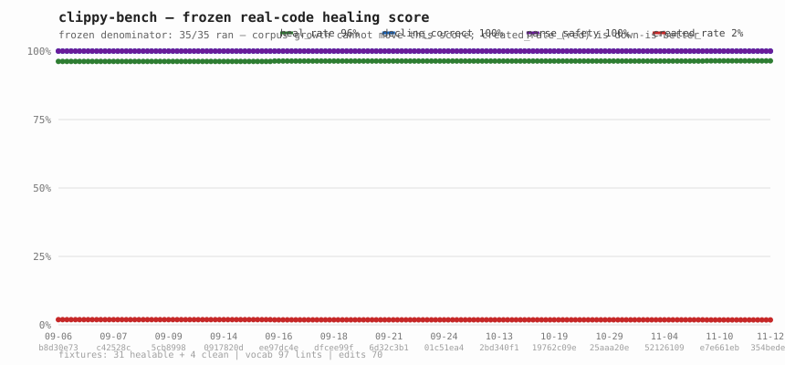

# riir-refine

> **Boundary contract:** [BOUNDARY.md](BOUNDARY.md) — what lives here, what may depend on it, known drift.

**The code fixer that learns** — a multi-domain modelless framework behind the
`HealDomain` trait that distills code rules into a ruliology-style search
space, drafts fixes via a modelless ternary SIMD matvec, and validates with a
`syn`-based syntax pruner. The shipped domain set (Plan 001 + Plans 018/030/019/085):

| Domain | Feature | Status | Corpus |
|---|---|---|---|
| **clippy_lints** (default) | `clippy_lints` | ✅ Production | 100 corpus lints (Batch 191 2026-09-30: +mem_replace_with_default FIXABLE [`std::mem::replace(dst, Default::default())` → `std::mem::take(dst)` — STD DEFINITION IDENTITY, `take` IS `replace(dest, T::default())`; the two qualified spellings only, the `mem::` form behind the legacy_numeric_constants whole-file shadow-guard; bare `replace(..)` refuses — the SAFER-than-clippy import-ambiguity class; style/default-on — Plan 188, the coverage-report pack XVIII; two gate catches en route: the lint_level driver-match refusal of my perf-group read + the freeze e2e's latent-E0308 in the corpus atom, both fixed at source] — the coverage-report re-arm; Batch 161 2026-09-18: +unit_arg FIXABLE [the syntactic-unit-typeness hoist — a block with no tail expr is `()` by the language definition; hoist + pass `()` is value/order-identical by construction, clippy's own suggestion shape; complexity/default-on — Plan 152, the fifth all-FIXABLE pack] +string_lit_as_bytes FIXABLE [`"abc".as_bytes()` → `b"abc"` — coercion identity; NURSERY group (the plan152 default-groups arm correcting the stale "default-level perf" comment); the `\u{` escape refused — clippy's own suggestion there is invalid Rust] — the frontier-lead pack VII, Plan 152; Batch 160 2026-09-18: +from_str_radix_10 FIXABLE [the construction-identity parse rewrite — std's int `FromStr` IS radix-10 `from_str_radix`, so `u32::from_str_radix(s,10)` → `s.parse::<u32>()` is resolution-identical, NO shadow guard — Plan 151, the fourth all-FIXABLE pack] +assign_op_pattern FIXABLE [the exactly-once-binding derivation compound-assign rewrite — params/annotated-lets/init-transfer/suffixed-literal legs; the swapped-operand arm probe-measured commutative-only (`y = 1 + y` fires, `y = 1 - y` silent)] — the frontier-lead pack VI, Plan 151; Batch 159 2026-09-18: +single_char_add_str FIXABLE [the `mut_string_param_heads_over` mutable-String derivation twin — `String`/`&mut String` params, VALUE-based single-char arg + `escape_default` emit] +manual_clamp FIXABLE [the lattice-absorption clamp rewrite, ints+char only — FLOATS refuse on the NaN max/min-vs-clamp divergence, inverted bounds refuse on clamp's release-mode assert — Plan 150, the third all-FIXABLE pack]; Batch 158: +to_string_in_format_args FIXABLE [perf-group, default-on — pinned by the plan149 default-groups probe; the signature-derivation Display-blanket scalar receiver + the bare-{} placeholder guard, composing with uninlined_format_args by design] +manual_range_contains FIXABLE [the contains rewrite closed by the same scalar derivation + literal bounds — Plan 149]; Batch 157 2026-09-18: +redundant_closure_for_method_calls FIXABLE [the signature-proven `v.iter().map(|s| s.len())` → `v.iter().map(String::len)` — the element type derived from the fn signature + a construction-identity whitelist, String/Vec/HashMap/HashSet × len/is_empty/capacity] +iter_skip_next FIXABLE [the two-arm rule: proven slice receivers heal `.get(n)`, the oracle-clean inverse one step better than clippy's own `.nth(n)`; every other receiver → `.nth(n)`, identical for all iterators] — the frontier-lead pack III, Plan 148; Batch 156: +io_other_error FIXABLE [the `Error::other` splice, inference-identical, legacy_numeric_constants shadow-guard pattern] +wrong_self_convention VERIFY [the `into_*(&self)`→`self` receiver flip, no-vis inherent-impl v1 scope] — the frontier-lead pack II, Plan 147; Batch 155: +let_and_return/+redundant_slicing/+map_flatten FIXABLE +ptr_arg VERIFY — the frontier-lead pack, Plan 146; Issue 120 2026-09-16: +doc_markdown FIXABLE — the pedantic doc-lint family's every-landing manual backtick pass, a faithful port of clippy's own word predicates over syn `#[doc]` attrs + the P21 oracle lane consuming clippy's spans verbatim; P14 2026-09-14: +unnecessary_map_or FIXABLE — the born-lint closure, `map_or(false,f)` → `is_some_and`/`is_none_or`/`is_ok_and` on receivers PROVEN by the shared `receiver_kind` substrate + the safe-let extension; Batch 91, the P9 clippy-1.98 batch: +byte_char_slices FIXABLE, +manual_slice_fill FIXABLE, +manual_checked_ops VERIFY, +chunks_exact_to_as_chunks VERIFY [MSRV floor: std 1.88]; Batch 90: +items_after_statements FIXABLE, +manual_let_else FIXABLE; option_if_let_else REFUTED per `.plans/051` — fixpoint ping-pong with single_match_else; Batch 89: +use_self FIXABLE, +suboptimal_flops VERIFY; missing_const_for_fn KILLED per `.plans/050`); 81 --fix eligible + 16 --verify + 3 self_evolve-only |
| **rust_perf** (default since 2026-08-13) | `rust_perf` | ✅ Phase 2 (GOAT G1+G5 PASS, Bench 013 promotion + Bench 015 finalization + Bench 016 Issue 012 + Bench 017 Issue 014 + Bench 020 Issue 014) | 183 rules (Batch 207, 2026-10-07, Plan 207 — the 10-07 staged leads' rust_perf half: `per-scope-map-scan-hash-crossover` (complexity — a scope-keyed lookup table scanned linearly on every lookup AND insert is quadratic in a region's operations; hash per scope makes it linear; the MEASURED 15% small-scope negative flips it into the hybrid: inline-scan the first eight entries without allocating, hash past them — `INLINE_ENTRIES = 8`; the key-type law: hash everything but the attribute field that has no Hash, Eq keeps the distinction; source tracel-ai/cubecl #1767 @ `d307dd46`) + `inline-hint-not-through-unmarked-wrapper` (dispatch — an `#[inline(always)]` hint does not propagate through an unmarked wrapper; the #25200 wrapper refactor silently stopped the inlining and cost +30–90 µs on every benchmark row, four-row laptop table in-commit; mark every wrapper in a marked hot chain and audit the attributes when a refactor adds indirection — only the benchmark saw it; source bevyengine/bevy #26040 @ `1ba0c9f9`); both NotBenchable annotated (127 → 129); Batch 204, 2026-10-07, Plan 204 — the PrismML NEON PQ2_0 vec_dot rule: `neon-tbl-replicate-2bit-codec-sdot-block-rescale` (simd, the corpus's first NEON decode/codec member — tbl-replicate the packed bytes, in-lane shift/mask/sub, sdot int32 sub-block accumulation, one block-scale rescale; regime = integer-capable consumers, anti-regime = float-domain outputs where NEON's missing gather forces the scalar-extraction path; NotBenchable on the x86_64 host box, M3-Max GOAT staged with the B62 naive-codec-reference law; source PrismML-Eng/llama.cpp #265 @ `6bfcd79a`) + 3 kernel_opt riders (B116-addendum ISA boundary, B127 CPU-NEON instance, B103-addendum pairing-migration orphan); the row previously read 181 (Batch 204), 179 (Batch 200, 2026-10-03, Plan 198 — the TensorFold v0.6.0 staged pool's SERVING HALF: 11 NotBenchable annotated serving-stack decision rules — prefix-cache-entry-one-token-early (resume needs a strictly shorter prefix, one-token-early keep + mid-chunk state cut), dual-reduction-shared-butterfly-ladder (two lane-sums ride one xor butterfly pass), idle-rank-doorbell-on-rendezvous-store (idle rank blocks on the rendezvous store NCCL already holds), prompt-item-per-consumer-kernel-measured (64 vs 16 pairs/item both measured, plan buffer at the narrowest consumer), concurrent-round-parity-solo-equal (parity as a 3-leg construction), lone-stream-graph-replay-mode-switch (execution mode keyed on live population), snapshot-then-release-shared-drafter-context, graph-pool-handle-fresh-per-generation, spec-copy-window-aimd-ramp-alone-gated (AIMD reset — the staged "halves" corrected), one-shot-staging-release-to-system, madvise-random-for-key-gather-tables; source `ashhart/tensorfold` @ `c4646171`, Apache-2.0 — license flipped MIT→Apache-2.0 at 0.6.0; ~10 staging drifts disclosed); Batch 198 +1 (the PrismML #284 selector-lattice beam, NotBenchable annotated); Batch 196, 2026-10-02, Plan 195 — the TensorFold v0.6.0 A− serving/host pair: the grammar-window draft prune (a grammar-constrained reply walks the drafted verify tree DFS before the verify forward, drops every draft no accepted path can hold, masks the rest — row-locality is the exactness law) + the startup-estimate-derived-from-allocation-shapes host-accounting rule (every capacity term from the allocator's own allocation shapes + a fake-allocator reconciliation at real shapes; sub-arms: NVFP4-widening estimator blindness + the --checkpoint-slots knob counted and refused pre-download); both NotBenchable annotated; source `ashhart/tensorfold` @ `c4646171`, Apache-2.0 — license flipped MIT→Apache-2.0 at 0.6.0. The row previously read 163 (through Batch 182) — it had gone stale: B186's +2 and B181's +2 never landed here (repaired at Batch 196 with the honest label); Batch 182, the mlxfast-bonsai2 DELTA distill — 3 NotBenchable annotated rules: the host-mirror shared-scalar one-time-verdict dispatch rule, the prompt-continuation draft override with the measured 16-token floor, the whole-round in-situ adoption trial (measurement-honesty ADOPTION member); Batch 181, the mlxfast-bonsai2 arena distill — 2 NotBenchable suggestion-only rules (the write-vectored capability flag (tokio 1.50 write_buf gates on is_write_vectored; PR #7871), the oneshot response-send unwrap-panic, the bounded-channel-cycle deadlock) + 4 annotation folds (spawn_blocking sharded-queue revert, LIFO-steal revert, socket-option family movement, coop API); Batch 153, the async-blocking distill — 3 NotBenchable suggestion-only rules extending the tokio family: the blocking-sleep async twin (the canonical blocking bug), the rayon oneshot bridge (the first tokio×rayon boundary rule), the TCP_NODELAY request-response io rule + 5 annotation folds (pool-choice anti-regime, 10–100 µs boundary, 128-op budget note, mini-redis accept-loop cite, io_uring buffer-group twin); Batch 152, the dial9 tokio-principles distill — 3 NotBenchable suggestion-only concurrency rules seeding the world-facing tokio family: the blocking-pool segment hoist, the adaptive consecutive-ready yield, the semaphore fan-out bound; Batch 147's agave distill + Batch 145's MTPLX mincore-routing host rule + Batch 143's nnethercote Dec-2025 rustc-perf distill: a MEASURED benchable log-gate rule + a NotBenchable-annotated macro-emission build-time rule; B141's three NotBenchable-annotated agent-context rules — measured compaction reserve, semantic truncation boundaries, pattern-bounded stream holdback; B139's prefault-admission io rule + B136's three NotBenchable-annotated concurrency rules + B135's three MEASURED benchable Wild-linker rules + the B118–B129 io distills all annotated — see `.docs/11_domains/rust_perf.md` for the per-batch ledger) from `rust-optimize` skill + nnethercote/perf-book + rustc-hash/bevy patterns + the hotpath-rs profiling guide + measured-GOAT/external distills (complexity/allocation/layout/concurrency/simd/arithmetic/iterators/dispatch/caching/io/bevy/wasm); 129 carry `context_notes` (verdict-class + regime caveats + metric-mismatch; re-pinned at Batch 207 — +2 the scope-map crossover (the measured-negative second arm + the attribute-less Hash key clause) + the wrapper rule (the audit discipline + the LLM-disclosure provenance note); was 127 at Batch 204). Bench 020 added the deterministic alloc-count axis (exact integers, stable across repeat runs) |
| **kernel_opt** (opt-in) | `kernel_opt` | ✅ Phase 3 + Batch 1-208 corpus | 776 rules (re-pinned at Batch 208 — the 10-07 staged leads: llama.cpp #30100 fusion-residual-identity + #29171 MLA FA exact-shape admission + #29928 headless-draft crop, all D; was 773 at Batch 207 — cubecl #1777 minifloat decode + #1751 profile-window drain; was 771 at Batch 206 — llama.cpp #29442 conversion-chunking + #28782 per-thread-stream memset; was 769 at Batch 205, 761 at Batch 203; popcorn Research 002-007; riir-gpu file-mining Batches 14-63 COMPLETE; measured-GOAT distills B49+; external distills incl. ktransformers/omlx/PrismML/mlx-lm/llama.cpp/ds4/uzu/lily/MTPLX/vLLM/qwen38-mtp/ds4-PR991/low-latency-nccl/ds4-rebase-surge/PrismML-CUDA-MMQ/PrismML-Metal-FA/ds4-Qwen-Q2/ds4-PR5/cloudrift-Emmy ×4 + the B878-884 self-distill ×5 + the B145 Metal-shape pack (EFQ + MTPLX split-K); per-batch ledger in `.docs/11_domains/kernel_opt.md`) — the Plan-001 "~300-500 rules in ~15-25 batches" projection long since exceeded |
| **sec** (opt-in) | `sec` | ✅ Phase 0+1+2 + Batch 131 + Batch 140 + Batch 165 (Bench 046; Phase 2 Batch 88; P8 intake Plan 057; InputValidation pair Plan 112; advisory-db distill Plan 120; wire-arithmetic overflow sink Plan 156) | 16 rules — FFI panic containment, Drop-glue panic safety, ptr-null hygiene, `from_raw_parts` len-zero, Rc backedges + the Phase-2 unsafe-impl/ffi-export/crypto trio + `nan-unsafe-sort-comparator` (PanicSafety) + the Batch-131 `InputValidation` pair (`length-prefix-validate-before-alloc` + `secret-file-create-without-0600`, Girder distill) + the Batch-140 `unbounded-read-into-vec` (rustsec/advisory-db distill, RUSTSEC-2024-0003 / CVE-2019-9514 class) + the Batch-165 `unchecked-wire-arithmetic` (the overflow sink on the shared `wire_taint` walker; Kani g2c/g2d property pair) — ALL InputValidation rules suggest-only; 6 fixable proposers + 4 suggest-only detectors + the real-clippy boundary gate (Plan 018 / Proposal 004) |
| **docker** (default since 2026-08-28) | `docker` | ✅ Phase 0+1+2 (Plan 030) | 31 rules (14 Class-A hadolint overlays + 17 novel cache/PID1/platform/base detections), 14 with bounded fixes; the first non-`syn` domain (stanza scanner) and the first with an external-binary oracle (`docker_verify` → hadolint, plus the Tier-2 `docker_buildcheck` → `docker build --check`). Zero-fixable-finding negative controls on two in-tree production Dockerfiles; G5-real `docker build` green |
| **dist** (default since 2026-09-13) | `dist` | ✅ Phase 1 + B1/B2 (Issue 085; Bench 082 + §6 addendum) | 5 suggest-only rules over name-matched `Cargo.toml` manifests — release-profile size knobs (strip / `[profile.dist]` size profile / panic-abort) for crates that ship a binary + the workspace-member profile trap + the Batch-143 `-Zhint-mostly-unused` large-API-dependency hint. Measured provenance: 11,903,168 → 4,546,448 bytes (−61%) on this tool itself. Second no-`syn` scanner (zero new deps); never edits `[profile.release]` (the `refuses()` table pins it) |
| **shader_perf** (opt-in) | `shader_perf` | ✅ Phase 0+1 (Plan 134 / Proposal 014) | 8 WGSL render-pipeline rules (`@vertex`/`@fragment`; `@compute` stays `kernel_opt`) — 1 bounded (the `unbounded-render-loop-guard` proposer, Tier-0-invariant-checked) + explicit-LOD two-regime + branch-divergent decision + const-fold + 3 Class B annotations + 1 corpus-only. Third no-`syn` scanner (no regex); `shader_verify` = in-process naga (already in the lock — zero new packages); negative control pins ZERO findings on the 190-file riir-shader vgpu port corpus. Consumers: the upcoming shader-toy editor's submit/save gate + the riir-dapps Proposal 002 Stage-2 mint gate |

Heavyweight LoRA is the last-resort fallback, not the co-equal path. Plan 005
(2026-08-14) added the **latent suggest layer** — `cargo refine --suggest`
retrieves ranked corpus rules for real code spans (GOAT G1–G4 PASS, Bench 018;
`--fix` CLI wiring is Phase 6 — the Phase 4 rust_perf proposers landed as
library code).

> **Distribution (binding, [Proposal 003](.proposals/003_binary_only_distribution.md)):**
> this source is **private forever** (Research 003: anything `riir-*` is
> internal). The public gets prebuilt `cargo-refine` binaries only, via GitHub
> Releases on a small source-free dist repo (`brew tap`, `curl | sh`,
> `install.ps1`, scoop). No crates.io, no source mirrors — `publish = false`
> is enforced in `Cargo.toml`.

## Status

**POC — multi-domain framework (Plan 001) + Phase 0 (rule distillation) +
L1 (drafter) + L2 (syntax validator) + additive self-evolution loop done.**

The clippy-healing pipeline that distills clippy rules into a ruliology-style
search space, drafts fixes via a modelless ternary SIMD matvec, and validates
with a `syn`-based syntax pruner. Heavyweight LoRA is the last-resort
fallback, not the co-equal path. Plan 001 generalized the framework to be
domain-pluggable behind the `HealDomain` trait.

| Layer | Status |
|---|---|
| L0 — Corpus (rule distillation) | ✅ Done (BLAKE3-committed freeze/thaw + seed corpus with 10 common lints + 46 perf rules + 2 kernel rules) |
| L1 — Ternary SIMD drafter | ✅ Done (Issue 001, zero-alloc matvec, p50=2.3µs) — ⚠️ **corpus-resident lints only**, see Issue 010 |
| L2 — Syntax validator | ✅ Done (Issue 002, `syn`-based parse check, p50=6.8µs) |
| L2 — Lint resolution check (clippy) | ✅ Done (Issue 003, `clippy_verify` feature, real `cargo clippy` JSON parsing, ~130ms/verify) |
| L2 — Test pass check (rust_perf) | ✅ Done (Plan 001 Phase 2, `rust_perf_verify` feature, real `cargo test` + compile-error detection via exit status + JSON parsing) |
| L2 — Compile check (kernel_opt) | ✅ Stub (Plan 001 Phase 3, `kernel_verify` feature, delegates to shared `RustAnalyzerPruner`; full CubeCL compile + numeric compare deferred per Proposal 012 §Phase 0) |
| L3 — Ruliology search | ✅ Done (Issue 005, `ruliology_search` feature, Pareto-front from katgpt-ruliology pattern, ~400µs/10-candidate search) |
| SE — Self-evolution loop (additive) | ✅ Done (Issue 004 + Issue 008; `self_evolve` DEFAULT-ON since Issue 018 with `RIIR_REFINE_SELF_EVOLVE=0` opt-out; G1–G5 + G6/G7 ALL PASS — 50.0pp healing-rate improvement on real `cargo clippy` feedback; Plan 005 T9.3 selection is `SelectionMode::BetaPosterior` — −8.4% selection regret vs the raw-rate blend, Bench 028) |
| Latent — span retrieval + suggest/fix CLI (Plan 005) | ✅ Phases 1–4 + 6 T6.1/T6.4 Done (`latent_retrieval` feature, opt-in; `cargo refine --suggest` — riir-rag `AstChunker`/`ModellessEmbedder`/`NeuronDbRetriever`, fan-out routing; GOAT G1–G4 PASS, Bench 018. Phase 4: top-5 rust_perf `propose_fix` proposers. Phase 6 T6.1: `cargo refine --fix [--write]` — **span-preserving** edit splice, visitor-gated; GOAT G1–G5 PASS, Bench 019 — G5 landed in katgpt-rs `katgpt-pruners` (commit `8c331cd9`, 12 files / 20 edits, 1233 tests green). T6.4: clippy proposers migrated to the shared emitter (`src/edit_emitter.rs`); `--fix` covers 5 perf rules + 33 structural clippy lints with fixpoint composition (Issue 016 expanded 7->33 + a 4-lint --verify tier, Bench 021); 3 type-blind clippy lints stay suggest-only). Phase 5 kernel proposers DEFERRED (concept-grade corpus — see Plan 005 §Phase 5). **Phase 3 REOPENED then partially recovered**: G1 is dead at scale (Bench 022), T3.5 lifted clippy top-1 54.2%→70.8% + perf→97.9% via the operator-aware tokenizer (Bench 027), still under the 80% bar; **Phase 3 CLOSED 2026-08-16**: T3.5.5's real-`cargo clippy` oracle + authored multi-lint spans gave the first uncontaminated measurement (+12.0pp, off 84.0%→96.0%), promoting `RerankMode::Structural`; clippy top-1 now 87.5% on the committed eval and 96.0% uncontaminated — both over the 80% bar  **Plan 005 COMPLETE as a document 2026-08-16**: Phase 7 closed as a negative result (T7.4 BLAKE3 commitment shipped), Phase 9 closed (T9.3 BetaPosterior default, Bench 028; T9.4 refuted, Bench 029), Phases 10/11/12/14 deferred on measured blockers (Bench 030), Phase 13 research half met (Research 058) |
| Router — kernel_opt expert routing | ✅ Corpus-wired (Plan 003, `KernelExpertRouter` wraps `pick_domain<15,5>` from Plan 558; 15 category centroids wired to 68-rule corpus; 13/15 reachable, 2 documented unreachable) |
| Thermal — kernel_opt tier dispatch | ✅ Stub (Plan 001 Phase 3, `KernelThermalRouter` + `ThermalTier` enum; Plasma→Hot→Warm→Cold→Freeze; returns Plasma for all calls) |
| L4 — LoRA fallback (all domains) | ⏳ Deferred to riir-train |

## Scope limit (measured, Bench 009)

The pipeline is a **fast cache over corpus-resident lint fixes**, not a general
clippy fixer. Measured on 10 lints (the seed corpus at bench time — since

grown to 40 via the Issue 016 structural expansion; the measurement's
scope-limit conclusion is unchanged):

| | in-distribution (corpus holds the fix) | held-out (same lints, unseen code) |
|---|---|---|
| exact-match | **10/10** | **0/10** |
| e2e throughput vs Bonsai-27B | ~74,000× tok/s | ~68,000× tok/s |

The L1 drafter returns corpus `fixed_code` **verbatim** — the input code selects
*which* stored fix to return but never influences the text (`Issue 010`).
On unseen code it therefore emits a valid-but-wrong function, and L2 reports
`parses = true` on it, so **a cache miss is currently silent**. Deploy it as a
cache with a fallback path, and do not read the throughput number as a
capability claim. For reference, Ternary-Bonsai-27B scored 10/10 on both
fixtures at ~16 tok/s.

## Multi-domain architecture (Plan 001)

The framework is domain-pluggable behind the [`HealDomain`](src/domain.rs)
trait. Each domain owns: (1) what counts as a fixable rule, (2) how to
validate a proposed fix against ground truth. The domain-agnostic core
(drafter + pruner + ruliology + self-evolve) operates on the corpus entries
this trait produces.

```text
src/
├── domain.rs           # HealDomain + HealEntry traits (the one new abstraction)
├── corpus.rs           # Corpus<D: HealDomain> — BLAKE3-committed freeze/thaw
├── drafter.rs          # TernaryDrafter (Stage 1) — generic over E: HealEntry
├── adaptive_drafter.rs # AdaptiveDrafter (Stage 2) — domain-agnostic
├── draft/              # Plan 005 latent retrieval (RuleIndex + DomainRouter + LatentMatcher)
├── pruner.rs           # RustAnalyzerPruner — domain-agnostic syntax check
├── ruliology_search.rs # Pareto-front candidate search (opt-in)
├── self_evolve.rs      # HealPipeline + LatentFixMemory + LatentSkillEvolution
└── domains/
    ├── clippy_lints/   # feature "clippy_lints" (DEFAULT) — clippy::* lint healing
    │   ├── corpus.rs   # 10 common clippy lints
    │   ├── verify.rs   # cargo clippy re-run (behind clippy_verify)
    │   └── proposers/  # 10 per-lint AST codemods (Issue 010 Stage 2)
    ├── rust_perf/      # feature "rust_perf" (default-on since 2026-08-13) — rust-optimize perf healing
    │   ├── corpus.rs   # 126 perf rules (rust-optimize skill + perf-book + measured-GOAT/external distills; ledger in .docs/11_domains/rust_perf.md)
    │   ├── verify.rs   # cargo test re-run (behind rust_perf_verify)
    │   └── bench.rs    # perf-bench Pareto validator (behind rust_perf_bench, the GOAT gate)
    └── kernel_opt/     # feature "kernel_opt" (opt-in, 4090 DEFERRED)
        ├── corpus/     # 776 rules across entries_gpu_*.rs (Batch 1-208: popcorn + riir-gpu + measured-GOAT + external distills; ledger in .docs/11_domains/kernel_opt.md)
        ├── router.rs   # KernelExpertRouter wraps pick_domain<4,5> (Plan 558)
        ├── thermal.rs  # Plasma→Hot→Warm→Cold→Freeze tier dispatch (returns Plasma)
        └── verify.rs   # compile-only stub (behind kernel_verify)
```

**Cross-domain auto-routing — shipped as fan-out (Plan 005, 2026-08-14).**
The unified `cargo refine --suggest` CLI runs with `--domain auto`: it **fans
out across all feature-enabled domains**, with the router verdict as a
per-span annotation (NOT a gate — the 8-D structural centroids mis-routed
fixtures, so gating starved the correct domain). Each domain is still
feature-selected; requesting a feature-off domain is a hard error. The bin
stays suggest-only — the Phase 4 rust_perf proposers landed as library
code; `--fix` CLI wiring is Phase 6.

### Feature matrix

| Feature | Default | Implies | Purpose |
|---|---|---|---|
| `clippy_lints` | ✅ on | — | clippy lint healing domain |
| `clippy_verify` | off | `clippy_lints` | real `cargo clippy` lint resolution check |
| `rust_perf` | ✅ on | — | rust perf healing domain (Plan 001 Phase 2; promoted 2026-08-13, Bench 013 G1+G5) |
| `rust_perf_verify` | off | `rust_perf` | real `cargo test` test pass check |
| `rust_perf_bench` | off | `rust_perf` | perf-bench Pareto validator (the GOAT gate; Bench 013) |
| `kernel_opt` | off | `katgpt-core/variable_rank_domain_expert` | GPU kernel opt domain (Plan 001 Phase 3) |
| `kernel_verify` | off | `kernel_opt` | CubeCL compile check (STUB — full validator deferred) |
| `sec` | off | — | security-pattern healing domain (Plan 018; FFI/Drop/ptr hygiene + the Batch-131 InputValidation suggest-only pair + the Batch-140 advisory-db unbounded-read rule + the Batch-165 wire-arithmetic overflow sink, 16 rules + 6 fixable proposers + 4 suggest-only detectors; the `--domain sec` CLI + boundary gate) |
| `docker` | **on** | — | Dockerfile bounded-fix healing + retrieval (Plan 030 / Proposal 006; 27 rules, 14 bounded, `--domain docker` CLI + the DL3059-refusal gate). Zero new deps |
| `docker_verify` | off | `docker` | hadolint agreement oracle for the Class-A overlays; degrades to the Tier-0 stanza check with one log line when the binary is absent |
| `docker_buildcheck` | off | `docker_verify` | Tier-2 `docker build --check` (BuildKit's own linter) agreement oracle for the 4 rules whose incumbent is a check NAME, not a `DL` code. Stays opt-in on purpose: it needs a running daemon and a registry round-trip per non-`scratch` fixture (~1.3-2.2 s each), a strictly heavier dependency class than hadolint |
| `dist` | **on** | — | Issue 085: shipped-artifact build-config advice over name-matched `Cargo.toml` manifests (suggest-only, never a manifest write). **DEFAULT-ON since 2026-09-13** — all four GOAT promotion conditions PASS (Bench 082 + §6 addendum: precision fixtures, score-bench #92 FLAT, router floor 74/101 measured at default+dist, real consumer cites; B1/B2 scanner extensions `759e209d`) and the owner pull arrived (the Issue-085 fix directive). Zero new deps (the second hand-written no-`syn` scanner after docker) |
| `ruliology_search` | off | `clippy_lints` | L3 Pareto-front candidate search |
| `latent_retrieval` | off | `dep:riir-rag`, `dep:riir-neuron-db` | Plan 005: span-level latent retrieval + `cargo refine --suggest`/`--fix` CLI (Bench 018 G1–G4 + Bench 019; T3.5 operator-aware BM25 tokenizer, Bench 027) |
| `clippy_verify` + `latent_retrieval` | off | — | T3.5.5 real-`cargo clippy` labeling oracle (`ClippyOracle`) + the uncontaminated G1 harness (`tests/uncontaminated_g1.rs`) |
| `bonsai_retrieval` | off | `latent_retrieval`, `riir-rag/bonsai_embedder` | Plan 005 T3.5 option 3: 768-D Bonsai dense rerank. **HEAVY** — 6.7 GB GGUF, ~48 s/embed on CPU. Measurement-only (Bench 027) |
| `self_evolve` | on | — | additive self-evolution loop (memory + EMA + `EvolveRecorder`; DEFAULT-ON since Issue 018, opt-out `RIIR_REFINE_SELF_EVOLVE=0`; BLAKE3-committed memory since T7.4; Beta-posterior selection since T9.3) |
| `rustc_errors` | **ON** | — | **Plan 019**: `cargo refine --fix-compile` — oracle-driven compile-error repair (E0597/E0499/E0502 uncontested + the E0505 contested opening; delegated codes ship no template by the measured floor). GOAT at N=212: **105/105 uncontested fixed where `cargo fix` scores 0/105; 126/126 repaired cases behavior-green post-fix** (Bench 045). **PROMOTED DEFAULT-ON 2026-08-29 (owner call): driver-shaped (inert until invoked — zero runtime overhead), floor gate stands, dep-tree unchanged (`compile_oracle = []`)** |
| `ternary_inference` | off | `riir-engine`, `riir-gpu` | Bench 010: katgpt ternary generation on clippy prompts |
| `groq_first` | off | `dep:ureq` | Issue 051: groq-first free-tier LLM routing (`src/groq.rs`) — the Groq chat client + the groq→CF provider ladder (`router`, also needs `cf_workers_ai`). The daily drain reasons on the free tier FIRST and falls back to metered CF on limit; either leg may be absent (`GROQ_API_KEY` absent → pure CF, byte-identical; CF creds absent → a groq-only window whose exhausted free tier ends it cleanly), both absent → refused. Hardened: split connect/call timeouts, single-allocation auth header, token scrubbed from server-controlled error strings. `kat_drain --preflight` checks the ladder on an empty backlog at zero metered cost. Usage lands on the cost ledger's `providers.groq` block → the ops dashboard's absorption card |
| `compile_oracle` | off | — | Plan 019 T0.3: the real-`cargo` error-JSON capture plumbing for the `rustc_errors` domain (deliberately NOT implying `latent_retrieval` — a compile fixer must not grow a retrieval dep) |
| `fix_verify` | off | `compile_oracle`, `latent_retrieval` | Issue 015: `--fix --verify` — the compile gate as tooling (apply → cargo-check → revert only offending edits; real-repo GOAT Bench 031) |
| `score_bench` | off | `clippy_verify`, `latent_retrieval`, `clippy_lints`, `rust_perf` | Plan 014: `cargo refine --score-bench` — the frozen real-code healing bench + the committed score curve (`.benchmarks/score_history.jsonl`) |
| `margin_mining` | off | `score_bench`, `latent_retrieval` | Issue 077 T3: `e^{−2M}` margin-weighted carve-mining order (`score_bench_mine_v6 --order margin` / `--ab`) — RECORDED DEMOTE (Bench 080: tie at every budget; retrieval-similarity margins don't select lint-bearing raw spans), stays opt-in, miner default stays count-desc |
| `l4_lora` | off | — | Plan 336 T4.4/T5.3: the L4 generative-fallback SEAM (`L4Fallback` trait + `DaemonL4` transport) — inert unless a fallback is installed; Plan 336 G1 measured 0/60, stays UNARMED (see [`.docs/10_self_evolve/l4_fallback.md`](.docs/10_self_evolve/l4_fallback.md)) |
| `pav_data` | off | `l4_lora`, `score_bench` | Plan 356 A1: PAV (process-advantage) dataset curation for the L4 fixer campaign (real-daemon or seeded-mock source; opt-in — the campaign is a deliberate 30-40h exclusive-4090 budget) |
| `contrastive_scope` | off | `katgpt-core/contrastive_scope` | Bench 040 / Plan 016: the input-scope gate at the heal seam — non-Rust garbage is declined whole before it can burn an LLM call (G1 8/8 OOS declined, bit-identical in-distribution) |
| `kat_service` | off | `dep:ssh-key`, `dep:ed25519-dalek` | Proposal 005 Phase 0 (Plans 023/024/025): the KAT service client substrate — meter/charge/account/store + `kat_redact` (the leak-posture gate) + the `cargo refine vote` governance CLI (Proposal 008 T2.4, G9-GOV) + the onboarding CLI (kat-011 T0.2, [Plan 059](.plans/059_kat011_t02_and_corpus_runtime_counts.md): `login` adopts the default SSH key as the account identity, `account --history` renders the local earned/spent view; `--corpus-stats` counts at runtime with provenance stamps) |
| `kat_transport` | off | `dep:ureq`, `dep:qrcode`, `kat_service` | Proposal 005 Phase 1 T1.6 (Plan 040): the corpus-lease HTTP transport + the out-of-KAT top-up QR |
| `cf_workers_ai` | off | `dep:ureq`, `latent_retrieval`, `clippy_verify`, `l4_lora`, `kat_service` | Issue 040/046: the CF Workers AI REST client (`src/cf_workers_ai.rs`) — the fixer arms, the USD daily-cap ledger (reserve-then-reconcile), and the fixer model: DEFAULT `@cf/zai-org/glm-5.3-flash` (owner pivot 2026-08-28, second call — the prior default 4.7 FAILED the Issue 043 re-designation gate 3/9 and stays priced + selectable via `RIIR_CF_MODEL`; [Bench 057](.benchmarks/057_glm53_flash_fixer_regate.md) re-gated 5.3 at 7/9 strict-keep on BOTH arms, beating the earlier CF bar of [Bench 049](.benchmarks/049_fixer_regate_poc.md)) |
| `wasm_pruner` | off | — | WASM rust-analyzer pruner (L2 sandboxed variant — deferred on rubrc maturity) |

## Architecture

```text
Domain corpus (BLAKE3-committed freeze/thaw)
  clippy_lints: (lint_name, lint_group, buggy_code, fixed_code) tuples
  rust_perf:    (rule_id, name, category, buggy_code, fixed_code) tuples
  kernel_opt:   (rule_id, gpu_concept, ref_shape, opt_pattern) tuples
         │
         ▼
L1 — MODELLESS DRAFTER (PlasmaPath ternary SIMD matvec)
  Frozen direction vectors (.bits files)
  Template fallback when no weights loaded
  Zero-alloc hot path
         │
         ▼
L2 — VALIDATOR (always-on, domain-specific verifier opt-in)
  `syn` in-process parse check (fast, modelless, always-on)
  clippy_lints: `cargo clippy` re-run (feature `clippy_verify`)
  rust_perf:    `cargo test` re-run (feature `rust_perf_verify`)
  kernel_opt:   CubeCL compile (feature `kernel_verify`, STUB)
         │
         ▼
  [ validated fix ]
         │
         ▼ (opt-in, additive — feature `self_evolve`)
SE — SELF-EVOLUTION LOOP (composes on top of L0–L2)
  LatentFixMemory   : 4-axis retrieval over past fix trajectories
                     (latent dot+sigmoid, BM25 lexical, evidential-tier
                     trust prior — Certified/Heuristic/Withdrawn — with
                     Withdrawn never suggested; identical-triple dedup)
  LatentSkillEvolution: EMA per-lint direction-vector update
  Heals + records outcome → next-call retrieval benefits
  Degenerates to static-corpus path when memory is empty
```

### kernel_opt-specific layers (Plan 001 Phase 3)

```text
Kernel signature (M, N, K, dtype, hw)
         │
         ▼
Router — KERNEL EXPERT ROUTER (pick_domain<15,5>, Plan 558)
  Activity vector · category_centroids → expert index → category → rule_ids
  Plan 003: 15 category experts wired to 68-rule corpus (hand-crafted centroids;
  mining via CommittedFieldBlend deferred; 13/15 reachable)
         │
         ▼
Thermal — KERNEL THERMAL ROUTER (5-tier escalation)
  Plasma (modelless cache, M3 Metal) → Hot (Stage 2 adaptive) →
  Warm (LoRA draft, 4090 CUDA, DEFERRED) → Cold (full validate, DEFERRED) →
  Freeze (archive, DEFERRED)
  Scaffold: always returns Plasma (modelless-first mandate)
```

## L3 — Ruliology candidate search

When the L1 drafter proposes multiple candidates and L2 accepts more than one,
L3 enumerates the Pareto-front of (lint_satisfied, AST delta size) and picks
the minimum-complexity fix among the Pareto-optimal set.

The Pareto-front algorithm is reimplemented locally (~30 LOC) from
`katgpt-rs/crates/katgpt-ruliology/src/types.rs::WinMatrix::pareto_front`
(GOAT PASS, Bench 572). The substrate's version is coupled to `WinMatrix`
(2-player tournament semantics) + non-optionally pulls `katgpt-pruners`
(g_zero feature) — too heavy for clippy's needs. Clippy fixes have ground-truth
payoff (lint_satisfied: bool), not pairwise tournament payoffs, so the
`WinMatrix` type doesn't fit. This mirrors the repo's existing pattern:
`ClippyTernaryDrafter` reuses the `TernaryDraftModel` pattern from
`quest_grammar` without a code-level dep.

## Modelless-first mandate

The primary path (L0–L3) is entirely modelless — no training, no backprop:
- **L0**: rule distillation (named rules + bounded fix-space)
- **L1**: ternary SIMD matvec drafter (frozen direction vectors)
- **L2**: rust-analyzer validation
- **L3** (opt-in): ruliology Pareto-front candidate search
- **SE** (opt-in, additive): self-evolution loop — latent retrieval + EMA
  direction update. No gradient descent; the only state mutations are
  append-only memory + EMA direction refresh, matching the global
  modelless-first mandate.

The LoRA fallback (L4) is deferred to riir-train and is the conservative last
resort, not a co-equal path.

## Quick Start

```sh
# Run the clippy healing demo (L0 corpus → L1 drafter → L2 pruner)
cargo run --example heal_demo

# Run the rust_perf domain demo (Plan 001 Phase 2; default-on since 2026-08-13)
cargo run --example perf_heal_demo

# Full CI guard (5 layers: no-dep / default / per-feature / all-features / clippy+tests)
./scripts/ci_feature_guard.sh

# Re-run GOAT benches (results persisted in .benchmarks/001_goat_consolidated.md)
cargo bench --bench bench_001_l1_matvec      # L1 hot path
cargo bench --bench bench_002_l2_pruner_syn   # L2 hot path
cargo run --example ruliology_search_demo --features ruliology_search --release  # L3 opt-in

# Self-evolution real-world validation (~30s; spawns real cargo clippy)
cargo run --example self_evolve_real_world_demo --features "self_evolve clippy_verify" --release

# Latent suggest over real files (Plan 005; opt-in — pulls riir-rag)
cargo run --features latent_retrieval --bin cargo-refine -- --suggest src/

# Span-preserving fix (review mode, then write)
cargo run --features latent_retrieval --bin cargo-refine -- --fix --quiet src/
cargo run --features latent_retrieval --bin cargo-refine -- --fix --quiet --write src/
```

## KAT network — the KAT service (mining + balance)

The service plane (Cloudflare Worker in the private `riir-dapps` repo) hosts
the KAT ledger, the corpus lease, and the mining queue. The client talks to
`https://heal.gist.rs` by default; point it anywhere else with:

```sh
export RIIR_REFINE_KAT_SERVICE_URL=http://127.0.0.1:8811   # a localnet from riir-dapps
```

The loop (every step is honest about what is local vs server):

```sh
cargo refine login      # account key (Ed25519, OpenSSH format) + once-per-key welcome grant
cargo refine --fix      # heal — metered locally (accounting-only projection)
cargo refine sync       # PUSH the redacted signed batch (mining) + PULL the corpus lease
cargo refine sync --export batch.ndjson  # WRITE that batch locally, send nothing (no login; throwaway key)
cargo refine account    # burn / balance / grant / network state
cargo refine --refill   # out of KAT? dev/test faucet refill (see below)
```

### `cargo refine --refill` — the dev/test faucet refill (Plan 117)

When the balance runs dry, one command refuels from the service's faucet:

```sh
cargo refine --refill                   # faucet request → balance read → gate input refreshed
cargo refine --refill --refill-wait 120 # + a bounded settle poll (default: one read, no poll)
```

It composes three shipped surfaces — the faucet request (`faucet --request`'s
wire, amount pinned by the deployment's daily cap), an authorized crank
trigger (`POST /admin/crank/daily`, ONLY when `RIIR_REFINE_KAT_CRANK_TOKEN` is
set — the bearer IS the authorization, and prod never distributes one; without
it the row settles at the next hourly alarm), and the public balance read.
The result is written into the soft gate's input (the burn ack's server
balance), so the gate lifts the moment fuel lands instead of waiting for the
next burn push. Exit 0 iff the final synced balance is positive. The credit
is treasury-funded and capped — on a deployment whose treasury is at/below
its grant floor the crank report SAYS so (`skipped_treasury`) and nothing
credits until it is funded (riir-dapps Issues 010/025).

Leave at any time:

```sh
cargo refine --unmine          # opt OUT of contributing — key + balance UNTOUCHED, reversible
cargo refine --unmine --purge  # DESTRUCTIVE: also remove the local identity (orphans the
                             # server-side balance forever — no recovery path)
```

`--unmine` stops the push half of `sync` (the lease pull — a read — still
runs) and clears the sync bookkeeping; your key, balance and rewards stay
exactly as they are, so `--mine` re-enables contributing with the SAME
account. `--purge` is the explicit destructive opt-out: the identity IS the
key, so the server-side balance becomes permanently unclaimable, and a
purge + re-login cycle is the fresh-grant farm shape (each new key gets a
fresh once-per-key welcome grant) — which is exactly why it is never the
default.

## Fuel model — burn, auto-report, hourly settle

Healing burns **1 KAT per code word token**, metered locally
(accounting-only projection). After every run that settles a charge, the
client AUTO-REPORTS the cumulative burn to the service (`POST /burn`,
account-key signed) and prints one line with the fresh server balance —
account billing, a ~5 s budget, never blocks the run and never changes its
exit code. It rides the login, so `--unmine` does not stop it (billing ≠
contribution).

Offline runs **stack like local commits**: the ack watermark
(`.refine/kat_burn_ack.json`) advances only on a 200-accepted response, so a
push that fails is a local commit — the next run (or `cargo refine sync`)
reports the FULL stacked total in one signed report, and the server's
monotone watermark makes a replayed report a no-op. The service debits the
100M KAT free grant **warn-and-pay** and commits burn to the mining pool on
its hourly settle bucket (Issue 076 — the 7-day epoch stays the staking
cadence). The push rides the same network build as `sync`; a build without
the transport compiles it to nothing.

### The soft gate (Issue 075 — depleted accounts, owner decision 2026-09-08)

Prepaid fuel, not an interactive gate: when the account's **last synced
server balance** is ≤ 0 and the machine has never contributed-and-synced,
scanning runs REFUSE at start (exit 1) until the user refuels by any of
three paths: `cargo refine --refill` (the dev/test faucet refill — Plan 117),
contributing (`cargo refine --mine`, then one accepted `cargo refine sync` — the
burn-push ack records the server's `contributed` truth, which lifts the gate
for good), or paying (the web payment page). Since Issue 080 the sticky
grace is **server truth only** (dated removal 2026-09-10,
fleet v3 live): the burn-ack v3 `contributed` field decides — `Some(true)`
lifts the gate; `false` refuses; `None` (a pre-v3 ack/server) is simply not
contributed. The former machine-local `contributed_once.json` marker is
RETIRED — the `kat_contribution` module is deleted, nothing reads or writes
the file, and a copy left on disk by a pre-removal install has zero effect.
Logged-out, offline, and never-synced machines stay warn-only —
no server authority, no honest gate. The refusal names all three refuel
paths. `RIIR_REFINE_KAT_GATE=0` (or the
shared `RIIR_REFINE_KAT_METER=0` billing switch) disarms the gate; the burn
push itself keeps its never-blocks contract. Contributed accounts are
never re-gated while depleted — mining payouts land at the closing settle
of the claim's own epoch (≤7 days after that epoch closes; dapps issue 035),
and bricking a contributor mid-epoch is the exact failure the gate
exists to avoid.

## Automatic rustfmt (`--fix --write`)

Healed files are **rustfmt'd automatically** after the write — default-on,
`--no-fmt` to disable. No manual post-heal formatting step, no SKILL
required — the discipline is built into the tool:

- **fmt-clean-at-HEAD gate**: rustfmt only touches a healed file when the
  *original* (pre-heal) content was already rustfmt-clean. Files with
  pre-existing formatting drift are healed but **left unfmt'd** — a
  mechanical heal never drags unrelated formatting churn into your diff.
- **CRLF skip**: CRLF files are reported (`fmt: skip (CRLF)`) and never
  converted (rustfmt would rewrite every line ending).
- **Edition-aware**: the rustfmt edition comes from the owning package's
  `Cargo.toml` (`edition = "..."`, default `2024`) — bare-file rustfmt
  defaults to a pre-2024 edition and fails on let-chains.
- **Never fatal**: rustfmt missing from PATH or a parse failure warns and
  skips; the healed file is always left as valid Rust.

Dry runs (`--fix` without `--write`) report the **fmt plan** per file
(`fmt: would-format` / `skip (pre-existing drift)` / `skip (CRLF)`) plus a
run summary:

```text
$ cargo-refine --fix src/crate/
fix src/crate/foo.rs (12 edit(s)):
  [uninlined_format_args   ] line 41
  fmt: would-format
fix src/crate/bar.rs (3 edit(s)):
  ...
  fmt: skip (pre-existing drift)
scanned 2 file(s), ... fmt: 1 would-format, 1 skip pre-existing drift
```

The same summary appears after `--write` (`fmt: 22 formatted, 70 skip
pre-existing drift, 3 skip CRLF`). Under `--verify` the fmt pass applies
after the compile gate, to files with kept edits only.

## clippy-bench — the frozen healing score + SVG curve (Plan 014)

The bench that answers "are we getting better?" with a number that can
only move by healing better — **the denominator is frozen** (34 fixtures:
real pre-sweep mined spans + the T3.5.5 realistic multi-lint composite set,
provenance recorded per fixture), and the ground truth is real
`cargo clippy` before/after, not our own proposers.



Axes: `heal_rate` (up) · `created_rate` (RED, down — false positives)
· `parse_safety` (healed output compiles) · `decline_correctness` (clean
code left untouched — declining is a correct answer). The console report
also prints the **miss map** (which lints persist, where healing fails).

Run it after any proposer/corpus change; each run appends one point to
`.benchmarks/score_history.jsonl` and re-renders the SVG:

```text
cargo run --features score_bench --bin cargo-refine -- --score-bench
```

Run #1 (2026-08-19): heal 84.6% · created 3 · safety 92.9% · decline 100% —
and it caught a REAL proposer bug on its first execution (Issue 032:
`needless_range_loop` × `identity_op` same-pass composition half-applied
the rewrite → dangling loop variable). **Run #2 (fix `86ba7f1`, same day):
heal 90.4% · safety 100%** — the first upward step on the curve. **Run #3
(`c8d0d34`, same day): heal 98.1% · created 1 (1.9%)** — the run-#2 miss map
triaged to root causes: 5 probe-verified proposer extensions (bare `return;`,
call-arg paren wraps, the 2-arm bool match shape, macro-arg descent for
`needless_range_loop`, `useless_format` single-arg) + `static-str` emitting
`const fn` (closing both `missing_const_for_fn` creations) + a latent
`static-str` trait-impl soundness fix. The two residuals are documented
boundaries: `single_option_map` (nursery — clippy's own `manual_map` fix
produces the same cascade) and one String-typed `useless_format` persist
(the type-aware terminal fix is beyond parse-only reach). Expect a STEP
curve at root-cause fixes, not a training curve — the self-learning
mechanisms measured negative and were killed; improvement is
engineering-iterative and the curve makes it honest.

## Watch mode (real use) — Plan 019 Phase 5

`scripts/watch_heal.sh` wraps `cargo refine --fix-compile --write` in a watch
loop for real session use: your editor saves, the oracle repairs what it
can, the miss queue collects what it can't.

```bash
./scripts/watch_heal.sh                    # session-touched .rs files only
./scripts/watch_heal.sh src/foo.rs ...     # an explicit scope
HEAL_FEATURES="--features my-gate" ./scripts/watch_heal.sh   # the repo's real feature set
HEAL_BIN="cargo run --features rustc_errors --bin cargo-refine --" ./scripts/watch_heal.sh  # dev build
```

Three recorded caveats are REQUIREMENTS of any wrapper — the script
encodes them, and a hand-rolled variant must too:

1. **Write semantics are clean by construction.** `--fix-compile` NEVER
   writes without `--write` (pinned by test) and a reverted candidate is
   byte-identical to its pre-run content. There is no unconditional-write
   trap.
2. **`--verify-args` MUST carry the repo's real feature set.** The oracle
   is `cargo check`; a fix that compiles under default features can break
   a gated config (the Issue 031 H3 class). Default: `--all-features` (the
   safe superset) — narrow for speed only once you know your repo's shape.
3. **NEVER whole-repo scoping on a shared checkout.** Default scope =
   session-touched files (`git diff --name-only HEAD` + untracked `.rs`),
   the recorded sibling-collision discipline. The watch TRIGGER may be the
   tree; the HEAL SCOPE stays the list.

Self-evolution state lives at `<repo>/.refine/`: `trajectories.kv/` (the
durable neuron-db store, `latent_retrieval` builds — encrypted WAL + BM25
+ the 8-D latent axis), `memory.json` (the default-build fallback), and
`misses/` (the template-authoring queue — each miss is a self-contained
authoring request with the rendered diagnostic). Export either backend:

```bash
cargo refine --dump-trajectories > trajectories.jsonl
```

Debug-query the loop state (Issue 037 observability — one command, no jq,
works from any repo with the installed binary; summarizes the JSON backend
always + the repo-local kv store when present, incl. the E1 record / E2
verdict / E3 learn loop-state verdict):

```bash
cargo refine --memory-stats
```

Concurrent sibling builds: export a private `CARGO_TARGET_DIR` before
launching (see the script header for the isolation recipe — the global
rule; the oracle shares your target dir by default).

## Ops surface (Cloudflare workers + nightly) — Issues 044/045

This repo also hosts the **LLM ops plane**: the cost/budget housekeeping
worker, the ops dashboard, and the nightly generator. State as of
2026-08-29 (verified live):

| Piece | URL / where | State |
|---|---|---|
| Housekeeping worker | `https://riir-kat-housekeeping.foxfox.workers.dev` | **LIVE** — hourly cron, T9 code deployed, `READ_TOKEN` gate on (`/hours` `/days` `/backfill` anon → 401), `CF_API_TOKEN` set (`/status` → `token_set:true`, neurons + containers collecting, 14-day backfill run) |
| Ops dashboard | `https://riir-ops-dashboard.foxfox.workers.dev` | LIVE — serves the self-contained HTML; fetches `/latest` from the housekeeping worker. **Auth gate ships OPEN** (owner decision 2026-08-28; one `wrangler secret put DASHBOARD_TOKEN` closes it) |
| Nightly generator | `scripts/ops_nightly.sh` + `scripts/com.riir.ops-nightly.plist` | **Shipped, NOT bootstrapped** — two commands: `cp scripts/com.riir.ops-nightly.plist ~/Library/LaunchAgents/ && launchctl bootstrap gui/$(id -u) ~/Library/LaunchAgents/com.riir.ops-nightly.plist` |

**Credentials live in `.env` (gitignored — never commit, never print).**
[`.env.example`](.env.example) is the documented template: what each var is
for, which consumer reads it, and where each is minted. The four core vars:
`GROQ_API_KEY` (free-tier LLM routing, Issue 051) · `CF_API_TOKEN`
(Account Analytics:Read — worker secret AND nightly generator; the only one
that cannot be minted from this machine) · `CF_DEPLOY_API_TOKEN`
(least-privilege deploy token, preferred by the nightly) · `READ_TOKEN`
(the housekeeping read gate, 64-hex). Optional: `ALERT_WEBHOOK_URL` +
`MONTHLY_BUDGET_USD` (cap-crossing paging — inert until set; crossings
still land in KV + `/status alerts_today`) · `DASHBOARD_TOKEN`.

Deploy rule (Issue 044 T16.1, load-bearing): wrangler honours
`CF_API_TOKEN` as a deprecated alias of `CLOUDFLARE_API_TOKEN`, so an
analytics-scoped value in the deploy environment silently breaks auth —
deploys run under `env -u CLOUDFLARE_API_TOKEN -u CF_API_TOKEN …` (the
nightly and `cloudflare/housekeeping` runbooks already do; keep it that
way).

Full narratives: Issues 044 (dashboard + alerting + nightly) and 045
(housekeeping worker, rollout, backfill) RESOLVED + removed 2026-09-01
per the noise-reduction rule — the live state + owner-gated residuals
are documented in [AGENTS.md](AGENTS.md) §"CF ops surface"; the full
narratives live in git history (`git log -- .issues/044_*` /
`git log -- .issues/045_*`).

## Coverage (measured, Bench 045 — the honest product numbers)

Over the N=212 known-inverse mutation corpus (12 committed anchors + 200
generated; every seed carries a ground-truth behavior test):

| error family | `cargo fix --broken-code` | `cargo refine --fix-compile` | verdict |
|---|---|---|---|
| E0597 (borrow outlives owner) | **0%** | **100%** | net-new (uncontested) |
| E0499 (two `&mut` alive) | **0%** | **100%** | net-new (uncontested) |
| E0502 (borrow across mutation) | **0%** | **100%** | net-new (uncontested) |
| E0505 (move out of borrowed) | 100% but **100% silently diverges** (`&v.clone()` changes aliasing) | **100% matched** | the contested win |
| E0596 / E0382 / E0507 / E0373 | 100% matched | no template — delegated | `cargo fix` owns these |

- **Uncontested stratum: 105/105 fixed** where the floor is 0/105.
- **Never-wrong by construction:** every kept fix strictly reduces the
  coded-error count (full `cargo check` verdict); everything else reverts
  byte-exact. Non-compiling edits surviving a run: **0** (pinned by test).
- **Semantics honest:** 126/126 repaired cases pass their seeds' behavior
  tests post-fix; every semantics-changing template (clone-instead-of-
  borrow, drop-order, ownership transfer, lifetime loosening) prints its
  `⚠ semantic change` note in the diff — never silent.
- Coverage is partial BY DESIGN and per-family numbers are the product
  claim, not a blended total. Misses land in `.refine/misses/` — the
  template-authoring queue.

## Usage

```rust
use riir_refine::{build_seed_corpus, ClippyTernaryDrafter, RustAnalyzerPruner};

// Build the corpus from seed entries (or your own)
let corpus = build_seed_corpus();

// Draft a fix (fallback mode = corpus template lookup)
let mut drafter = ClippyTernaryDrafter::fallback();
let candidates: Vec<_> = corpus.lookup("needless_return").cloned().collect();
let drafted = drafter.draft_fix("needless_return", buggy_code, &candidates)?;

// Validate with the syn-based syntax pruner
let pruner = RustAnalyzerPruner::new();
let result = pruner.validate(&drafted.code, "needless_return");
if result.is_valid() {
    // Apply the fix
}
```

## References

- [Proposal 001](.proposals/001_multi_domain_modelless_code_healer.md) — the multi-domain meta-architecture argument
- [Plan 001](.plans/001_multi_domain_framework_refactor.md) — execution plan (Phases 1–5)
- [Bench 001](.benchmarks/001_goat_consolidated.md) — consolidated GOAT gate results (L1 + L2 + Phase 3 + L3)
- [Bench 008](.benchmarks/008_real_world_validation.md) — real-world validation of `self_evolve` via `cargo clippy` (G6 + G7)
- [Bench 009](.benchmarks/009_bonsai_vs_modelless_e2e_tokps.md) — e2e tok/s vs Ternary-Bonsai-27B on llama.cpp (~74,000× throughput; 0/10 held-out quality)
- [Bench 011](.benchmarks/011_stage2_goat.md) — Stage 2 adaptive drafter GOAT (Issue 010 resolution)
- [Plan 005](.plans/005_real_file_span_healing.md) — real-file span-level healing (latent suggest Phases 1–3, proposers Phase 4, `--fix` Phase 6 T6.1; kernel Phase 5 deferred with scope verdict)
- [Bench 018](.benchmarks/018_plan005_latent_suggest_goat.md) — latent `--suggest` GOAT (G1–G4 ALL PASS)
- [Bench 019](.benchmarks/019_plan005_phase6_fix_span_preserving_goat.md) — span-preserving `--fix` GOAT (G1–G4 PASS; G5 blocked on sibling rebase)
- [`.docs/10_self_evolve/`](.docs/10_self_evolve/) — design notes for the self-evolution loop (HealPipeline, LatentFixMemory, LatentSkillEvolution)
- [Proposal 034](../riir-ai/.proposals/034_clippy_healing_drafter_pruner.md) — the original clippy-healing design argument
- [Proposal 012](.proposals/) — GPU kernel optimization (absorbed into Plan 001 Phase 3 as `kernel_opt` domain)
- [Plan 558](../katgpt-rs/.plans/) — `pick_domain` substrate (consumed by `KernelExpertRouter`)
- [Plan 331 Phase A](../riir-train/.plans/331_lora_rust_coder_candidates_consolidated.md) — Gemma-2 r16 production (LoRA fallback base)
- [Plan 333](../riir-train/.plans/333_bitnet_ternary_moe_neuro_symbolic_poc.md) — Ternary-Bonsai-27B (LoRA fallback primary base)
- [RustAssistant](https://arxiv.org/abs/2412.16358) (Microsoft Research, 2024) — 75% prior art ceiling
- [Proposal 011](../katgpt-rs/.proposals/011_rust_swe_bench_latent_space_via_wasm_pruner.md) — WASM rustc pruner (rubrc)

## License

MIT OR Apache-2.0
