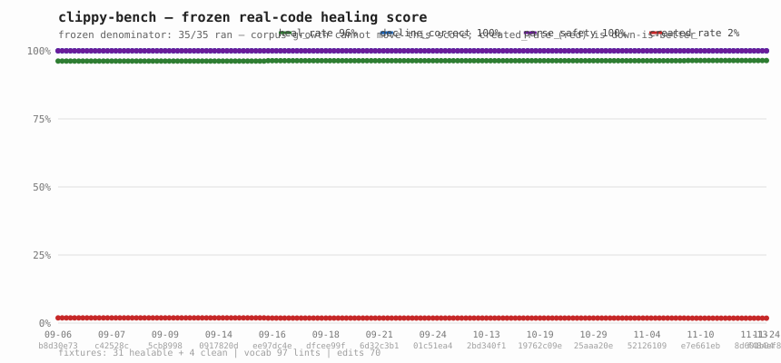

# riir-refine

**`cargo refine`** — the code fixer that learns. It finds issues in your Rust
with real tooling (`cargo clippy`, hadolint, `cargo check`), drafts bounded
fixes from a 1,700+ rule corpus, and compile-gates every edit — an edit that
does not compile is reverted byte-exact, so a run never leaves your tree
broken. Fixing runs locally and offline; nothing about your code leaves the
machine unless you explicitly join the contribution network (which shares
run outcomes, never source).

> **Boundary contract:** [BOUNDARY.md](BOUNDARY.md) — what lives here, what
> may depend on it, known drift.

## See it work

```text
$ cargo refine src/main.rs            # dry run — reviews, changes nothing
scan root: …/demo/src — 1 source file(s)
Refining…
clippy oracle (auto): 1 real diagnostic(s) anchored ahead of ranking
src/main.rs:1-8 (routed: clippy) [oracle]
  [clippy] needless_return         oracle finding  →  fn foo() -> i32 { 42 }
  [clippy] useless_format          score    36.37  →  fn f() -> String { "done".to_string() }
  [perf  ] format-concat-loop      score    83.45  →  fn build(chunks: &[&str]) -> String {
  [perf  ] raw-bytes-with-hit-backfill-once  score 65.62  →  // one raw read serves both consumers
🔍 Found clippy 7 | perf 6 — 13 total
🛠️ ~53% fixable via `cargo refine fix` (compile-gated; the suggest-only rows stay manual)
⏱️ clippy 0.2s | scan 0.0s | refine 1.9s

$ cargo refine fix src/main.rs        # apply — writes, compile-gates, rustfmts
verify: 2 cargo check(s) — kept 1 file(s) / 2 edit(s), reverted 0 edit(s)
fix src/main.rs (2 edit(s) verified):
  [let_and_return] line 6
  [let_and_return] line 5
  fmt: formatted
🔍 Fixed 2 edit(s) across 1 file(s)
```

The `verify:` line is the contract: every kept edit re-ran `cargo check`.
An edit that broke the build was reverted before it ever reached your file.

## Why `cargo refine`

- **Modelless by construction.** No LLM in the fix path. The corpus is the
  model: mined rules are drafted through a ternary SIMD matvec, checked by a
  `syn` parse gate, and ranked by measured outcomes.
- **Never-wrong by construction.** Baseline check → apply → re-check →
  revert what breaks. Every kept fix strictly reduces the coded-error count;
  non-compiling edits surviving a run: **0** (pinned by test).
- **Declining is a first-class answer.** A span with no rule that fits prints
  `[no corpus rule]` and lands in the miss queue — it never guesses.
- **Learns from outcomes, not gradients.** Fix trajectories persist locally
  (`.refine/trajectories.kv`), rules carry Elo ratings updated by real fix
  verdicts, and a frozen-denominator score bench proves the corpus only
  moves by fixing better.
- **Local-first.** Fixing is free, offline, and account-less. Sharing is a
  separate explicit opt-in (`cargo refine join`) that ships anonymized
  run outcomes — never spans, source, or paths — and the scanner is
  secret-blind by design (`cargo refine --secret-scan` shows what it would
  never send).

## Install

```sh
cargo install riir-refine   # from crates.io — binary: cargo-refine → `cargo refine`
cargo install --force riir-refine   # also replaces a binary from the legacy cargo-refine crate
```

Prebuilt binaries carry the hosted contribution surface (`join`, the
leaderboard, latent retrieval) and are checksum-verified against each
release's `SHA256SUMS`:

```sh
# macOS / Linux (Homebrew 6+ — the trust step is part of the install)
brew tap riir-ai/tap
brew trust riir-ai/tap
brew install riir-ai/tap/riir-refine

# or the checksum-verified script
curl -fsSL https://raw.githubusercontent.com/riir-ai/cargo-refine/main/install.sh | sh

# Windows (PowerShell)
scoop bucket add riir-ai https://github.com/riir-ai/scoop-bucket
scoop install riir-refine
```

## The domains

One matcher per enabled domain fans out over every file; the router verdict
is a per-span annotation, never a gate.

| Domain | Feature | Default | Rules | What it fixes |
|---|---|---|---|---|
| **clippy_lints** | `clippy_lints` | on | 120 corpus lints | `clippy::*` — mechanical rewrites proven value-preserving (97 fixable + 20 verify-tier + 3 self-evolve) |
| **rust_perf** | `rust_perf` | on | 396 rules | CPU hot paths — allocation, concurrency, io, layout, iterators, dispatch, caching, measurement honesty |
| **kernel_opt** | `kernel_pregate` | on | 1115 rules | GPU kernels + host orchestration (Metal / CUDA / wgpu); joins a file only when the kernel-signal gate fires |
| **sec** | `sec` | off | 85 rules | security classes — web trust, crypto hygiene, input validation, FFI/unsafe (7 fixable, 78 suggest-only) |
| **docker** | `docker` | on | 31 rules | Dockerfile bounded fixes against the hadolint oracle |
| **dist** | `dist` | on | 8 suggest-only rules | shipped-artifact build-config advice over `Cargo.toml` manifests |
| **shader_perf** | `shader_perf` | on | 8 rules | WGSL render-pipeline (`@vertex`/`@fragment`) bounded fixes |
| **ane** | `ane_pregate` | on | 22 rules | CoreML/ANE host-orchestration decisions (suggest-only) |
| **rustc_errors** | *(default)* | on | error-code playbooks | compile-error repair via `cargo refine fix-compile`, keyed by rustc error code |

Counts are re-derived from the compiled corpus on every guard run
(`scripts/pins_manifest.py` — the manifest is the single source of truth;
stale prose rows red the build).

## How it works

```text
L0 distill     mined rules from measured sources (external repos, blogs,
               clippy/rustc internals) — fixtures compiled AND executed
               before entry
L1 drafter     span-level retrieval over the corpus, ternary SIMD matvec
               scoring — zero-alloc, no LLM
L2 pruner      syn parse check — a fix that does not parse is declined
L3 search      Pareto-front candidate search (ruliology, default-on)
gate           compile-gated apply (fix_verify): baseline check → apply →
               re-check → auto-revert what breaks; rustfmt-clean-at-HEAD
               files are re-formatted, drifted files are left untouched
self-evolve    fix trajectories + Elo-rated rules + the frozen score bench
```

The `--fix` lane also audits its own blind spots after every run: cfg-gated
regions, `required-features` targets, module-decl folds, and any kept edit
under a failed final check are disclosed with the exact `--verify-args`
re-run that would have compiled them. Kept-but-unproven edits never
certify.

## The CLI

`cargo refine` with no arguments is the dry run — zero edits, one banner
line. The verbs:

| Command | What it does |
|---|---|
| `cargo refine` | dry run over `.` (or given paths) — findings only |
| `cargo refine fix` | write fixes, compile-gated (`--no-verify` opts out; `--repo-posture` edits only where the repo's own clippy flagged) |
| `cargo refine fix-compile` | repair *broken* code, keyed by rustc error code |
| `cargo refine --clippy-json <file>` | feed a real `cargo clippy --message-format=json` stream — oracle spans rank first, lintless diagnostics surface as `[no corpus rule]` |
| `cargo refine --hotpath-json <file>` | profile-guided fixing — `[hot]` spans rank first by time share |
| `cargo refine --oracle-census` | which targets the auto-oracle cannot see (required-features blindness) |
| `cargo refine --secret-scan` | report credential-shaped literals — kind + path:line, blinded context, never the value |
| `cargo refine --info` | wallet, account, corpus counts, release verdict — one command |
| `cargo refine update` / `upgrade` | refresh the rule set / update the binary (SHA256SUMS-checked) |
| `cargo refine join` / `leave` / `rank` | the contribution network — join, leave (zero data after), leaderboard |
| `cargo refine offline` / `online` | the firewall — every network lane refuses until you say otherwise |
| `cargo refine config set --url <alias>` | bookkeeping only — dialing is mainnet by default; `--net devnet` steers one run |
| `cargo refine topup` / `buy` | the KAT pay lane (catalog → signed intent → QR) |

Run-end output is one roll-up: `findings by domain: clippy 41 · perf 23 ·
sec 95 — 159 total`, the fix CTA, and a `⏱️ clippy \| scan \| refine` phase
split that blames the wait honestly (the clippy oracle compiles your
workspace; `cargo refine` is waiting, not working).

## For scripts and agents

- Exit codes are stable; `--yes` (or `RIIR_REFINE_YES=1`) is non-interactive
  consent; `RIIR_REFINE_AUTO_ORACLE=0` never spawns clippy.
- The auto-oracle arms feature gaps itself: after the default pass it
  re-runs clippy over distinct missing `required-features` sets (up to 3
  gap passes), so gated tests' lints are not silently unseen.
- `cargo refine --config-audit`, `--orphan-report`, `--coverage-report`,
  `--gate-calibration`, `--corpus-delta`, `--misses` are report lanes —
  census-shaped, exit-code-honest, built for CI and agent loops.
- The `cargo-refine` agent skill (`.agents/skills/cargo-refine/`) teaches an
  agent the dry-run-first discipline, the divergence classes, and the
  post-mining feedback loop.

## How it is checked

Real `cargo clippy` is the reference — not our own proposers.

**The score bench** (the curve, re-rendered on every run): the denominator is
frozen (real pre-sweep extracted spans + a realistic multi-lint composite),
ground truth is clippy before/after. Axes: heal rate (up), created rate
(false positives — down), parse safety, decline correctness. Latest:
**heal 96.4% · created 1.8% · safety 100% · decline 100%** (2026-11-13) —
with the residuals named, not hidden (one nursery cascade clippy's own fix
produces too; one type-aware `useless_format` beyond parse-only reach).
Every corpus or proposer change appends a point:



```sh
cargo run --features score_bench --bin cargo-refine -- --score-bench
```

**Coverage** (Bench 045, N=212 known-inverse mutation corpus, every seed
carrying a ground-truth behavior test):

| error family | `cargo fix --broken-code` | `cargo refine fix-compile` | verdict |
|---|---|---|---|
| E0597 (borrow outlives owner) | **0%** | **100%** | net-new |
| E0499 (two `&mut` alive) | **0%** | **100%** | net-new |
| E0502 (borrow across mutation) | **0%** | **100%** | net-new |
| E0505 (move out of borrowed) | 100% but **silently diverges** (`&v.clone()`) | **100% matched** | the contested win |
| E0596 / E0382 / E0507 / E0373 | 100% matched | — | `cargo fix` owns these |

Uncontested stratum 105/105; 126/126 repaired cases pass their behavior
tests post-fix; every semantics-changing fix prints a `⚠ semantic change`
note in the diff — never silent. Coverage is partial **by design**; the
per-family numbers are the claim.

**The gates** (`scripts/ci_feature_guard.sh`, the same guard CI runs):
corpus counts re-derived from compiled builders, clippy `-D warnings` at
both feature extremes, retrieval floors, the rustfmt-clean gate, and the
binary-target feature-combo gate. Consumer drift is swept across the
workspace after any guard-class landing (`scripts/consumer_residue_sweep.sh`).

## Not supported / honest limits

- **Suggest-only stays suggest-only.** `sec`, `dist`, `shader_perf`, `ane`
  and most of `docker` print findings; they never auto-apply. The corpus
  marks every rule `fixable` / `verify` / `suggest` — the CLI never exceeds
  the rule's own grade.
- **Documented divergence classes stay manual**: comment-guarded matches,
  array-literal defaults, named-arg renames, nested macro args — the fixer
  is silent on them by design rather than wrong.
- **No training curve.** Expect a STEP in the score bench at root-cause
  fixes. The learned-weight mechanisms measured negative and were removed;
  improvement here is engineering-iterative, and the curve makes it honest.
- **The L4 generative fallback (LoRA) is a seam, not a feature.** It is
  installed but never promoted — `decline` is the default answer, and
  measured 0/60 against a trained model.
- **Bench files are guarded.** Perf edits under `benches/` are declined or
  flagged — a benchmark's numbers are its artifact, not a fix surface.
- **Macro-heavy spans** (dsl-macros, attribute proc-macros) are parsed as
  tokens only; semantic fixes inside macro expansion are out of reach for a
  parse-only pruner.

## Automatic rustfmt

Fixed files are rustfmt'd automatically after the write — default-on,
`--no-fmt` to disable. The discipline is built in:

- **fmt-clean-at-HEAD gate** — a file with pre-existing formatting drift is
  fixed but left unfmt'd; a mechanical fix never drags unrelated churn into
  your diff.
- **CRLF files** are reported and never converted.
- **Edition-aware** — the edition comes from the owning package's
  `Cargo.toml` (default 2024), so let-chains and newer syntax survive.
- **Never fatal** — rustfmt missing or a parse failure warns and skips; the
  fixed file is always valid Rust.

## Watch mode

`scripts/watch_heal.sh` wraps `fix-compile` in a watch loop for real
sessions: editor saves, the oracle repairs what it can, the miss queue
collects what it can't. Three requirements any wrapper must keep (the
script encodes them): never write without `--write`; `--verify-args` must
carry the repo's real feature set; scope fixes to session-touched files on
a shared checkout.

```sh
./scripts/watch_heal.sh                    # session-touched .rs files
HEAL_FEATURES="--features my-gate" ./scripts/watch_heal.sh
```

Self-evolution state lives under `<repo>/.refine/`: `trajectories.kv/` (the
durable store), `memory.json` (default-build fallback), `misses/` (the
authoring queue). Query it with `cargo refine --memory-stats`; export with
`cargo refine --dump-trajectories`.

## Using it as a library

```rust
use riir_refine::{build_seed_corpus, ClippyTernaryDrafter, RustAnalyzerPruner};

let corpus = build_seed_corpus();
let candidates: Vec<_> = corpus.lookup("needless_return").cloned().collect();
let drafted = ClippyTernaryDrafter::fallback()
    .draft_fix("needless_return", buggy_code, &candidates)?;
let pruner = RustAnalyzerPruner::new();
if pruner.validate(&drafted.code, "needless_return").is_valid() {
    // apply
}
```

## The contribution network (opt-in)

Fixing is local: offline, free, account-less. Sharing fix data is a
separate, explicit opt-in. Contributions are anonymized and secret-blind —
the redaction layer never lets credentials or secrets leave the machine —
and they build the MIT-licensed community corpus: every contributed repair
is reviewed, never scraped, and improves fixing for everyone.

```sh
cargo refine join       # GitHub device flow, once — explains exactly what is shared first
cargo refine fix        # joined machines share run outcomes automatically; not joined: nothing is sent
cargo refine leave      # unbinds the identity, zero data afterwards
```

**What stays on your machine:** fix history and the rule cache under your
repo's `.refine/`; identity state under `~/.config/` (deleted by
`cargo refine leave --purge`). `RIIR_REFINE_OFFLINE=1` (or `cargo refine
offline`) turns every network lane off — healing never needs the network.

## Development

```sh
cargo test                                  # the suite
./scripts/ci_feature_guard.sh               # the full 9-layer gate
cargo run --example heal_demo               # the clippy fix demo (L0→L1→L2)
cargo run --features score_bench --bin cargo-refine -- --score-bench   # the score bench
```

Releases: `scripts/release.sh v<tag>` — one command, one Touch ID
fingerprint; it refuses unless the tree is clean, the tag matches `HEAD`,
and the release notes carry a `corpus:` line. The Cloudflare ops plane
(housekeeping worker + dashboard) is documented in
[AGENTS.md](AGENTS.md) §"CF ops surface".

## Documentation

- [AGENTS.md](AGENTS.md) — the authoritative repo-local context (CLI UX
  contract, feature-flag discipline, domain rule counts, lessons)
- [`.docs/`](.docs/README.md) — the book (11 numbered folders; domain
  ledgers in `11_domains/`)
- [`.benchmarks/`](.benchmarks/001_goat_consolidated.md) — GOAT gates,
  score history (`score_history.jsonl` + SVG)
- [`HISTORY.md`](HISTORY.md) — batch records, sweep campaigns, resolved
  issues
- [Proposal 001](.proposals/001_multi_domain_modelless_code_healer.md) — the
  multi-domain modelless architecture argument
- [RustAssistant](https://arxiv.org/abs/2412.16358) (Microsoft Research,
  2024) — the 75% prior-art ceiling this corpus is measured against

## License

MIT OR Apache-2.0
